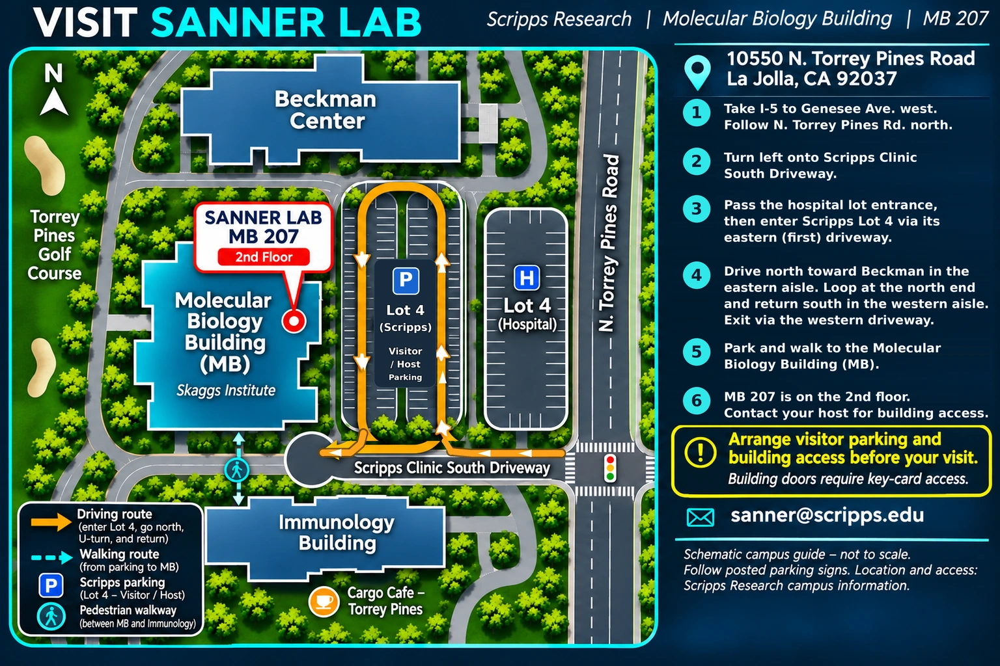

---
# photo banner with the title shown over it (see .photo-banner in styles.scss)
title-block-banner: images/scripps-campus.jpg
body-classes: photo-banner
title-block-banner-color: "#ffffff"
title: "Contact"
toc: false
---

**Michel Sanner** 
Department of Integrative Structural and Computational Biology 
Scripps Research 
La Jolla, CA, USA

Email: [sanner@scripps.edu](mailto:sanner@scripps.edu) 
Bluesky: [\@sannerlab.github.io](https://bsky.app/profile/did:plc:xnwalwj7goqgasajc3shg2cg) 
LinkedIn: [Sanner Lab](https://www.linkedin.com/company/144103051)

For a commercial license for MSMS, contact Dr. Sanner by email.

## Directions

The lab is in room MB 207, on the 2nd floor of the Molecular Biology Building, Scripps Research, 10550 N. Torrey Pines Road, La Jolla, CA 92037.

[{fig-alt="Campus map with directions to the Sanner Lab, Molecular Biology Building room 207" width="100%"}](images/sanner_lab_directions_reversed_loop.webp)

Arrange visitor parking and building access with your host before your visit; building doors require key-card access.
