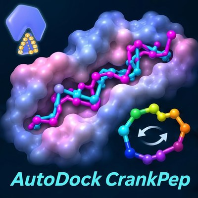
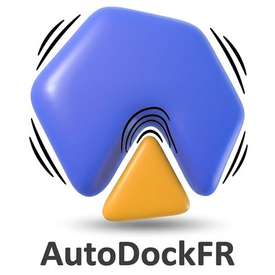
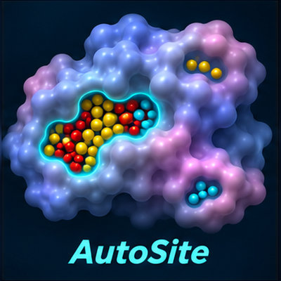
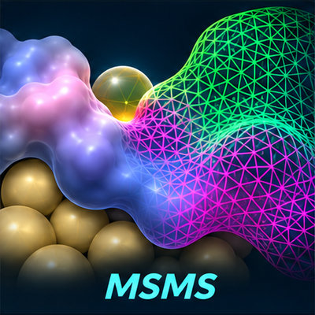
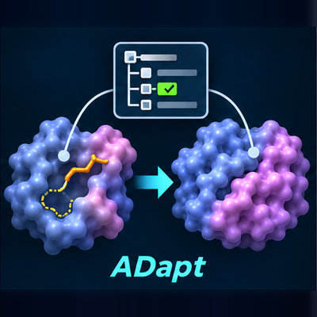
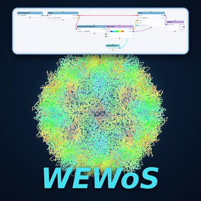
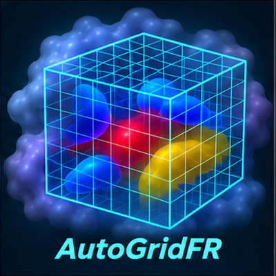
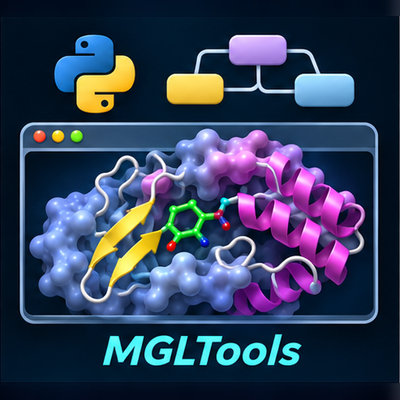

---
# the banner picture carries its own title, so the heading is hidden (see .picture-banner in styles.scss)
title-block-banner: images/sannerpath_banner_home.jpg
body-classes: picture-banner
title: "Sanner Lab"
subtitle: "Scripps Research, La Jolla"
toc: false
---

The main focus of the [Sanner Lab at Scripps Research in La Jolla](lab.qmd) is the development of
computational methods for predicting, analyzing, visualizing and optimizing molecular
interactions. We have contributed to the development of several widely used software tools,
including MSMS for calculating molecular surfaces, AutoDock4 and AutoDockFR for docking small
molecules into proteins, F2Dock for docking proteins and, most recently, AutoDock CrankPep, along
with a variety of graphical user interfaces such as PMV, Vision, AutoDockTools, AutoGridFR,
ADapt and WEWoS.

::: {.tool-grid}

::: {.tool-card .tc-software .tool-card-wide}
### [Software](software/index.qmd)
Downloads, documentation and tutorials. Click a picture to open that tool's page.

[Methods]{.tile-group}

::: {.tool-tiles}

[[Dock linear and cyclic peptides]{.tile-text}](software/adcp/index.qmd)
[[Dock small molecules into flexible receptors]{.tile-text}](software/adfr/index.qmd)
[[Find ligand-binding pockets on proteins]{.tile-text}](software/autosite/index.qmd)
[[Compute molecular surfaces]{.tile-text}](software/msms/index.qmd)

:::

[User interfaces]{.tile-group}

::: {.tool-tiles}

[[Prepare molecules for docking starting from a PDB file]{.tile-text}](software/adapt/index.qmd)
[[Visual programming with Vision in a web browser]{.tile-text}](software/wewos/index.qmd)
[[Prepare receptors, pockets and affinity maps for docking]{.tile-text}](software/agfr/index.qmd)
[[Visualize and analyze molecules with PMV, AutoDockTools and Vision]{.tile-text}](software/mgltools/index.qmd)

:::
:::

::: {.tool-card .tc-lab}
### [Lab](lab.qmd)
Who we are.
:::

::: {.tool-card .tc-pubs}
### [Publications](publications.qmd)
Papers from the lab.
:::

:::
