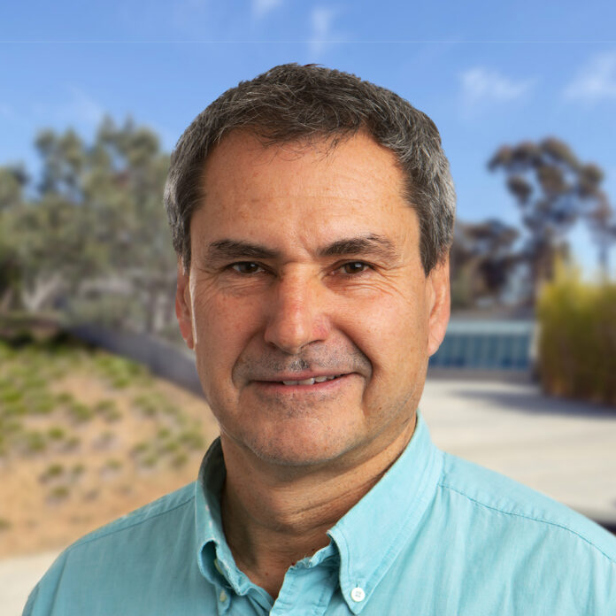

## Principal investigator

::: {.person}

::: {.person-photo}
{fig-alt="Portrait of Michel Sanner"}
:::

::: {.person-text}
### Michel Sanner

Professor of Molecular Biology, Department of Integrative Structural and Computational Biology,
Scripps Research. [Faculty page](https://www.scripps.edu/faculty/sanner/) ·
[Google Scholar](https://scholar.google.com/citations?user=lGVSqeYAAAAJ) ·
[sanner@scripps.edu](mailto:sanner@scripps.edu)

Michel Sanner received his Ph.D. in Computer Science from the University of Haute Alsace, France,
in 1992. His laboratory develops computational methods for predicting molecular interactions,
including the widely used AutoDock4 and tools for docking small molecules, proteins and peptides.
He also has a long-standing interest in software engineering: the lab builds reusable software
components that can be assembled quickly into custom applications, such as PMV, AutoDockTools
and the visual programming environment Vision.
:::

:::

## Postdoctoral fellows

<!-- To add a photo: put it in images/people/ and replace the placeholder div with
     {fig-alt="Portrait of <name>"}
     To add a description: write it in the empty paragraph under the name. -->

::: {.member-row}

::: {.member}
::: {.member-photo .placeholder}
KS
:::
**Kandarp Sojitra** 
Postdoctoral Fellow 
[GitHub](https://github.com/kandarpsojitra29)
:::

::: {.member}
::: {.member-photo .placeholder}
JW
:::
**Jiahui Wang** 
Postdoctoral Fellow 
[GitHub](https://github.com/Jiahuiwang0614)
:::

:::

## Research

*To be written.*
