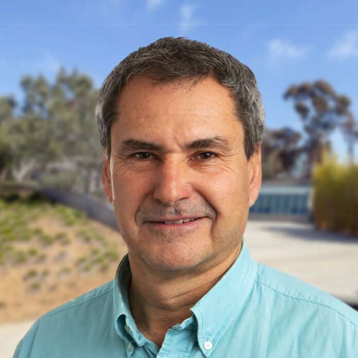
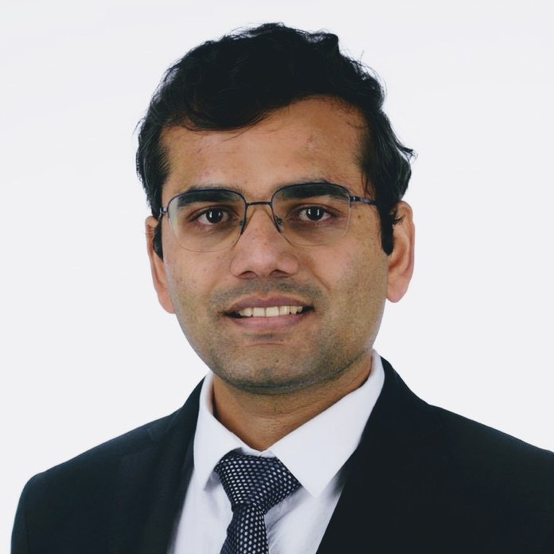
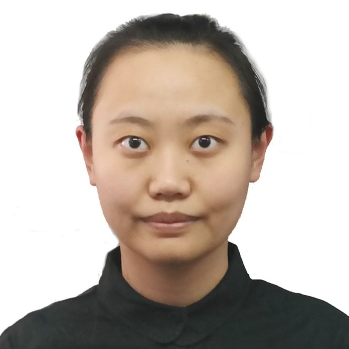

---
# the banner picture carries its own title, so the "Lab" heading is hidden (see .picture-banner in styles.scss)
title-block-banner: images/sannerpath_banner.jpg
body-classes: picture-banner
title: "Lab"
---

## Principal investigator

::: {.person}

::: {.person-photo}
{fig-alt="Portrait of Michel Sanner"}
:::

::: {.person-text}
### Michel Sanner

Professor of Molecular Biology, Department of Integrative Structural and Computational Biology,
Scripps Research. [Faculty page](https://www.scripps.edu/faculty/sanner/) ·
[Google Scholar](https://scholar.google.com/citations?user=lGVSqeYAAAAJ) ·
[sanner@scripps.edu](mailto:sanner@scripps.edu)

Michel Sanner received his Ph.D. in Computer Science from the University of Haute Alsace, France,
in 1992. His laboratory develops computational methods for predicting molecular interactions,
including the widely used AutoDock4 and tools for docking small molecules, proteins and peptides.
He also has a long-standing interest in software engineering: the lab builds reusable software
components that can be assembled quickly into custom applications, such as PMV, AutoDockTools
and the visual programming environment Vision.
:::

:::

## Postdoctoral fellows

<!-- To add a photo: put it in images/people/ and replace the placeholder div with
     {fig-alt="Portrait of <name>"}
     To add a description: write it in the empty paragraph under the name.
     LinkedIn icon after the name: [<i class="bi bi-linkedin" aria-hidden="true"></i>](<url>){.member-linkedin aria-label="<name> on LinkedIn"} -->

::: {.member-row}

::: {.member}
{fig-alt="Portrait of Kandarp Sojitra"}

**Kandarp Sojitra** [<i class="bi bi-linkedin" aria-hidden="true"></i>](https://www.linkedin.com/in/kandarp-a-sojitra-63938963/){.member-linkedin aria-label="Kandarp Sojitra on LinkedIn"} 
Postdoctoral Fellow
:::

::: {.member}
{fig-alt="Portrait of Jiahui Wang"}

**Jiahui Wang** [<i class="bi bi-linkedin" aria-hidden="true"></i>](https://www.linkedin.com/in/jiahui-wang-54219b327/){.member-linkedin aria-label="Jiahui Wang on LinkedIn"} 
Postdoctoral Fellow
:::

:::

## Research

The lab develops computational methods for predicting how biological molecules recognize and
bind each other, and turns them into software that other researchers can use. Our work spans
molecular surfaces, docking of small molecules and peptides, and the software engineering that
lets these methods be combined into new applications. Papers are listed on the
[Publications](publications.qmd) page.

### Peptide docking

Peptides are flexible, so predicting how one binds a protein means folding it and docking it at
the same time. [AutoDock CrankPep (ADCP)](software/adcp/index.qmd) does both, combining
physics-based folding with focused docking into a known binding region, and it handles linear
and cyclic peptides. ADCP is regarded as a state-of-the-art physics-based peptide docking method.
We have also shown that it complements deep-learning structure predictors: independent
physics-based sampling and scoring can refine and re-rank AI-generated models of
protein–peptide complexes.

### Protein–ligand docking and binding sites

We contributed flexible receptor side chains to AutoDock4, one of the most widely used docking
programs. [AutoDockFR (ADFR)](software/adfr/index.qmd) extends this with explicitly specified
binding-site flexibility, [AGFR](software/agfr/index.qmd) prepares receptors and docking maps,
and [AutoSite](software/autosite/index.qmd) finds ligand-binding sites and predicts where key
ligand atoms are likely to sit.

### Molecular surfaces

[MSMS](software/msms/index.qmd) computes solvent-excluded molecular surfaces quickly and
reliably. It is built into Chimera, VMD, MGLTools and many other programs and pipelines.

### Scientific software engineering

Early computational biology programs were hard to reuse and maintain. We pioneered a
component-based architecture built around Python, in which reusable modules for computation
and visualization can be assembled quickly into new applications; the 1999 paper describing it
has been cited more than 4,600 times. This approach produced the Python Molecular Viewer (PMV),
AutoDockTools and the visual programming environment Vision, distributed together as
[MGLTools](software/mgltools/index.qmd) to more than 20,000 registered users, and it has been
reused in augmented reality, animation and cellular modeling, including CellPACK. Michel Sanner
was also a founding member of the SciPy conference.

## Funding

The lab's work, including the software on this site, is supported by the National Institutes
of Health (NIH):

| Award | NIH institute | Years | Project |
|---|---|---|---|
| [R35 GM152084](https://reporter.nih.gov/project-details/11311801) | NIGMS | 2024–2029 | Structure-based in-silico prediction of peptide interactions |
| [R01 GM096888](https://reporter.nih.gov/project-details/10653086) | NIGMS | 2011–2025 | AutoDockFR and flexible receptor docking, then in-silico prediction of protein–peptide interactions |
| [P41 RR008605](https://reporter.nih.gov/project-details/8362789) (subproject) | NCRR | 2004–2012 | Visualization environments for multi-scale biomedical modeling |
| [R21/R33 GM065609](https://reporter.nih.gov/project-details/7070659) | NIGMS | 2003–2010 | Representation of flexible biomolecular shapes |

NIGMS: National Institute of General Medical Sciences. NCRR: National Center for Research
Resources. The content of this website is solely the responsibility of the authors and does not
necessarily represent the official views of the National Institutes of Health.

## Alumni

<!-- Current positions and links were checked in October 2026; only verified ones are given. -->

### Postdoctoral fellows

- **Yong Zhao**, until 2008, then CambridgeSoft
- **Donald Keidel**, 2008–2011, then eMolecules
- **Matthew Danielson**, 2011–2013, then Eli Lilly
- **Pradeep Ravindranath**, 2013–2016. Founder and CEO, DynamWorks ·
  [LinkedIn](https://www.linkedin.com/in/paravindranath/) ·
  [Google Scholar](https://scholar.google.com/citations?user=1DqFHq0AAAAJ)
- **Yuqi (Gary) Zhang**, from 2017. Schrödinger, San Diego ·
  [ORCID](https://orcid.org/0000-0001-7532-5369)
- **Vera Prytkova**
- **Sudhanshu Shanker**, 2022–2023. Assistant Professor, Mahindra University ·
  [Faculty page](https://www.mahindrauniversity.edu.in/faculty/sudhanshu-shanker)

### Programmers

- **Ruth Huey**, 1999–2016 (in memoriam)
- **Sophie Coon**, 2000–2004. Neurocrine Biosciences ·
  [LinkedIn](https://www.linkedin.com/in/sophiecoon/)
- **Frédéric Giacometti**, 2001–2003
- **Guillaume Vareille**, 2006–2009
- **Sargis Dallakyan**, 2006–2014. Senior Software Engineer, Rady Children's Hospital–San Diego ·
  [LinkedIn](https://www.linkedin.com/in/sargis/)
- **Alexandre Gillet**. Principal Software Engineer, PacBio ·
  [LinkedIn](https://www.linkedin.com/in/alexandre-gillet-0bb0818/)
- **Anna Omelchenko**, until 2021

### Students and interns

- **Chris Carrillo**, La Jolla High School
- **Dagny Whall**, 2021, La Jolla High School
- **Harpreet Singh Saluja**, 2022, UC San Diego
- **Dayna Olson**, 2022, Michigan State University
- **Katherine Ge**, 2022, Stanford University
