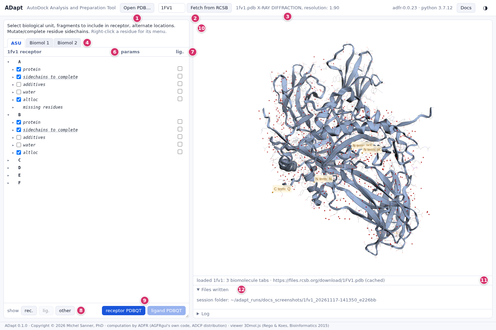

::: {.callout-note}
ADapt 0.1.1, the version described in our paper, is on
[GitHub](https://github.com/sannerlab/adapt/tree/v0.1.1) (tag `v0.1.1`): see [Download](download.qmd).
:::

ADapt works in a web browser. It takes a PDB entry to receptor and ligand files ready for docking
with AutoDock4, AutoDock Vina, AutoDockFR and AutoDock CrankPep.

An entry of the Protein Data Bank holds refined atomic coordinates, which are often not directly
suitable for docking. Preparing a receptor from it means making a series of choices: the
biological assembly; the cofactors, ions, waters and ligands to keep; and the alternate locations,
missing residues, side chains, and atoms the AutoDock force field cannot type. Most of these choices
depend on where a fragment sits relative to the pocket you plan to dock into, so they are best made
while looking at the structure.

ADapt reads a PDB or mmCIF file, or fetches the entry from the RCSB, and analyses it with ADFR's own
code, the same code as the PDB analyzer of [AGFRgui](../agfr/index.qmd). It builds every biological
assembly the entry declares, classifies every residue by what it is and what it needs, proposes
docking-oriented defaults, and lists each issue in a tree linked to a 3D view.

{fig-alt="The ADapt interface in a web browser, showing PDB entry 1FV1"}

- **Choices in context.** One tab per biological assembly; alternate locations with their
  occupancies; side chains completed with a rotamer you can browse; mutations; ion charges; an ion
  AutoDock cannot type replaced by one it can. Selecting an item shows it in the 3D view.
- **Missing residues.** Gaps and missing termini are listed and drawn; an internal gap can be
  rebuilt on request (PDBFixer, then Amber ff14SB), and the loop is kept only if it passes geometry
  checks.
- **Ligands** are recognized with a table of the components of every PDB entry, built from the RCSB
  PDB; for an entry released later, ADapt offers to rebuild it.
- **Docking-ready files with provenance.** The receptor, and optionally a ligand, are written as
  PDBQT files whose header records how they were derived from the entry. Every choice is recorded in
  a checksummed session that can be reopened and reproduces its files.
- **Runs where you need it.** On your computer, from a desktop icon or `adapt serve --open`; on a
  cluster, through SSH. Other web applications can embed it, as
  the ADCPpilot peptide-docking interface does.

- [Documentation](documentation.qmd)
- [Tutorials: worked cases](tutorials.qmd)
- [Download](download.qmd)

## License

ADapt is distributed under the [Sannerlab MIT-like Source-Available License](/software/license.qmd).
