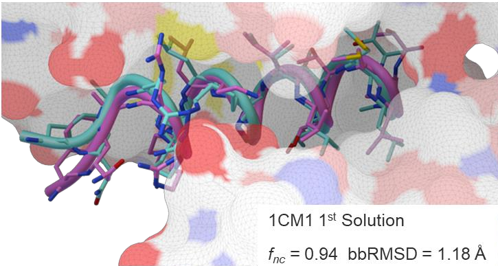
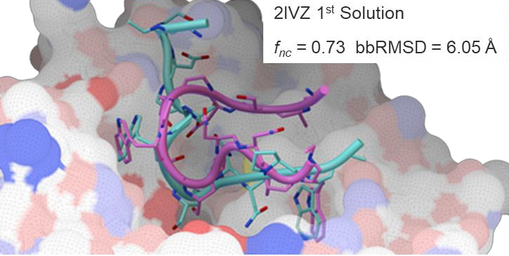
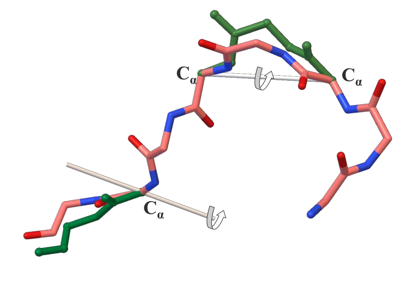
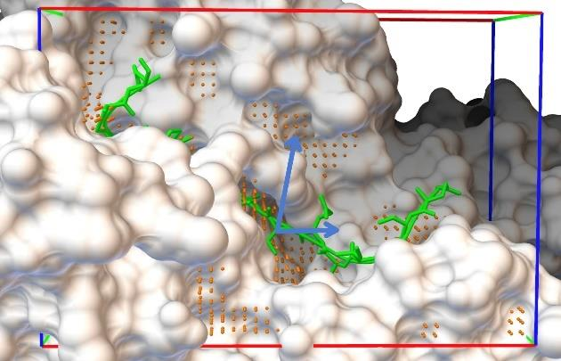
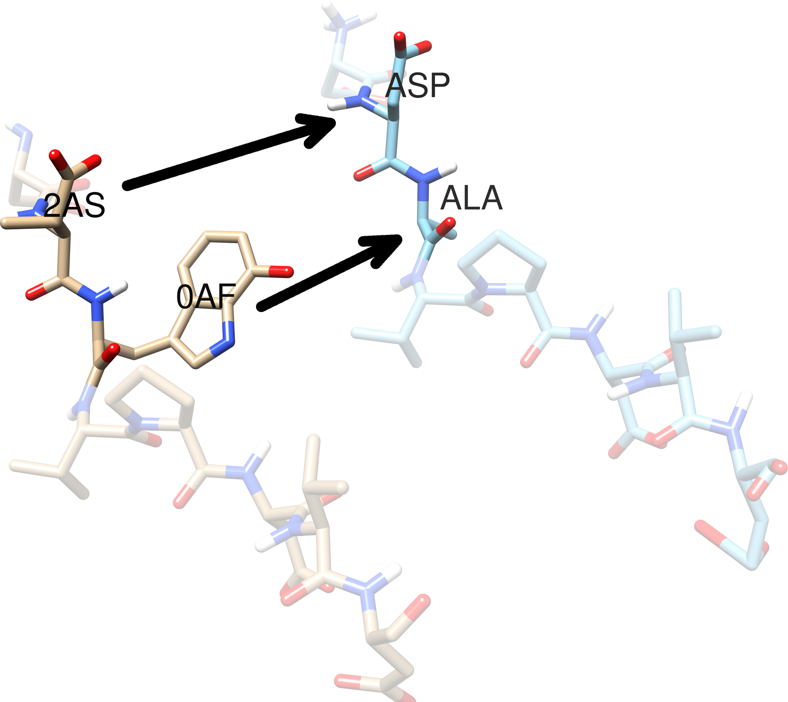

Images made with AutoDock CrankPep (ADCP). Click an image to enlarge it.

<!-- To add an image: put the file in software/adcp/img/ and add it inside the gallery block below,
     one image per line with a blank line between images:
     {fig-alt="Short description of what the image shows"}
     -->

::: {.gallery layout-ncol="3"}

{fig-alt="Cyan docked helical peptide overlaid on magenta crystal peptide in a receptor groove"}

{fig-alt="Docked and crystal peptide backbones curled in a polarity-colored receptor pocket"}

{fig-alt="Peptide backbone sticks with rotation axes drawn through C-alpha atoms"}

{fig-alt="Receptor molecular surface inside a docking box with orange grid points and green peptide fragments"}

{fig-alt="Two peptide stick models with arrows linking non-standard residues 2AS and 0AF to ASP and ALA"}

:::
