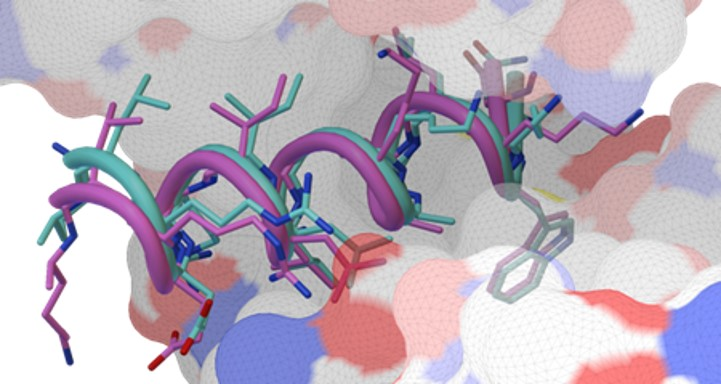
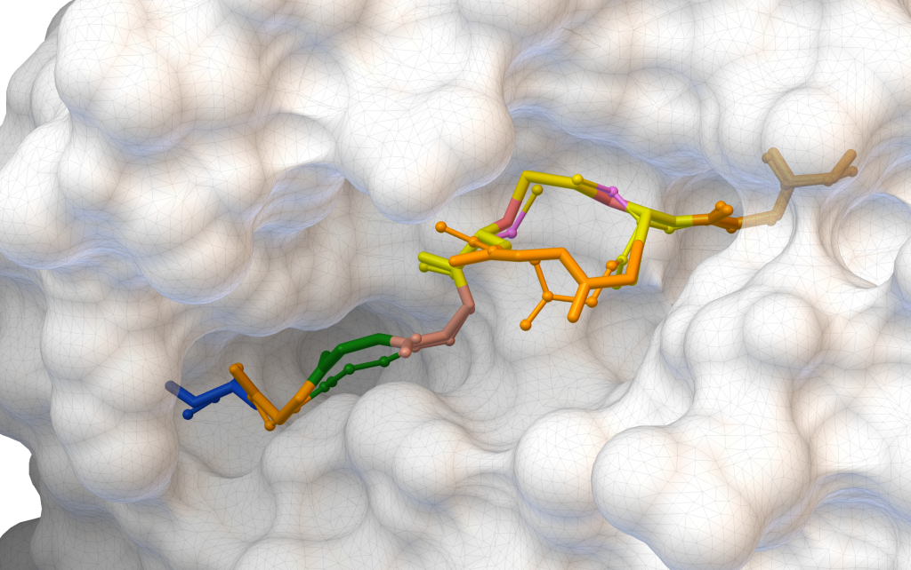
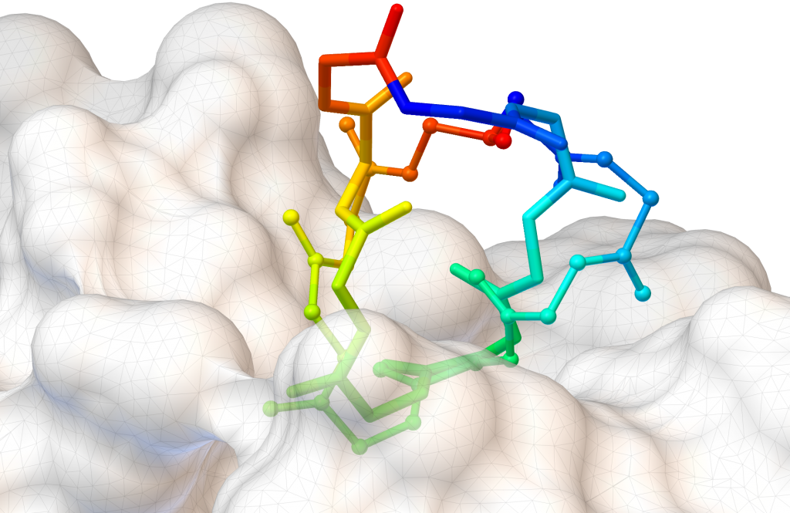
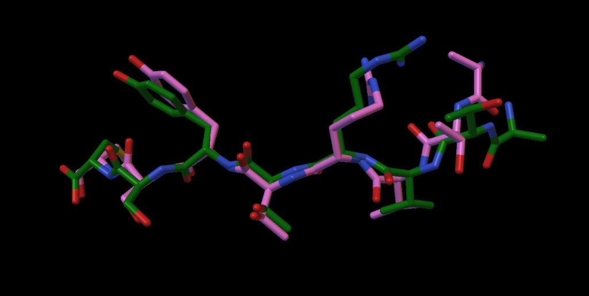
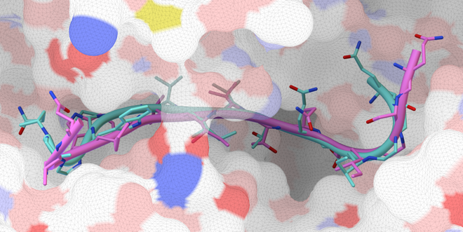
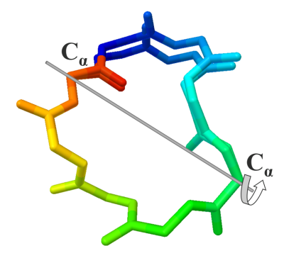

**AutoDock CrankPep** (ADCP) is a docking engine specialized for peptides. It combines a protein
folding technique with AutoDock's efficient representation of a rigid receptor as affinity grids.
A Monte Carlo search folds the peptide while it optimizes the peptide's interaction with the
receptor, which yields docked peptides. ADCP takes a peptide as a sequence string and has
docked peptides of up to 20 amino acids successfully.

ADCP is part of the [AutoDock Suite](https://ccsb.scripps.edu/autodocksuite).

::: {.gallery layout-ncol="3"}

{fig-alt="Two superimposed helical peptide poses in a receptor pocket"}

{fig-alt="ADCP example, PDB 5GRD"}

{fig-alt="ADCP example, PDB 3AV9"}

{fig-alt="ADCP example, PDB 1N7F"}

{fig-alt="ADCP example, PDB 4AK4"}

{fig-alt="Crankshaft move rotating a cyclic peptide about the axis between two C-alpha atoms"}

:::

## Versions

| Version | Status | Platforms | Install |
|---|---|---|---|
| **1.1** | current | Linux (macOS through an Ubuntu virtual machine) | micromamba or conda, [Download](1.1/download.qmd) |
| 1.0 | deprecated | Linux, macOS (Windows through WSL) | ADFRsuite 1.0 installer, [Download](1.0/download.qmd) |

## What changed in version 1.1

Version 1.1 adds support for non-standard amino acids and lets you minimize docked poses with
OpenMM. In detail:

1. **Streamlined output.** Docked poses are saved in a single multi-model PDB file,
   `xxx_out.pdb`, where `xxx` is the job name (or a default name), and a summary file
   `xxx_summary.dlg` is written.
2. **Full side chains.** Docked poses contain all-atom side chains instead of a rotamer index.
3. **Number of poses.** Set how many docked poses to write with `-m` / `--nmodes`.
4. **Command line changes.** The target file is given with `-T` and can be a `.trg` file or a
   folder containing one. The new option `-k` keeps calculation details.
5. **Rotamer libraries.** Side-chain rotamers are loaded from `.lib` text files; system rotamer
   libraries are selected with `-L`.
6. **Non-standard amino acids.** Rotamers for modified side chains can be added without
   recompiling. The syntax `<FOO>` names the side chain used for the full-atom representation,
   preceded by the letter of the coarse potential.
7. **D-amino acids.** Write `&` before the coarse potential letter.
8. **Histidine protonation states.** HIE and HID are supported.
9. **Automatic affinity maps.** ADCP loads affinity maps for every atom type detected in the
   peptide.
10. **MD refinement.** Docked poses can be minimized with OpenMM, with options to control it.

## Source code

The source code is on GitHub: [ccsb-scripps/ADCP](https://github.com/ccsb-scripps/ADCP).

## How to cite

If you use ADCP in your work, please cite:

- Zhang, Y.; Sanner, M. F. AutoDock CrankPep: combining folding and docking to predict
  protein–peptide complexes. *Bioinformatics* **2019**.
  [doi:10.1093/bioinformatics/btz459](https://doi.org/10.1093/bioinformatics/btz459)
  ([preprint PDF](https://ccsb.scripps.edu/adcp/wp-content/uploads/sites/38/2019/06/ADCP_Sanner_chemRxiv.pdf),
  [supplementary PDF](https://ccsb.scripps.edu/adcp/wp-content/uploads/sites/38/2019/06/ADCP_Sanner_SI_chemRxiv.pdf))
- Zhang, Y.; Sanner, M. F. Docking flexible cyclic peptides with AutoDock CrankPep.
  *J. Chem. Theory Comput.* **2019**.
  [doi:10.1021/acs.jctc.9b00557](https://doi.org/10.1021/acs.jctc.9b00557)
