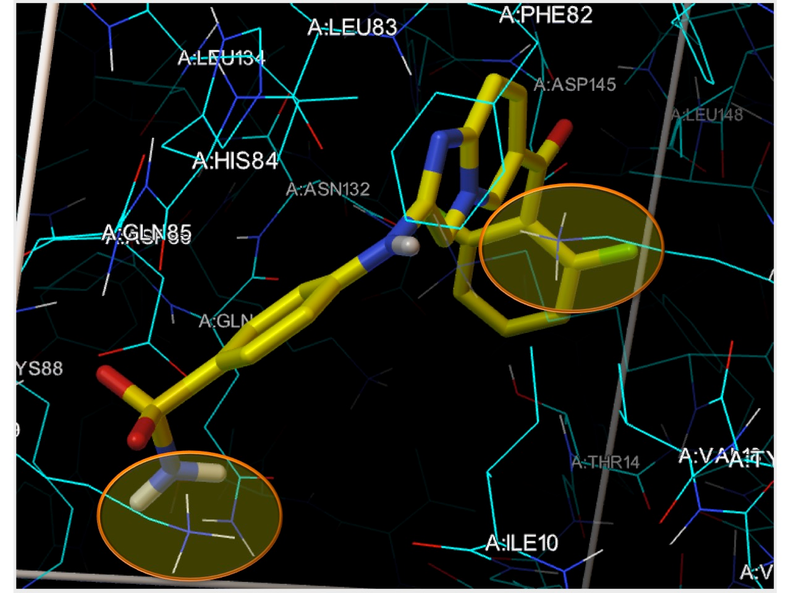

Images made with AutoDockFR (ADFR). Click an image to enlarge it.

<!-- To add an image: put the file in software/adfr/img/ and add it inside the gallery block below,
     one image per line with a blank line between images:
     {fig-alt="Short description of what the image shows"}
     -->

::: {.gallery layout-ncol="3"}

, Fig. 1, CC BY 4.0.*](img/adfr-genome-ligand-flexible-sidechains.png){fig-alt="Diagram of the ADFR genome: translation, rotation and torsion genes for a ligand plus chi-angle genes for two flexible receptor side chains, shown on stick models."}

, Fig. 2, CC BY 4.0.*](img/adfr-affinity-map-gradient.png){fig-alt="Two colored cross-sections of an AutoDock carbon affinity map over a protein, showing the original map and the processed map with an inward gradient."}

, Fig. 4, CC BY 4.0.*](img/adfr-translational-points.png){fig-alt="Protein shown as green atomic spheres inside a docking box, with a blue surface marking favorable translational points for ligand placement."}

, Fig. 8, CC BY 4.0.*](img/adfr-apo-vs-holo-sidechains.png){fig-alt="Overlay of apo (orange) and holo (green) CDK2 binding-site side chains around a mesh surface of the bound ligand, with residue labels."}

, Fig. 8, CC BY 4.0.*](img/adfr-docked-vs-holo-sidechains.png){fig-alt="Overlay of ADFR-docked (purple) and crystallographic holo (green) ligand and side chains in the CDK2 binding site, with residue labels."}

{fig-alt="Yellow ligand in the CDK2 binding site on a black background, with two orange ellipses highlighting clashes with receptor lysine side chains."}

:::
