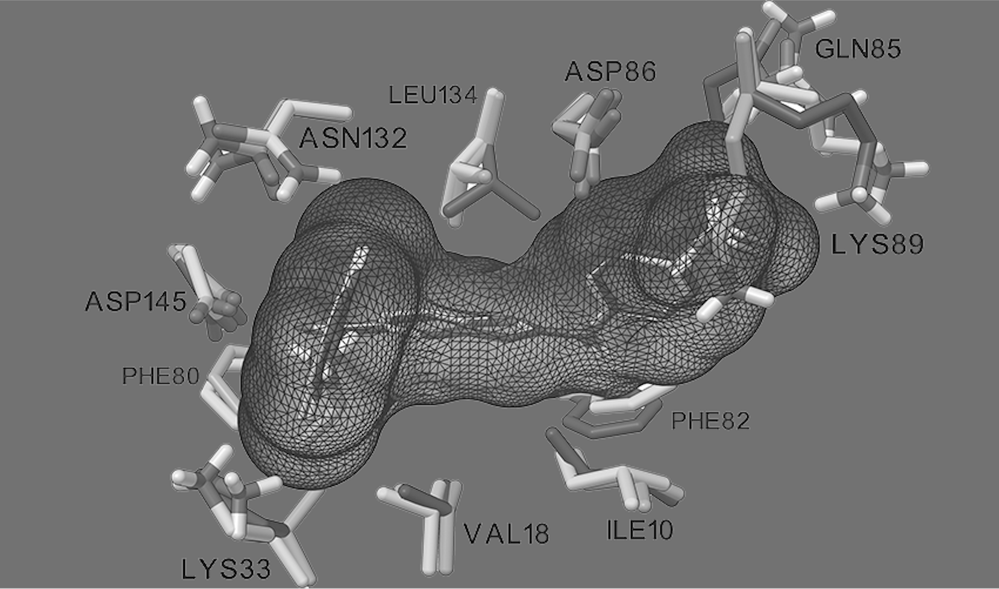

{width="75%" fig-align="center" fig-alt="A docked ligand, shown as a mesh surface, surrounded by labeled receptor side chains of CDK2 (ILE10, VAL18, LYS33, PHE80, PHE82, GLN85, ASP86, LYS89, ASN132, LEU134, ASP145)"}

**AutoDockFR** (ADFR) is a protein–ligand docking program developed in the Sanner laboratory at
Scripps Research under the AutoDock umbrella. It uses:

- the AutoDock4 scoring function, implemented in a C++ library and wrapped for Python;
- its own genetic algorithm, which evolves and optimizes several solutions at once, handles large
  numbers of rotatable bonds, and stops a search when it converges, possibly before using all the
  energy evaluations it was given;
- a generic representation of molecular flexibility, the **Flexibility Tree**, which supports many
  kinds of motion in both the ligand and the receptor.

ADFR supports the docking modes of AutoDock4 and Vina, but it was designed specifically to include
selective **receptor flexibility**, and it also supports **covalent docking**. Its custom genetic
algorithm can dock ligands with more rotatable bonds than AutoDock4. ADFR is distributed as part of
the [ADFR software suite](download.qmd), which provides additional tools for automated docking.

## Ease of use

ADFR streamlines the docking procedure and supports managing and reproducing docking experiments
through data provenance. Self-documenting files store:

- the binding-pocket representation used for docking (**target files**, `.trg`), and
- the docking results (**Docking Result Object files**, `.dro`).

The metadata in these files supports reproducibility and reduces the risk of operator errors, such
as mixing up affinity maps.

## Input

- **Ligands** are prepared for docking with AutoDock, in the PDBQT format; ADFR derives the ligand's
  flexibility from its rotatable bonds. `prepare_ligand` converts a ligand PDB file to PDBQT.
- The **receptor** is given as a target file, a single file describing the receptor. Target files
  are computed from a receptor PDBQT file with `agfr` on the command line or with the graphical
  interface `agfrgui` (see [AutoGridFR](../agfr/index.qmd)). `prepare_receptor` converts a receptor PDB
  file to PDBQT; see [how to create a PDBQT file for a receptor](documentation.qmd#how-to-create-a-pdbqt-file-for-a-rigid-receptor).

## Usage

Given a receptor and a ligand in PDBQT format, a simple docking runs like this:

```bash
agfr -r rec.pdbqt -l xtallig.pdbqt -o target
adfr -t target.trg -l lig.pdbqt -J firstDocking
```

Line 1 uses the native ligand `xtallig.pdbqt` of receptor `rec.pdbqt` to define a docking box
covering the pocket and computes the AutoDock affinity maps, stored in `target.trg`. Line 2 docks
the ligand `lig.pdbqt` into this pocket. More examples are in the [tutorials](tutorials.qmd).

## Implementation

ADFR is written in object-oriented languages and built from reusable software components.
Performance-critical components are in C and C++ (for example ADFRcc); others are in Python (ADFR,
AutoSite, MolKit2, ProDy). See [Implementation](documentation.qmd#implementation) for the list of
components.

## What's new in ADFR 1.2

ADFR 1.2 is available on the [Download page](download.qmd) as part of ADFRsuite 1.0.

- **Accuracy:** ADFR 1.2 matches AutoDock4 and AutoDock Vina on standard docking benchmark
  datasets, and performs better when receptor side chains are made flexible.
- **Speed:** efficient C++ implementations of the scoring function, the Flexibility Tree and the
  Solis–Wets local search.
- **Ease of use:**
  - includes [AutoGridFR](../agfr/index.qmd), which makes it easier to specify and calculate affinity maps;
  - includes an improved AutoSite (1.1) for predicting binding pockets;
  - supports complex docking scenarios: flexible receptor side chains, covalent docking, hydrated
    docking;
  - a streamlined executable that uses multi-core processors;
  - streamlined output (log file, poses file and docking result object file);
  - data provenance and reproducibility through target and docking result object files.

## Versions

| ADFRsuite | Contains | Platforms | Install |
|---|---|---|---|
| **1.0 rc1** | ADFR 1.2, AGFR 1.2, AutoSite 1.0 and 1.1, ADCP 1.0 | Linux, macOS, Windows | [Download](download.qmd#adfrsuite-1.0-rc1) |
| 1.1 dev | | Linux | [Download](download.qmd#adfrsuite-1.1-development-version) |

## License

ADFR is released under the LGPL v2 open-source license. See [License](license.qmd).

## Publications

- Ravindranath, P. A.; Forli, S.; Goodsell, D. S.; Olson, A. J.; Sanner, M. F. AutoDockFR: Advances
  in Protein-Ligand Docking with Explicitly Specified Binding Site Flexibility.
  *PLOS Comput. Biol.* **2015**, 11 (12), e1004586.
  [doi:10.1371/journal.pcbi.1004586](https://doi.org/10.1371/journal.pcbi.1004586)
- Zhao, Y.; Stoffler, D.; Sanner, M. Hierarchical and multi-resolution representation of protein
  flexibility. *Bioinformatics* **2006**, 22 (22), 2768–2774.
  [doi:10.1093/bioinformatics/btl481](https://doi.org/10.1093/bioinformatics/btl481)

::: {.callout-note collapse="true"}
## Review note
- The CCSB home page says it is "under active development to replace the legacy AutoDockFR site"
  at `adfr.scripps.edu`; that site no longer responds, so the link was dropped.
- The CCSB `/adfr/overview` page is the **AutoGridFR** overview, not ADFR's. It was not used here.
:::
