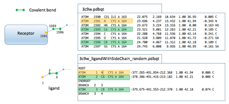

This tutorial re-docks the native covalent ligand of [PDB 3C9W](https://www.rcsb.org/structure/3C9W).
The receptor (`3c9w.pdbqt`) and the ligand (`3c9w_ligandWithSideChain_random.pdbqt`) are in the
[tutorial data](https://ccsb.scripps.edu/agfr/download/551/).

For covalent docking, the receptor and the covalent ligand must share 3 atoms, as shown below:
2 atoms (green) form the covalent bond, and 1 atom (yellow) is an anchor on the receptor side.
These atoms are used to move the ligand into place relative to the receptor and create the
covalent bond.

{fig-alt="Receptor atoms 1591 (N, anchor), 1593 (CA) and 1596 (CB) of CYS 164 in 3c9w.pdbqt matched to ligand atoms 1 (N), 2 (CA) and 3 (CB) in the ligand PDBQT file"}

::: {.callout-note}
Covalent docking needs no translational points: the covalent bond positions the ligand in the
docking box.
:::

**You will learn to:**

- generate a target file for covalent docking
- run ADFR to dock the ligand
- understand the output of an ADFR docking run

## 1. Generate the target file

```bash
agfr -r data/3c9w.pdbqt -b user 28.565 6.329 6.985 22.5 22.5 22.5 -c 1593 1596 -t 1591 -x A:CYS164 -o 3c9w_cov_cmdline
```

**Details:**

- The box position and size are set by hand here to show this option. This is the only
  `-b/--boxMode` option that ignores padding.
- `-c/--covalentBond` gives the serial numbers of the 2 receptor atoms that form the covalent bond,
  as they appear in the PDBQT file.
- `-t/--covalentBondTorsionAtom` gives the third atom of the covalent attachment, used to compute
  the torsion angle of the covalent bond.
- `-x/--covalentResidues` limits the traversal of the receptor to a list of residues. This is
  sometimes needed because covalent ligands can form bonds with the receptor other than the
  covalent attachment, as the native ligand of 3C9W does. When agfr walks the sub-tree beyond the
  covalent bond to find which atoms to cut out of the receptor for the affinity maps, that spurious
  bond would make it include a large part of the receptor, cutting out more than 1600 atoms.
  `-x` prevents this.
- The target file is called `3c9w_cov_cmdline.trg` (`-o`).

::: {.callout-note collapse="true"}
## Console output
```
#################################################################
# If you used AGFR in your work, please cite:                   #
#                                                               #
# P.A. Ravindranath S. Forli, D.S. Goodsell, A.J. Olson and     #
# M.F. Sanner                                                   #
# AutoDockFR: Advances in Protein-Ligand Docking with           #
# Explicitly Specified Binding Site Flexibility                 #
# PLoS Comput Biol 11(12): e1004586                             #
# DOI:10.1371/journal.pcbi.1004586                              #
#                                                               #
# P. Ananad Ravindranath and M.F. Sanner                        #
# AutoSite: an automated approach for pseudoligands prediction  #
# - From ligand binding sites identification to predicting key  #
# ligand atoms                                                  #
# Bioinformatics (2016)                                         #
# DOI:10.1093/bioinformatics/btw367                             #
#                                                               #
# Please see http://adfr.scripps.edu for more information.      #
#################################################################

Computing grids on fiji a Darwin-17.7.0-x86_64-i386-64bit computer
Date Thu Apr 18 12:31:04 2019

loading receptor: data/3c9w.pdbqt
set box using user
    Box center:    28.565     6.329     6.985
    Box length:    22.500    22.500    22.500
    Box size  :        60        60        60
    padding   :     0.000
    spacing   :     0.375

setting map types using: all to ['HS', 'Mg', 'HD', 'NA', 'Fe', 'Br', 'NS', 'A', 'C', 'Mn', 'G', 'F', 'I', 'H', 'J', 'N', 'Q', 'P', 'S', 'GA', 'Z', 'Zn', 'Cl', 'Ca', 'OA', 'SA', 'OS']

computing maps for center=(28.565 6.329 6.985) size=(22.500 22.500 22.500) dims=(60 60 60) ...
    maps computed in 9.86 (sec)
the following 33 covalent ligand atoms did not contribute to the grid calculation:
  A:CYS164:CA,CB,SG,O23,C7,O8,C9,C25,C10,C11,C12,C2,C1,O20,H20,C6,C5,O21,C22,C4,C3,C18,O31,C17,C16,C15,O29,H29,C14,O28,H28,C13,O24,
Adding gradient to maps ...
processing maps ... done 26.2598040104
writing maps ... done 4.58263802528
done adding gradient to maps 33.02 (sec)
making target file 3c9w_cov_cmdline.trg ...done.
    done. 45.70 (sec)
```
:::

## 2. Inspect the target file

```bash
about 3c9w_cov_cmdline.trg
```

This reads and displays the target file's metadata.

::: {.callout-note collapse="true"}
## Console output
```
docking target file
  date       : Thu Apr 18 13:41:22 2019
  node       : fiji
  AGFR       : v1.2

  receptor   : 3c9w.pdbqt
    FlexRec  : None
    covBond  : [3c9w:_A:CYS164:N (1591)] 3c9w:_A:CYS164:CA (1593) -- 3c9w:_A:CYS164:CB (1596)
    coords   : [23.521, 5.081, 12.263] [24.700, 4.867, 11.312] [23.696, 4.237, 13.432]
    covRes   : A:CYS164
    covFile  : covalenLig.pdbqt
    ignAtms  : [1592, 1595, 1596, 3349, 3350, 3351, 3352, 3353, 3354, 3355, 3356, 3357, 3358, 3359, 3360, 3361, 3362, 3363, 3364, 3365, 3366, 3367, 3368, 3369, 3370, 3371, 3372, 3373, 3374, 3375, 3376, 3377, 3378]

  box        :  mode ['user', '28.565', '6.329', '6.985', '22.5', '22.5', '22.5'], padding 4.00
    center   : 28.565 6.329 6.985
    length   : 22.500 22.500 22.500
    size     : 0060 0060 0060
    spacing  : 0.375

  maps       : 
    types    :  C  GA  Fe   A   e   d   S   Q   F  SA   G   P  Mg  Cl  Zn  OA  NS  Ca  Br  Mn  OS  
               NA   J   I  HS  HD   H   Z   N   W 
    W map    : weight 0.60 entropy -0.20
    gradients: Yes,  kept largest negative cluster

  pocketMode : ['user', '28.565', '6.329', '6.985', '22.5', '22.5', '22.5']
    #fillpts : 0 points
```
:::

## 3. Dock the randomized ligand

```bash
adfr -l data/3c9w_ligandWithSideChain_random.pdbqt -t 3c9w_cov_cmdline.trg --jobName covalent -C 1 2 3 --nbRuns 8 --maxEvals 100000 -O --seed 1
```

This re-docks the native ligand after randomizing it (its conformation, position and orientation
in the crystal structure were changed at random). `-C 1 2 3` names the 3 ligand atoms that match the
covalent attachment atoms of the receptor (see the figure above). `adfr` detects the available
cores and uses all of them by default. Here it runs 8 independent searches (`--nbRuns 8`), each
with up to 100,000 evaluations of the scoring function (`--maxEvals 100000`). By default `adfr`
runs 50 searches of 2.5 million evaluations each. The low values here give a quick run that is
enough to show how docking works.

The run writes:

| File | Content |
|---|---|
| `3c9w_ligandWithSideChain_random_covalent_summary.dlg` | the docking log, with most of what is shown on the terminal |
| `3c9w_ligandWithSideChain_random_covalent_out.pdbqt` | the docked poses |
| `3c9w_ligandWithSideChain_random_covalent.dro` | the docking result object: input, output and metadata of this run |

::: {.callout-tip}
## Notes
- Output files are named after the ligand, followed by the job name (`--jobName`, if given).
- The search is stochastic; setting the seed (`--seed`) makes a run reproducible for a given
  version of the code. See the [re-docking tutorial](tutorial-redocking.qmd#dock-the-randomized-ligand).
:::

::: {.callout-note collapse="true"}
## Console output
```
#################################################################
# If you used ADFR in your work, please cite:                   #
#                                                               #
# P.A. Ravindranath S. Forli, D.S. Goodsell, A.J. Olson and     #
# M.F. Sanner                                                   #
#                                                               #
# AutoDockFR: Advances in Protein-Ligand Docking with           #
# Explicitly Specified Binding Site Flexibility                 #
# PLoS Comput Biol 11(12): e1004586                             #
#                                                               #
# DOI:10.1371/journal.pcbi.1004586                              #
#                                                               #
# Please see http://adfr.scripps.edu for more information.      #
#################################################################

Docking on fiji a Darwin-17.7.0-x86_64-i386-64bit computer
Date Thu Apr 18 13:46:27 2019
reading ligand /Users/sanner/test1.1/data/3c9w_ligandWithSideChain_random.pdbqt
Detected 4 cores, using 4 cores
Unpacking maps /Users/sanner/test1.1/3c9w_cov_cmdline.trg
Performing search (8 GA evolutions with 100000 maxEvals each) ...
0%   10   20   30   40   50   60   70   80   90   100%
|----|----|----|----|----|----|----|----|----|----|
***************************************************
Termination status
    0/   8  0.0% runs failed
    8/   8 100.0% runs exhausted their evaluations
    0/   8  0.0% runs stopped converged 1 or 2 clusters
    0/   8  0.0% runs stopped after no improvement in clusters
    0/   8  0.0% runs stopped because GA ran out of choices
    0/   8  0.0% runs stopped because GA population converged

Refining results ...
done.

mode |  affinity  | clust. | ref. | clust. | rmsd | energy | best |
     | (kcal/mol) | rmsd   | rmsd |  size  | stdv |  stdv  | run  |
-----+------------+--------+------+--------+------+--------+------+
   1         -6.3     0.0    -1.0       8     0.2     0.1    006
Writing poses to 3c9w_ligandWithSideChain_random_covalent_out.pdbqt

Docking performed in 13.17 seconds, i.e. 0 hours 00 minutes 13.165729 seconds 

*************** first GA command ***************************
"/Users/sanner/test1.1/mgltools2_x86_64Darwin_1.2/bin/pythonsh" "/Users/sanner/test1.1/ADFR/bin/runOneGA.py" -F "/var/folders/gm/frz8gxj57hzbyyzwtt5bq8m40000gn/T/tmpaAcjqR/3c9w_cov_cmdline" -M rigidReceptor -R "/var/folders/gm/frz8gxj57hzbyyzwtt5bq8m40000gn/T/tmpaAcjqR/3c9w_cov_cmdline/3c9w.pdbqt" "-l" "data/3c9w_ligandWithSideChain_random.pdbqt" "--jobName" "covalent" "-C" "1" "2" "3" "--maxEvals" "100000" "-O" -V "1591" "1593" "1596" -S 1 -j 1 -o "3c9w_ligandWithSideChain_random_covalent/covalent0001.dlg"
```
:::

## 4. Understanding the output

The messages printed during docking, line by line:

```
Docking on fiji a Darwin-17.7.0-x86_64-i386-64bit computer
Date Thu Apr 18 13:46:27 2019
reading ligand /Users/sanner/test1.1/data/3c9w_ligandWithSideChain_random.pdbqt
Detected 4 cores, using 4 cores
Unpacking maps /Users/sanner/test1.1/3c9w_cov_cmdline.trg
```

1. host name and platform on which the program runs
2. date and time of execution
3. the ligand docked
4. number of cores detected and used
5. the target file used

By default ADFR uses all available cores; limit the number with `-c`.

```
Performing search (8 GA evolutions with 100000 maxEvals each) ...
0%   10   20   30   40   50   60   70   80   90   100%
|----|----|----|----|----|----|----|----|----|----|
***************************************************
Termination status
    0/   8  0.0% runs failed
    8/   8 100.0% runs exhausted their evaluations
    0/   8  0.0% runs stopped converged 1 or 2 clusters
    0/   8  0.0% runs stopped after no improvement in clusters
    0/   8  0.0% runs stopped because GA ran out of choices
    0/   8  0.0% runs stopped because GA population converged
```

See the [re-docking tutorial](tutorial-redocking.qmd#understanding-the-output) for how to read the
termination statistics. The results:

```
mode |  affinity  | clust. | ref. | clust. | rmsd | energy | best |
     | (kcal/mol) | rmsd   | rmsd |  size  | stdv |  stdv  | run  |
-----+------------+--------+------+--------+------+--------+------+
   1         -6.3     0.0    -1.0       8     0.2     0.1    006
```

Here all 8 searches reached the same solution: the first and only solution has a cluster size of 8
(*clust. size*).

## 5. Docking metadata

```bash
about 3c9w_ligandWithSideChain_random_covalent.dro
```

This displays the metadata of the docking run.

::: {.callout-note collapse="true"}
## Console output
```
docking result file
  date       : Thu Apr 18 13:46:27 2019
  node       : fiji
  platform   : Darwin-17.7.0-x86_64-i386-64bit
  ncores     : 4

  receptor   : 3c9w_cov_cmdline.trg
   docking target file
     date       : Thu Apr 18 13:41:22 2019
     node       : fiji
     AGFR       : v1.2

     receptor   : 3c9w.pdbqt
       FlexRec  : None
       covBond  : [3c9w:_A:CYS164:N (1591)] 3c9w:_A:CYS164:CA (1593) -- 3c9w:_A:CYS164:CB (1596)
       coords   : [23.521, 5.081, 12.263] [24.700, 4.867, 11.312] [23.696, 4.237, 13.432]
       covRes   : A:CYS164
       covFile  : covalenLig.pdbqt
       ignAtms  : [1592, 1595, 1596, 3349, 3350, 3351, 3352, 3353, 3354, 3355, 3356, 3357, 3358, 3359, 3360, 3361, 3362, 3363, 3364, 3365, 3366, 3367, 3368, 3369, 3370, 3371, 3372, 3373, 3374, 3375, 3376, 3377, 3378]

     box        :  mode ['user', '28.565', '6.329', '6.985', '22.5', '22.5', '22.5'], padding 4.00
       center   : 28.565 6.329 6.985
       length   : 22.500 22.500 22.500
       size     : 0060 0060 0060
       spacing  : 0.375

     maps       : 
       types    :  C  GA  Fe   A   e   d   S   Q   F  SA   G   P  Mg  Cl  Zn  OA  NS  Ca  Br  Mn  OS  
                  NA   J   I  HS  HD   H   Z   N   W 
       W map    : weight 0.60 entropy -0.20
       gradients: Yes,  kept largest negative cluster

     pocketMode : ['user', '28.565', '6.329', '6.985', '22.5', '22.5', '22.5']
       #fillpts : 0 points

  ligand     : 3c9w_ligandWithSideChain_random.pdbqt
     nbAtoms : 34
     types   : A:6 C:16 OA:8 HD:3 SA:1 
  lig ref    : None
  summary    : 3c9w_ligandWithSideChain_random_covalent_summary.dlg
  GA params  : 
    maxEvals : 100000
    nbRuns   : 50
    jobName  : covalent
    seed     : 1
    covLig   : [1, 2, 3]

```
:::

::: {.callout-note collapse="true"}
## Review note
- The CCSB text calls the receptor file `3cw9.pdbqt` in two places; the files and commands use
  `3c9w`. Corrected.
- The CCSB text said "up to 100'000 evaluations (`--maxEvals 100'00`)"; the command uses 100000.
- The CCSB page does not explain `-C 1 2 3`; the explanation above (ligand atoms matching the
  receptor's covalent attachment atoms) is read from the figure. Please confirm.
:::
