## GUI reference

### Toolbar buttons

| Button | Function |
|---|---|
| 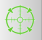{.icon} | Focus the view on the current docking box. |
| 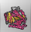{.icon} | Show/hide the receptor as lines. Cycles through 3 modes: the entire receptor; receptor atoms inside the docking box; hidden. |
| 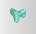{.icon} | Show/hide the receptor surface. Cycles through 3 modes: surface of the entire receptor; surface of atoms inside the docking box; hidden. |
| {.icon} | Show/hide residue labels. Cycles through 3 modes: label all receptor residues; label residues with at least one side-chain atom in the box; hidden. |
| 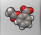{.icon} | Show/hide the ligand. |
| {.icon} | Show/hide the ligand anchor atom: the ligand atom that AutoDockFR translates to the pocket fill points to build the initial pool of solutions for its genetic algorithm. |
| 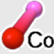{.icon} | Show/hide the atoms forming the covalent bond. |
| 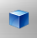{.icon} | Show/hide the docking box. |
| 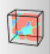{.icon} | Show/hide the map visualization widget (orthoslices and isocontours). |

### Docking box buttons

| Button | Function |
|---|---|
| 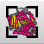{.icon} | Docking box encloses the receptor. |
| 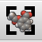{.icon} | Docking box encloses the ligand. |
| {.icon} | Docking box encloses the binding-pocket fill points. |
| 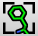{.icon} | Docking box encloses receptor amino acids selected by the user. |
| {.icon} | Set the docking box manually, and set the grid spacing and smoothing factor. |

### Validity status lights

Each light has up to three states: disabled, invalid (red) and valid (green).

| Light | Function |
|---|---|
| 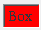{.icon} 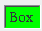{.icon} | **Box**: red if the box does not overlap the receptor (no receptor atom inside the box). Never disabled; applies to every docking calculation. |
| 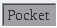{.icon} 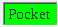{.icon} 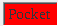{.icon} | **Pocket**: enabled unless the receptor is prepared for covalent docking. Red if none of the selected (displayed) fill points is inside the box. |
| 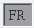{.icon} 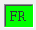{.icon} 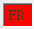{.icon} | **FR** (flexible residues): enabled only when side chains have been made flexible. Red if at least one atom of these side chains is outside the box. |
| 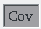{.icon} 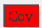{.icon} 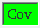{.icon} | **Cov** (covalent docking): enabled only when the covalent docking check button is checked. Turns green once the 2 receptor atoms forming the covalent bond are selected. |
