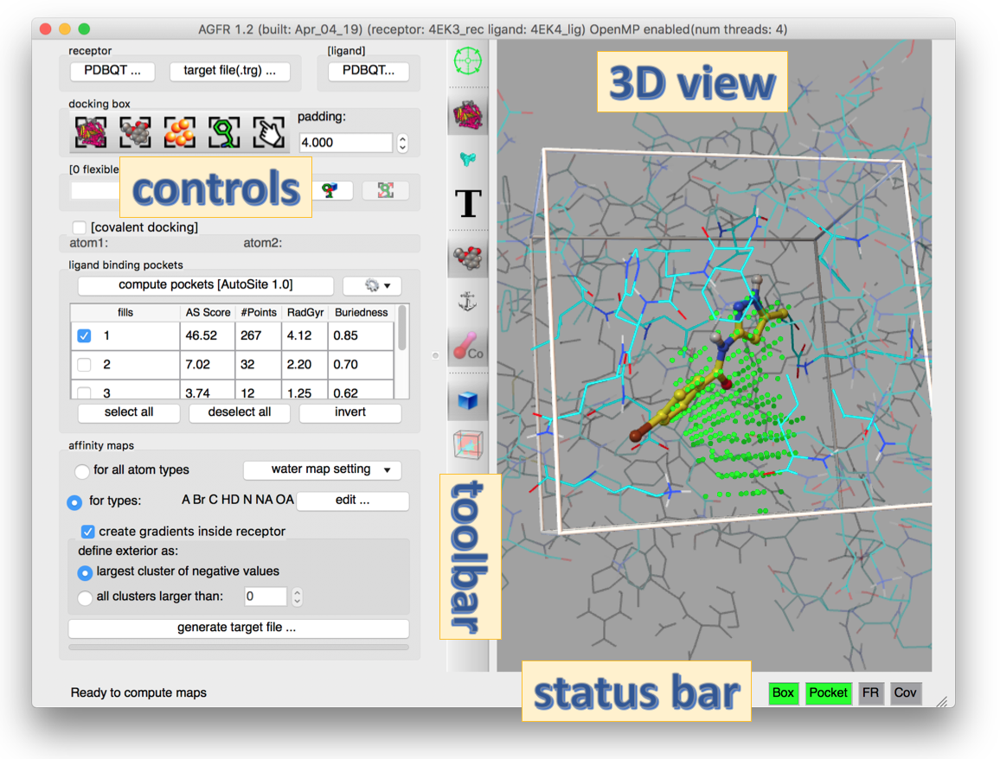

AutoGridFR (AGFR) generates **target files**: a single file that defines the binding site on a
receptor targeted for docking. Target files make affinity maps easier to manage and support data
provenance and reproducibility. They can be unzipped and the maps extracted for use with
AutoDock4.

AGFR runs from the command line or through a graphical user interface (GUI). This page gives an
overview of the GUI and a reference for its buttons. The [tutorials](tutorials.qmd) walk through
typical use cases step by step. Command-line examples are in the
[AutoDockFR tutorials](/software/adfr/tutorials.qmd).

## The graphical interface



Start the GUI with `ADFRsuite-1.0/bin/agfrgui`. The window title shows the program version and
the names of the loaded receptor and ligand. If OpenMP is enabled, it also shows the number of
available hardware threads.

The GUI has four areas:

1. **Controls** (left): stacked boxes of widgets for the steps of computing a target file for a
   receptor.
2. **3D view** (right): real-time visual feedback.
3. **Toolbar** (middle): buttons that change the representation in the 3D view.
4. **Status bar** (bottom): text about running computations or the next possible step, and
   status lights (red or green) that show whether the current docking box is valid.

### Control panel

- **Receptor** and **ligand** (top): load a receptor as a PDBQT file, or open an existing target
  file, which sets every widget the way the target file was generated. Optionally, load a
  crystallographic ligand to help position the docking box and/or choose the atom types for which
  to compute maps.
- **Docking box**: buttons that size and position the box (the rectangular region over which
  affinity maps are computed) to enclose the entire receptor, the ligand (if loaded), a pocket (if
  pockets were found, see below), a set of receptor amino acids, or a box set by hand. Every button
  except the manual one computes the bounding box and adds the current padding on each side. The
  box must overlap the receptor, otherwise the **BOX** status light is red.
- **Flexible residues** ("[0 flexible residue(s)]"): optionally make receptor side chains
  flexible, by typing a selection string or picking residues in a tree widget. The syntax is a
  chain ID, a colon and a comma-separated list of residues, for example `A:LYS33,LYS89;B:ARG12`.
  The box must cover the flexible residues, otherwise the **FR** light is red; a button enlarges
  the box to fix this. See the
  [flexible side chains tutorial](tutorial-flexible-receptor.qmd).
- **Covalent docking**: optionally specify the 2 atoms that form the covalent bond between the
  receptor and the ligand, by picking them in the 3D view or typing their full names (for example
  `A:CYS164:SG`). A covalent ligand already present in the receptor is drawn with dashed lines and
  can be edited by adding or removing atoms. See the
  [covalent docking tutorial](tutorial-covalent.qmd).
- **Ligand binding pockets**: a table of the pockets that [AutoSite](/software/autosite/index.qmd)
  finds in the current box. Select fills to define the binding pocket. AutoSite 1.0 and 1.1 are
  both available; 1.1 is slower but describes pockets better, especially for larger ligands such
  as peptides.
- **Affinity maps**: the atom types for which maps are computed. Computing maps for all AutoDock
  atom types is preferred, because the target file then works for any ligand. AGFR also computes
  water maps for hydrated docking automatically; their parameters are set here. You can also
  choose whether to add gradients to the maps, and set options for them.

Most buttons are enabled only once their prerequisites are met. For example, **generate target
file…** is enabled only after a receptor is loaded, a box overlapping the receptor is defined, at
least one pocket fill is selected, and that fill overlaps the box. The 4 status lights at the
bottom right start red and turn green as conditions are met, which guides you through the
workflow.

The maps are computed by an optimized, OpenMP-enabled version of AutoGrid4 bundled with AGFR.



## FAQ

**How can I inspect a target file?**

Open it in `agfrgui`, or print its metadata with `about`:

```
> about NativeCDK2BindingSite_rigid.trg
docking target file
date : Mon Jan 28 18:54:17 2019
node : fiji
platform : Darwin-17.7.0-x86_64-i386-64bit

receptor : 4EK3_rec.pdbqt
FlexRec : None
covBond : No

box : 
center : 23.332 28.922 29.598
length : 17.250 16.500 12.000
size : 0046 0044 0032
spacing : 0.375

maps : C A e d OA Br NA HD N W 
pocketMode : ['user', 23.332000000000001, 28.922000000000001, 29.597999999999999, 17.25, 16.5, 12.0]
#fillpts : 247 points
file : NativeCDK2BindingSite_rigid/translationPoints.npy
>

```

::: {.callout-note collapse="true"}
## Review note
- The FAQ on CCSB refers to `AutoDockSuite-$VERSION/bin/agfrgui` and `.../bin/about`; the install
  folder is `ADFRsuite-1.0`. Written as ADFRsuite here; please confirm.
- An image at the end of the CCSB overview page (`Picture1-200x175.png`) is missing on the CCSB
  server and was dropped.
:::
