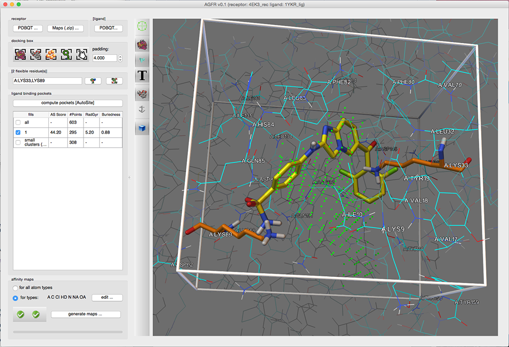
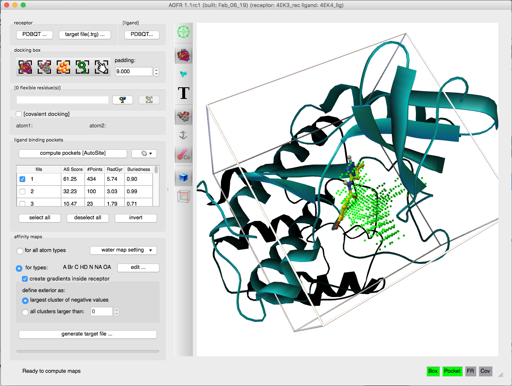

Images made with AutoGridFR (AGFR). Click an image to enlarge it.

<!-- To add an image: put the file in software/agfr/img/ and add it inside the gallery block below,
     one image per line with a blank line between images:
     {fig-alt="Short description of what the image shows"}
     -->

::: {.gallery layout-ncol="3"}

{fig-alt="Screenshot of AGFR v0.1: control panel on the left and a 3D view with a white docking box, green pocket points, a yellow ligand and orange flexible side chains."}

{fig-alt="Screenshot of AGFR 1.1 with a teal ribbon protein, a docking box, and green AutoSite pocket points next to a ligand."}

:::
