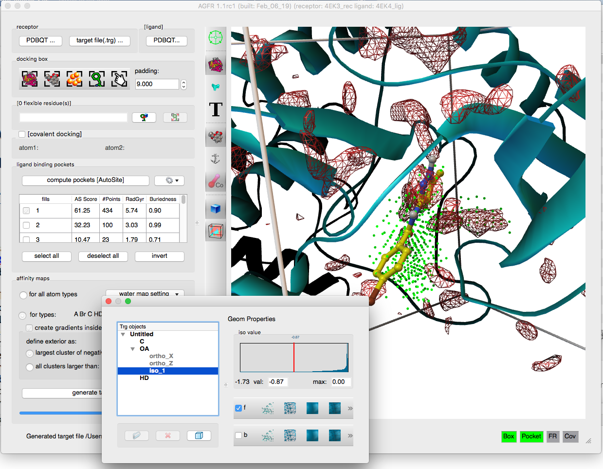
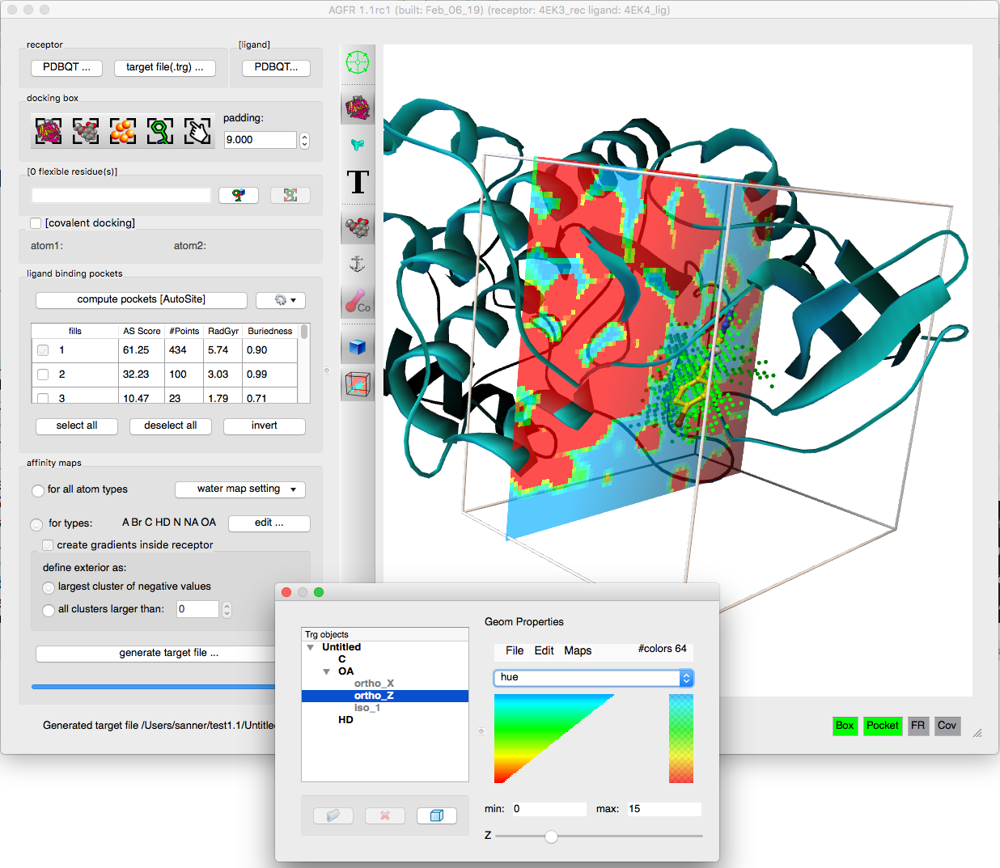
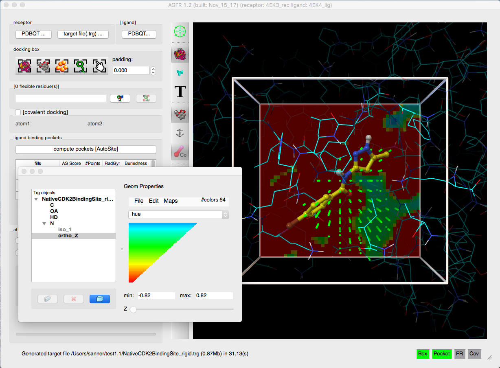

**AutoGridFR** (AGFR) computes the affinity maps that
[AutoDockFR](/software/adfr/index.qmd), [AutoDock CrankPep](/software/adcp/index.qmd) and
[AutoDock4](https://autodock.scripps.edu/) use to represent the binding site of a receptor
during docking. AGFR is part of [ADFRsuite](download.qmd).

AGFR can set the position and size of the docking box in several ways, from the command line or
from a graphical user interface. It runs AutoGrid4 to calculate the affinity maps and stores them
in a **target file** (`.trg`) together with metadata that describe the maps and how they were
calculated. The metadata make maps easier to manage and support data provenance and
reproducibility. Target files can be unzipped and the maps extracted for use with AutoDock4.

## Features

- Affinity maps for:
  - rigid receptors
  - receptors with **flexible side chains**
  - **covalent docking**
- Water maps for **hydrated docking**
- Automatic **binding pocket detection** (with [AutoSite](/software/autosite/index.qmd))
- **Affinity gradients** added to the maps
- Graphical user interface and command line
- Support for data provenance and reproducibility

::: {.gallery layout-ncol="3"}

{fig-alt="The AGFR graphical user interface"}

{fig-alt="AGFR screenshot"}

{fig-alt="AGFR screenshot"}

{fig-alt="Affinity map shown as an orthoslice"}

{fig-alt="Covalent ligand outlined with dashed lines"}

{fig-alt="Docking box set from AutoSite fill points"}

:::

## Get started

| | |
|---|---|
| [Download](download.qmd) | AGFR is installed with ADFRsuite 1.0 |
| [Documentation](documentation.qmd) | the graphical interface, a GUI reference, FAQ |
| [Tutorials](tutorials.qmd) | six step-by-step tutorials with the graphical interface |

## How to cite

If you use AGFR in your work, please cite:

- Zhang, Y.; Forli, S.; Omelchenko, A.; Sanner, M. F. AutoGridFR: Improvements on AutoDock
  Affinity Maps and Associated Software Tools. *J. Comput. Chem.* **2019**.
  [doi:10.1002/jcc.26054](https://doi.org/10.1002/jcc.26054)

The `agfr` program also asks you to cite:

- Ravindranath, P. A.; Forli, S.; Goodsell, D. S.; Olson, A. J.; Sanner, M. F. AutoDockFR:
  Advances in Protein-Ligand Docking with Explicitly Specified Binding Site Flexibility.
  *PLoS Comput. Biol.* **2015**, 11(12), e1004586.
  [doi:10.1371/journal.pcbi.1004586](https://doi.org/10.1371/journal.pcbi.1004586)
- Ravindranath, P. A.; Sanner, M. F. AutoSite: an automated approach for pseudo-ligands
  prediction, from ligand-binding sites identification to predicting key ligand atoms.
  *Bioinformatics* **2016**.
  [doi:10.1093/bioinformatics/btw367](https://doi.org/10.1093/bioinformatics/btw367)

::: {.callout-note collapse="true"}
## Review note
- The CCSB home page says ADFRsuite is available for Linux, Mac OS and **Windows**; the ADFRsuite
  1.0 download page offers Linux and macOS only (Windows through WSL). Windows left out here.
- The CCSB pages say "We plan to add direct support for target files in the next release of
  AutoDock4" (written 2019). Left out; please say whether this happened.
- Dead links on the CCSB page: `adfr.scripps.edu` (AutoDockFR) and
  `htpps://ccsb.scripps.edu/autodock` (typo, and ccsb.scripps.edu/autodock is gone). AutoDock4
  now links to autodock.scripps.edu.
:::
