In this scenario we have a receptor and a known ligand in the PDBQT format and we define a docking box centered on the ligand.

We will use the cyclin-dependent kinase 2 (CDK2, PDB 4EK3) and one of its ligands (PDB 4EK4). The files 4EK3_rec.pdbqt and 4EK4_lig.pdbqt are available in the [tutorial data file](https://ccsb.scripps.edu/adfr/download/1063/).

Start the graphical interface with `ADFRsuite-1.0/bin/agfrgui`.

## 1. Load receptor

**Click 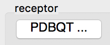{.icon} and select 4EK3_rec.pdbqt**

The receptor molecule is loaded and displayed as lines representing atomic bonds colored by atom type with carbon atoms shown in cyan. The default docking-box covers the entire receptor with the default padding (4.0 Angstroms) added to each side.

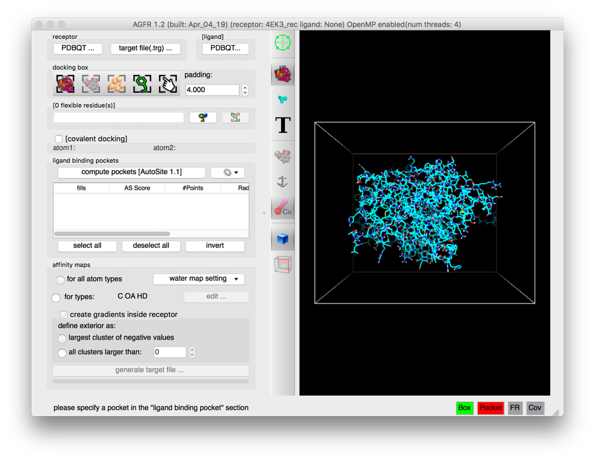

**Notes:**

- Amino acids located in the docking box with no flexible side-chains (*i.e.* glycine, alanine and proline) are displayed with dimmed down lines.
- Several buttons in the control section and the tool-bar are now enabled.
- The status bar indicates that the next step could be to detect pockets.

The 3D scene can be rotated, translated and scaled using the 3 mouse buttons:

| Mouse button | Action |
|---|---|
| Left | Rotate |
| Middle | Translate |
| Right | Scale |

Depth-cueing can be turned on and off by pressing the keyboard key ‘d’ while the mouse pointer is in the 3D view.

## 2. Load ligand

**Click on the 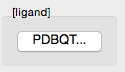{.icon} button to load 4EK4_lig.pdbqt**

The ligand molecule appears in the licorice representation with carbon atoms displayed in yellow.


**Notes:**

- More buttons are enabled by this operation both in the control panel and in the tool-bar. In particular the button allowing to position and size the box using the ligand {.icon}.

## 3. Define box

**Click {.icon} to make the docking box cover the ligand then click on {.icon} to focus the 3D scene on the box.**

The docking box is now centered on the ligand and scaled to have a 4.0 angstroms padding from the ligand atoms.

The padding can be adjusted using the spin box in the “docking box” section.

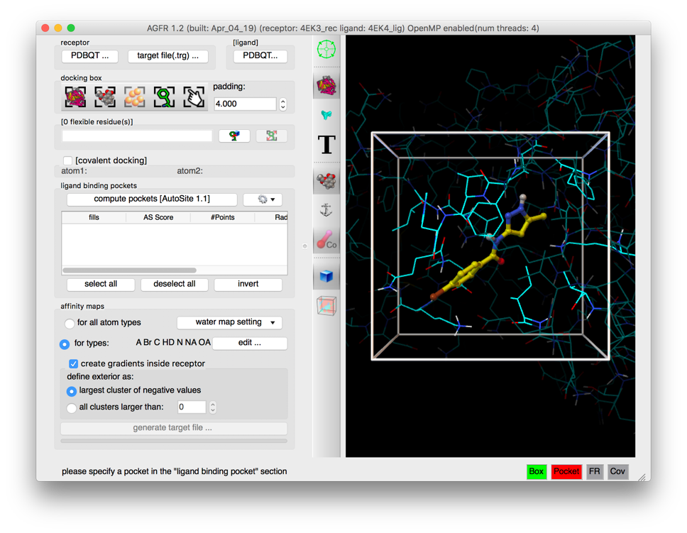

**Notes:**

- The amino acids outside the docking box, as well as the amino acids within the docking box with no flexible side-chains (i.e. glycine, alanine and proline) are displayed dimmed down. This facilitates the visual identification of the amino acids in the docking box that can potentially be made flexible during the docking calculation.
- Click the {.icon} button to display the “box parameters” user interface. This interface provides widgets to modify the box center coordinates, and box size along the 3 dimensions. NOTE: the mouse scroll wheel can be used to alter values while the mouse pointer is over the widget displaying numerical values.

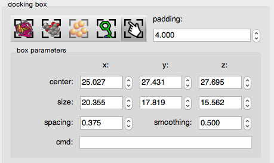


The spacing widget sets the distance between the grid points at which affinity values are calculated.

The smoothing widget allows the specification of the smoothing factor used for calculating affinity values. These values are initialized with AutoGrid’s default values.

The *cmd* typein widget allows the command-line specification of the docking box. For instance: center 10 11 12.3 will center the docking-box on (10.0, 11.0, 12.3). Multiple commands can be entered on a single line separated by a semicolon character ‘;’ (e.g. “center 12.34 34.12 56.56; size 26 26 26″) .

## 4. Set AutoSite version

**Click on 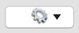{.icon} and select 1.0**

Versions 1.0 and 1.1 of [*AutoSite*](/software/autosite/index.qmd) are available. Version 1.1 produces better pocket descriptions, especially for larger ligands, but is somewhat slower. Here we use version 1.0 as it displays more grid points which work better for illustrative purposes.

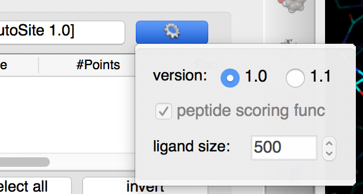

**Notes:**

- Version 1.1 of AutoSite performs post processing steps on the fills identified by version 1.0. First it inflates the fills to achieve better coverage of known ligands, and second it shrinks the inflated fill to retain 1/5 of the fill points to generate better points to be used during docking to position the ligand in the box.
- Version 1.1 can use a custom scoring function for ranking pockets when the ligand is a peptide.
- Version 1.1 uses a ligand size (i.e. volume expressed in grid points) to rank pockets. The default values of 500 selects good pockets for both small molecules and peptides.

## 5. Binding pockets

**Click on 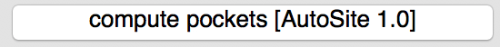{.icon}**

Ligand binding pockets are computed using [*AutoSite*](/software/autosite/index.qmd) by identifying and clustering high-affinity points. Each cluster of points is called a “fill” and listed in the table widget. The pocket with the largest *AutoSite* score is selected by default and displayed as a set of green dots. The fill points of all selected fills are displayed in the 3D viewer and will be written into the target files.

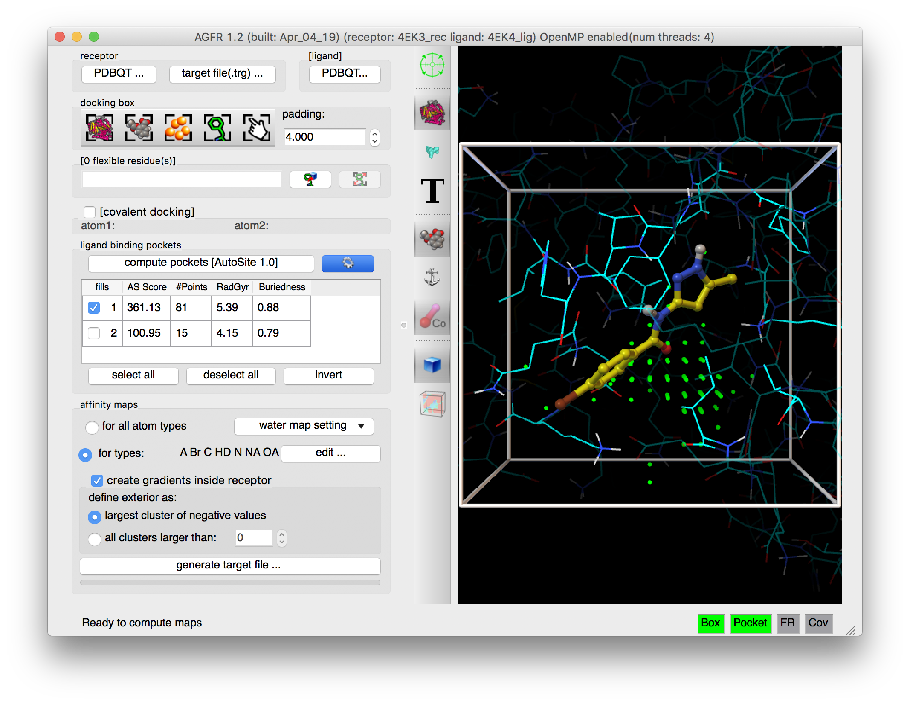

**Notes:**

- *AGFR* supports version 1.0 and 1.1 of the *AutoSite* algorithm. The latter is slower but creates better pocket descriptors, in particular for larger ligands such as peptides.
- Binding pockets are defined as subsets of high affinity grid points calculated on a 1 Angstrom resolution grid for the carbon, oxygen, and hydrogen maps (C, NA, HD). These points are clustered. Each cluster is called a fill and is assigned a rank. Usually, high ranking clusters are likely to be ligand binding pockets.
- Additional fills can be selected. The fill points of all selected fills are displayed as dots and will be saved in the target file. *ADFR* will use these points during docking for positioning the ligand in the docking box.
- The button labeled “generate target file…” is now enabled and all required status lights are green indicating that we defined a valid docking box and a valid pocket definition (*i.e.* a set of fill points that overlap with the docking box).

## 6. Maps parameters

**Check the 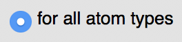{.icon} button**

 loading the ligand initialized the list of maps to be computed to the list of *AutoDock* atom types found in the ligand, in this case: “A C Cl HD N NA OA”. Computing maps for all atoms types will use a little more disk space but the resulting target file can be used for any ligand and is recommended.

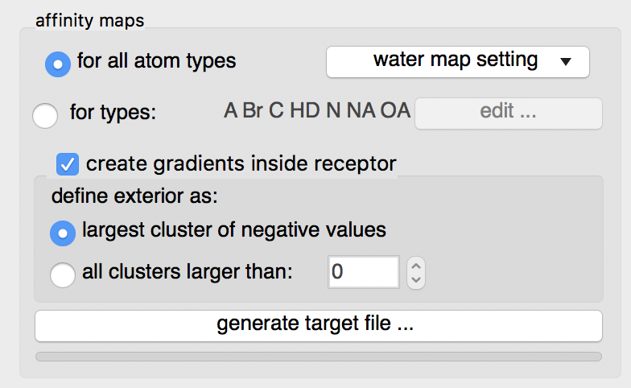

The “edit …” button will display an interface for manually specifying the list of atoms types for which affinity maps are requested.

**Water maps**: water maps are calculated automatically and stored in the target file. These maps are used for [hydrated docking](https://doi.org/10.1021/jm2005145). Their parameters can be set in the “water map setting” pull-down.

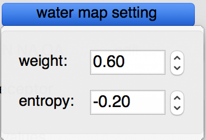

**Gradients**: By default, an affinity gradient will be created for the region of the grid covered by the receptor (except for the electrostatic and desolvation maps). If your CPU has multiple cores and OpenMP is detected, the calculation will execute in parallel and the number of available threads appears in the GUI title bar. Gradients are not required, however, they are recommended as they have been shown to help docking find solutions more efficiently. The addition of gradients requires the definition of the *interior* and *exterior* of the receptor. By default, the largest cluster of negative values (favorable affinities) is used to define the exterior of the receptor. In this case, everything else, including receptor cavities large enough to hold solvent but not open to the solvent, will be considered the interior and will be overwritten with the gradient. To prevent the gradient generation on grid points of internal cavities, the user can specify a cluster size above which clusters of points with negative values are considered to be outside the receptor and therefore preserve their original affinity values.

## 7. Generate maps

**Click on the “generate target file…” button**

The program asks for the name and location for the target file that will be generated. It will then compute the affinity maps and store them in the target file along with meta data.

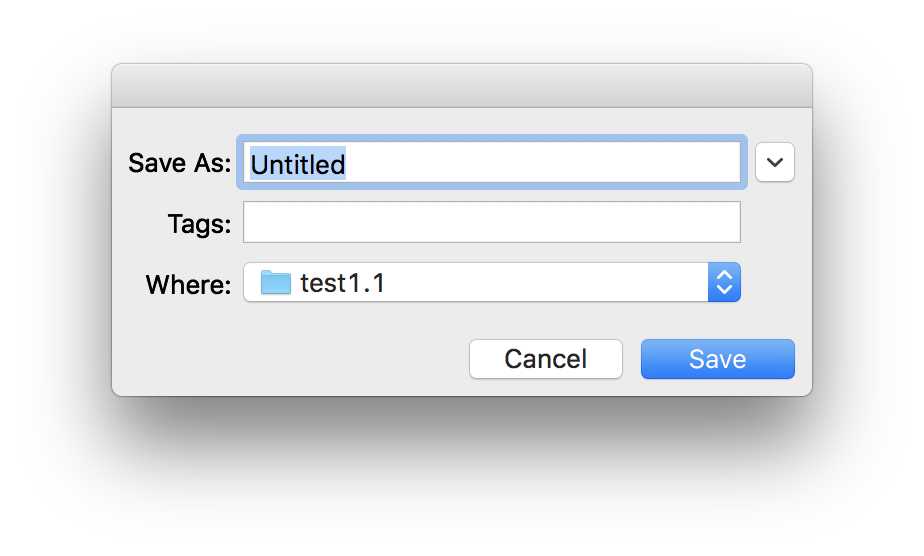

The generated target file describes the binding pocket targeted for docking on the receptor. It stores the PDBQT file of the receptor used to compute the affinity maps, the grid parameter file used to run *AutoGrid,* as well as files generated by the *AutoGrid* run (*i.e.* affinity maps, *AutoGrid* log file, etc.). In addition, it stores meta-data about the generation of the target file such as: the time and computer architecture on which the maps were computed, the docking-box parameters, the grid parameter file, the versions of *AGFR* and *AutoSite*, the water map parameters, etc.

It is recommended to use names that are descriptive. In this case we use *NativeCDK2BindingSite_rigid* as we defined the docking box using the native ligand and we did not specify any flexible receptor side chains.

Pressing the “Save” button will start the calculation in a separate thread, leaving the graphical user interface responsive. The progress bar below the button will indicate the level of completion of the calculation.

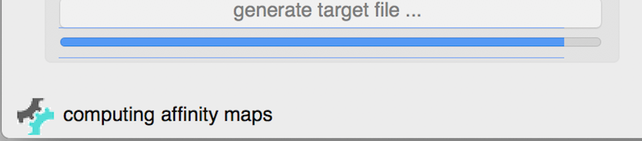

**Note:** a target file can be inspected from the command line using the *about* command (`ADFRsuite-1.0/bin/about`)

## 8. Same result from the command line

The target file produced by this tutorial can also be generated from the command line:

```bash
agfr -r data/4EK3_rec.pdbqt -l data/4EK4_lig.pdbqt -as
```

| Option | Meaning |
|---|---|
| `-r` | the receptor file |
| `-l` | the ligand file |
| `-as` | use the original AutoSite algorithm (1.0) rather than version 1.1 |

**Note:** By default, when a ligand is specified on the command line, *AGFR* will use this ligand to position and size the box. For more options run `agfr -h` (or `agfr --help`).

The command provided above produces the following output:

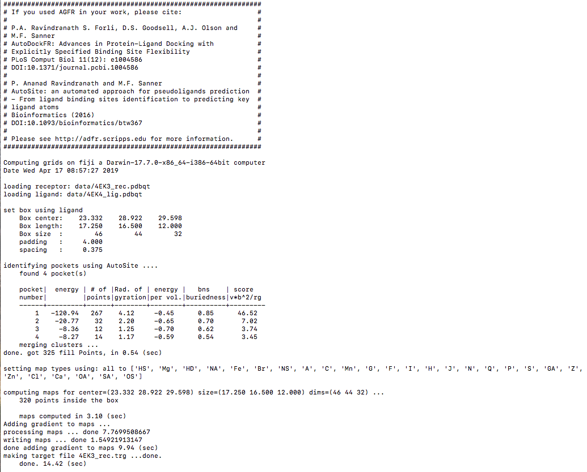

::: {.callout-note collapse="true"}
## Review note
- `ADFRsuite-1.0/bin/about` was written `AutoDockSuite-1.0/bin/about` on the CCSB page; changed to the ADFRsuite folder name used everywhere else. Please confirm.
- The command-line output is only available as a screenshot on the CCSB page.
:::
