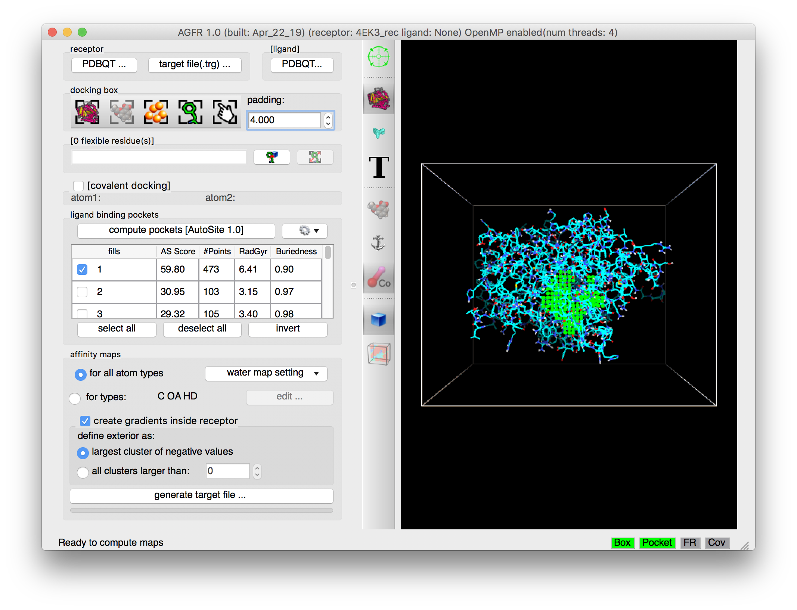
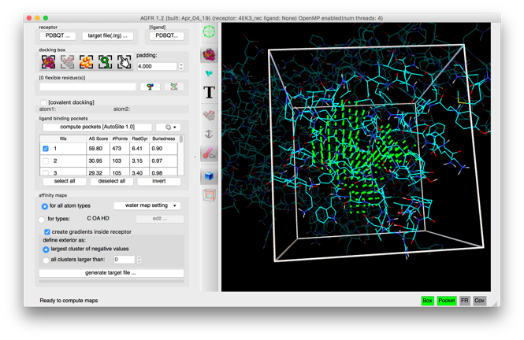

In this scenario we have a receptor but no ligand binding site information. We use *AutoSite* to identify possible binding pockets that we use to define the docking box and calculate maps.

We will illustrate this use case with cyclin-dependent kinase 2 (CDK2, PDB 4EK3). The receptor file 4EK3_rec.pdbqt is available in the [tutorial data file](https://ccsb.scripps.edu/adfr/download/1063/).

Start the graphical interface with `ADFRsuite-1.0/bin/agfrgui`.

## 1. Load receptor

**Click {.icon} and select 4EK3_rec.pdbqt**

The receptor molecule is loaded and displayed as lines representing atomic bonds colored by atom type with carbon atoms shown in cyan. The default docking-box covers the entire receptor with the default padding (4.0 Angstroms) added to each side.

**Notes:**

- Amino acids located in the docking box with no flexible side-chains (*i.e.* glycine, alanine and proline) are displayed with dimmed down lines.
- Several buttons in the control section and the tool-bar are now enabled.
- The status bar indicates that the next step could be to detect pockets.

The 3D scene can be rotated, translated and scaled using the 3 mouse buttons:

| Mouse button | Action |
|---|---|
| Left | Rotate |
| Middle | Translate |
| Right | Scale |

Depth-cueing can be turned on and off by pressing the keyboard key ‘d’ while the mouse pointer is in the 3D view.

## 2. Set AutoSite version

**Click on {.icon} and select 1.0**

Versions 1.0 and 1.1 of [*AutoSite*](/software/autosite/index.qmd) are available. Version 1.1 produces better pocket descriptions, especially for larger ligands, but is somewhat slower. Here we use version 1.0 as it displays more grid points which work better for illustrative purposes.

**Notes:**

- Version 1.1 of AutoSite performs post processing steps on the fills identified by version 1.0. First it inflates the fills to achieve better coverage of known ligands, and second it shrinks the inflated fill to retain 1/5 of the fill points to generate better points to be used during docking to position the ligand in the box.
- Version 1.1 can use a custom scoring function for ranking pockets when the ligand is a peptide.
- Version 1.1 uses a ligand size (i.e. volume expressed in grid points) to rank pockets. The default value of 500 selects good pockets for both small molecules and peptides.

## 3. Binding pockets

**Click on {.icon}**

Ligand binding pockets are computed using [*AutoSite*](/software/autosite/index.qmd) by identifying and clustering high-affinity points. Each cluster of points is called a “fill” and listed in the table widget. The pocket with the largest *AutoSite* score is selected by default and displayed as a set of green dots. The fill points of all selected fills are displayed in the 3D viewer and they get written into the target files.

**Notes:**

- *AGFR* supports version 1.0 and 1.1 of the *AutoSite* algorithm. The latter is slower but creates better pocket descriptors, in particular for larger ligands such as peptides.
- Binding pockets are defined as subsets of high affinity grid points calculated on a 1 Angstrom resolution grid for the carbon, oxygen, and hydrogen maps (C, NA, HD). These points are clustered. Each cluster is called a fill and is assigned a rank. Usually, high ranking clusters are likely to be ligand binding pockets.
- Additional fills can be selected. The fill points of all selected fills are displayed as dots and will be saved in the target file. *ADFR* will use these points during docking for positioning the ligand in the docking box.
- The button labeled “generate target file…” is now enabled and all required status lights are green indicating that we defined a valid docking box and a valid pocket definition (*i.e.* a set of fill points that overlap with the docking box).

## 4. Set docking box

**Click on {.icon} to define the docking box using the displayed fills**

The box is defined as the bounding box of the grid points in all currently selected fills with current padding value (4.0 in this case) added on each side of the box.

**Notes:**

- All displayed fill points will be written into the target file as potential positions for the ligand during the docking. Selecting multiple fills leads to larger docking boxes where the ligand can explore multiple pockets.
- Target files can be generated for different pockets by selecting different fills and computing the corresponding target files. By using the command line it is possible to generate multiple target files in a single run, *i.e.* a different target file for each fill.

## 5. Maps parameters

**Check the {.icon} button**

 loading the ligand initialized the list of maps to be computed to the list of AutoDock atom types found in the ligand, in this case: “A C Cl HD N NA OA”. Computing maps for all atoms types will use a little more disk space but the resulting target file can be used for any ligand and is recommended.

The “edit …” button will display an interface for manually specifying the list of atoms types for which affinity maps are requested.

**Water maps**: water maps are calculated automatically and stored in the target file. These maps are used for [hydrated docking](https://doi.org/10.1021/jm2005145). Their parameters can be set in the “water map setting” pull-down.

**Gradients**: By default, an affinity gradient will be created for the region of the grid covered by the receptor (except for the electrostatic and desolvation maps). If your CPU has multiple cores and OpenMP is detected, the calculation will execute in parallel and the number of available threads appears in the GUI title bar. Gradients are not required, however, they are recommended as they have been shown to help docking find solutions more efficiently. The addition of gradients requires the definition of the *interior* and *exterior* of the receptor. By default, the largest cluster of negative values (favorable affinities) is used to define the exterior of the receptor. In this case, everything else, including receptor cavities large enough to hold solvent but not open to the solvent, will be considered the interior and will be overwritten with the gradient. To prevent the gradient generation on grid points of internal cavities, the user can specify a cluster size above which clusters of points with negative values are considered to be outside the receptor and therefore preserve their original affinity values.

## 6. Generate maps

**Click on the “generate target file…” button**

The program asks for the name and location for the target file that will be generated. It will then compute the affinity maps and store them in the target file along with meta data.

The generated target file describes the binding pocket targeted for docking on the receptor. It stores the PDBQT file of the receptor used to compute the affinity maps, the grid parameter file used to run *AutoGrid,* as well as files generated by the *AutoGrid* run (*i.e.* affinity maps, *AutoGrid* log file, etc.). In addition, it stores meta-data about the generation of the target file such as: the time and computer architecture on which the maps were computed, the docking-box parameters, the grid parameter file, the versions of *AGFR* and *AutoSite*, the water map parameters, etc.

It is recommended to use names that are descriptive. In this case we use *NativeCDK2TopFill_rigid* as we defined the docking box using the top ranking fill and we did not specify any flexible receptor side chains.

Pressing the “Save” button will start the calculation in a separate thread, leaving the graphical user interface responsive. The progress bar below the button will indicate the level of completion of the calculation.

**Note:** a target file can be inspected from the command line using the *about* command (`ADFRsuite-1.0/bin/about`)

::: {.callout-note collapse="true"}
## Review note
- Step “Maps parameters” says loading the ligand set the map list to “A C Cl HD N NA OA”, but this tutorial loads no ligand (text copied from the known-ligand tutorial).
- `ADFRsuite-1.0/bin/about` was written `AutoDockSuite-1.0/bin/about` on the CCSB page; changed to the ADFRsuite folder name. Please confirm.
:::
