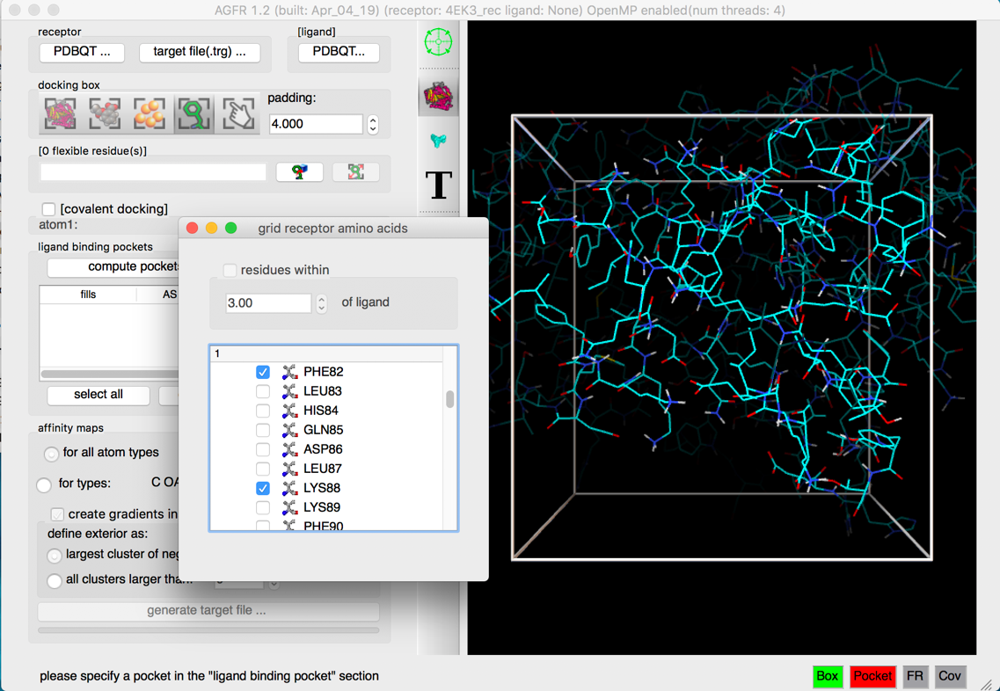
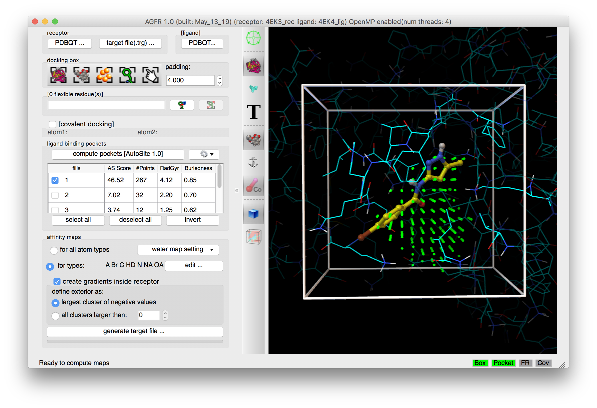

In this scenario the binding site is defined by the receptor amino acids that flank the active site.

We will illustrate this use case using cyclin-dependent kinase 2 (CDK2, PDB 4EK3). The receptor file 4EK3_rec.pdbqt is available in the [tutorial data file](https://ccsb.scripps.edu/adfr/download/1063/).

Start the graphical interface with `ADFRsuite-1.0/bin/agfrgui`.

## 1. Load receptor

**Click {.icon} and select 4EK3_rec.pdbqt**

The receptor molecule is loaded and displayed as lines representing atomic bonds colored by atom type with carbon atoms shown in cyan. The default docking-box covers the entire receptor with the default padding (4.0 Angstroms) added to each side.

**Notes:**

- Amino acids located in the docking box with no flexible side-chains (*i.e.* glycine, alanine and proline) are displayed with dimmed down lines.
- Several buttons in the control section and the tool-bar are now enabled.
- The status bar indicates that the next step could be to detect pockets.

The 3D scene can be rotated, translated and scaled using the 3 mouse buttons:

| Mouse button | Action |
|---|---|
| Left | Rotate |
| Middle | Translate |
| Right | Scale |

Depth-cueing can be turned on and off by pressing the keyboard key ‘d’ while the mouse pointer is in the 3D view.

## 2. Specify residues

**Click on {.icon} and select residues ILE10, PHE80, PHE82, and LYS89**

Clicking the button displays a tree widget listing the receptor amino acids covered by the docking box. The residues are organized by chains. The tree widget allows the selection/deselection of amino acids. The docking box automatically adjusts to cover all selected residues, adding the current padding value to each side of the box.

**Notes:**

- Click {.icon} to focus the 3D scene on the box.
- The top portion of the residue selection widget interface allows selecting amino acids located within a distance cutoff of a ligand molecule. This interface is currently disabled as no ligand has been loaded.
- Close the side chain selection widget by destroying the window, using the button in the corner of the window.

## 3. Binding pockets

**Click on {.icon}**

Ligand binding pockets are computed using [*AutoSite*](/software/autosite/index.qmd) by identifying and clustering high-affinity points. Each cluster of points is called a “fill” and listed in the table widget. The pocket with the largest *AutoSite* score is selected by default and displayed as a set of green dots. The fill points of all selected fills are displayed in the 3D viewer and will be written into the target files.

**Notes:**

- For this docking box *[AutoSite](/software/autosite/index.qmd)* identified 4 binding pockets. Fill #5 contains all un-clustered high affinity grid points.
- The binding pockets 1-4 are ranked by decreasing score with higher scores reflecting a higher predicted probability for the pocket to be a ligand-binding pocket. The fill points of all selected (i.e. displayed) binding pockets will be used by *ADFR* as potential initial positions of the ligand during the search. In this example select only fill #1. All selected (and displayed) fill points will be written as fill points into the target file.

## 4. Maps parameters

**Check the {.icon} button**

 loading the ligand initialized the list of maps to be computed to the list of *AutoDock* atom types found in the ligand, in this case: “A C Cl HD N NA OA”. Computing maps for all atoms types will use a little more disk space but the resulting target file can be used for any ligand and is recommended.

The “edit …” button will display an interface for manually specifying the list of atoms types for which affinity maps are requested.

**Water maps**: water maps are calculated automatically and stored in the target file. These maps are used for [hydrated docking](https://doi.org/10.1021/jm2005145). Their parameters can be set in the “water map setting” pull-down.

**Gradients**: By default, an affinity gradient will be created for the region of the grid covered by the receptor (except for the electrostatic and desolvation maps). If your CPU has multiple cores and OpenMP is detected, the calculation will execute in parallel and the number of available threads appears in the GUI title bar. Gradients are not required, however, they are recommended as they have been shown to help docking find solutions more efficiently. The addition of gradients requires the definition of the *interior* and *exterior* of the receptor. By default, the largest cluster of negative values (favorable affinities) is used to define the exterior of the receptor. In this case, everything else, including receptor cavities large enough to hold solvent but not open to the solvent, will be considered the interior and will be overwritten with the gradient. To prevent the gradient generation on grid points of internal cavities, the user can specify a cluster size above which clusters of points with negative values are considered to be outside the receptor and therefore preserve their original affinity values.

## 5. Generate maps

**Click on the “generate target file…” button**

The program asks for the name and location for the target file that will be generated. It will then compute the affinity maps and store them in the target file along with meta data.

The generated target file describes the binding pocket targeted for docking on the receptor. It stores the PDBQT file of the receptor used to compute the affinity maps, the grid parameter file used to run *AutoGrid,* as well as files generated by the *AutoGrid* run (*i.e.* affinity maps, *AutoGrid* log file, etc.). In addition, it stores meta-data about the generation of the target file such as: the time and computer architecture on which the maps were computed, the docking-box parameters, the grid parameter file, the versions of *AGFR* and *AutoSite*, the water map parameters, etc.

It is recommended to use names that are descriptive. In this case we use *CDK2BindingSite_rigid* as we defined the docking box using a known binding site and we did not specify any flexible receptor side chains.

Pressing the “Save” button will start the calculation in a separate thread, leaving the graphical user interface responsive. The progress bar below the button will indicate the level of completion of the calculation.

**Note:** a target file can be inspected from the command line using the *about* command (`ADFRsuite-1.0/bin/about`)

::: {.callout-note collapse="true"}
## Review note
- Step “Maps parameters” says loading the ligand set the map list to “A C Cl HD N NA OA”, but this tutorial loads no ligand (text copied from the known-ligand tutorial).
- `ADFRsuite-1.0/bin/about` was written `AutoDockSuite-1.0/bin/about` on the CCSB page; changed to the ADFRsuite folder name. Please confirm.
:::
