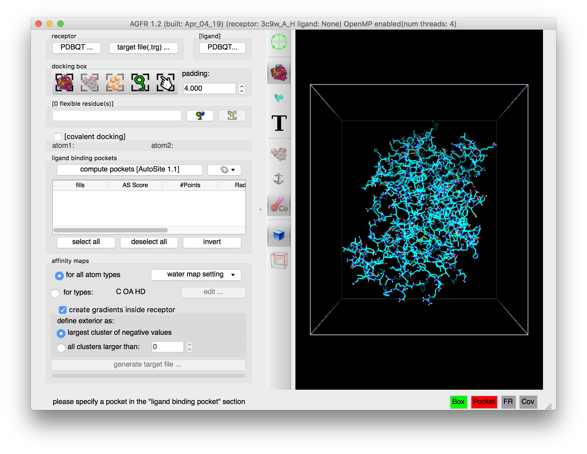
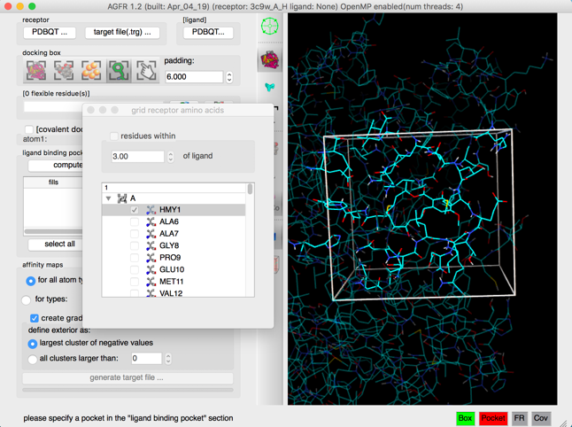
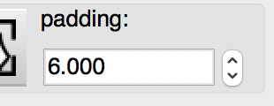
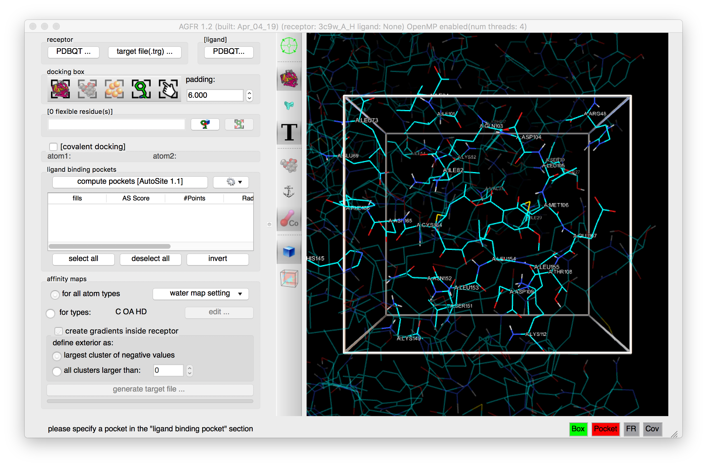
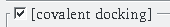
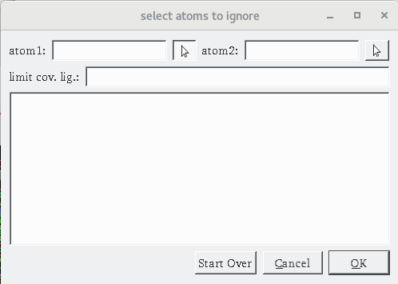
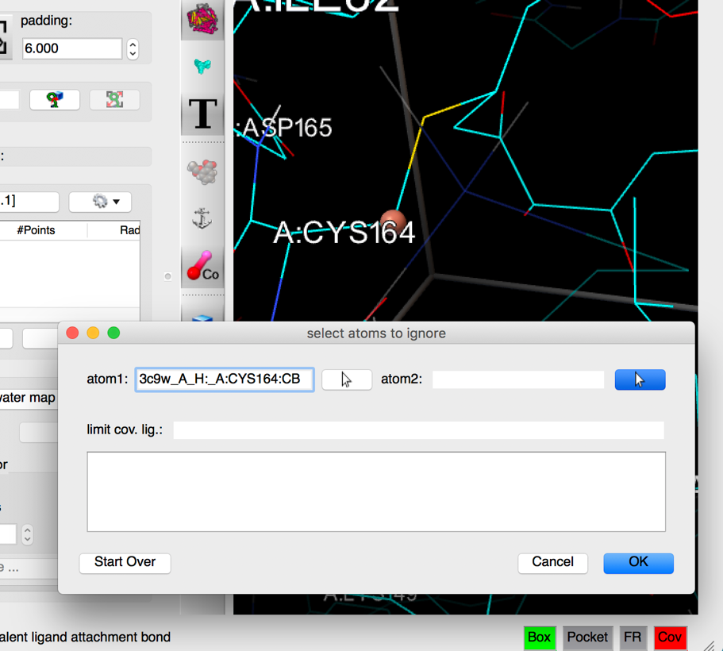
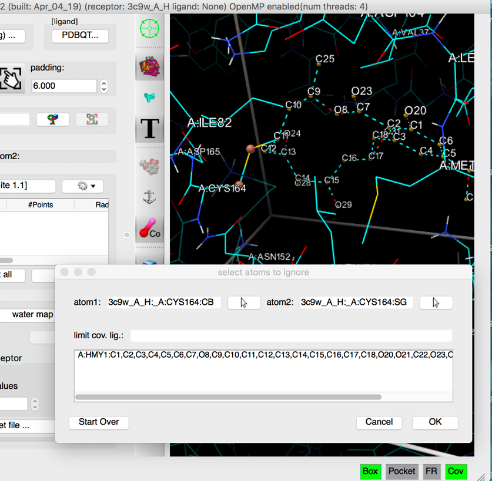
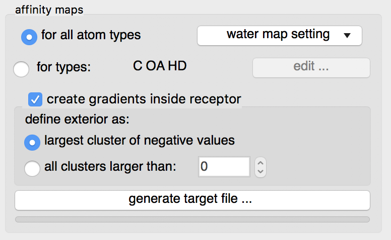

In this scenario we have a receptor with a covalently attached ligand and we will prepare the receptor for docking covalent ligands. We use chain A of PDB entry 3C9W. The file (3c9w_A_H.pdbqt) is in the tutorial data:

[ADFRTutorialData.zip](https://ccsb.scripps.edu/agfr/download/551/).

**3c9w_A_H.pdbqt was created as follows:**

1. download 3c9w.pdb from the [RCSB PDB](https://www.rcsb.org/structure/3C9W)
2. extract chain A including the covalent ligand HMY1 but excluding water molecules using your favorite molecule editor (for example PyMOL) and save it as 3c9w_A.pdb
3. add hydrogen atoms with reduce: `ADFRsuite-1.0/bin/reduce 3c9w_A.pdb > 3c9w_A_H.pdb`
4. generate the receptor PDBQT file: `ADFRsuite-1.0/bin/prepare_receptor -r 3c9w_A_H.pdb`

Start the graphical interface with `ADFRsuite-1.0/bin/agfrgui`.

## 1. Load receptor

**Click {.icon} and select 3c9w_A_H.pdbqt**

The receptor molecule is loaded and displayed as lines representing atomic bonds colored by atom type with carbon atoms shown in cyan. The default docking-box covers the entire receptor with the default padding (4.0 Angstroms) added to each side.

**Notes:**

- Amino acids located in the docking box with no flexible side-chains (*i.e.* glycine, alanine and proline) are displayed with dimmed down lines.
- Several buttons in the control section and the tool-bar are now enabled.
- The status bar indicates that the next step could be to detect pockets.

The 3D scene can be rotated, translated and scaled using the 3 mouse buttons:

| Mouse button | Action |
|---|---|
| Left | Rotate |
| Middle | Translate |
| Right | Scale |

Depth-cueing can be turned on and off by pressing the keyboard key ‘d’ while the mouse pointer is in the 3D view.

## 2. Place box

**Click on {.icon} and select residue HMY1, and dismiss dialog and click {.icon} to focus the scene on the box**

The docking box is set to cover the current ligand and the scene is centered on the docking box.

**Note:** Close the side chain selection widget by destroying the window, using the button in the corner of the window.

## 3. Adjust padding

**Increase padding to 6.0 and click {.icon} to label residues**

The box is larger and the residues inside the docking box are labelled.

**Notes:** the padding values can be typed in or changed by scrolling the mouse wheel.

## 4. Enable covalent docking

**Check the {.icon} check-button**

The dialog for specifying a covalent attachment (shown below) is displayed. The top row of the dialog allows the specifications of the 2 atoms that will form the covalent bond between the receptor and the ligand. These fields are initially empty and can be populated by picking them in the 3D viewer (left click) or by typing atom name directly into the fields.

**Notes:**

- The Pocket status light is now disabled as no pocket definition is required for covalent docking
- When the form is displayed initially, the left mouse click is automatically assigned the function to pick the first atom of the covalent bond.
- Atom1 should be on the receptor side of the covalent bond and atom2 on the ligand side.
- The “Cov” status button in the status bar becomes enabled {.icon}.

## 5. First atom

**Pick CB in CYS164 as the first atom of the covalent bond (left mouse button click) .**

As an atom is picked in the 3D viewer, a small sphere is displayed on the picked atom, the atom name is displayed in the atom 1 field, and the mouse function is set to picking the second atom.

**Notes:**

- clicking on the arrow button to the right of the “atom 1” and “atom 2” fields set the left mouse picking function of the 3D viewer to pick the corresponding atom.

- The visibility of the spheres highlighting the covalent bond is toggled using the {.icon} button in the toolbar.

## 6. Second atom

**pick SG in CYS164 as the second atom of the covalent bond**

 As the second atom forming the covalent bond is picked, a small sphere is displayed on the picked atom, the picked atom name is displayed in the “atom 2” field, and the sub-graph rooted at the covalent bond (atom1 atom2) is displayed with dashed lines, outlining the atoms identified as the covalent ligand (if any). These atoms will be removed from the receptor when calculating the affinity maps. The list of removed atoms appears in the dialog.

The left mouse picking function in the 3D viewer is now assigned to editing the set of atoms in the covalent ligand. Clicking on an included atom (i.e. with dashed lines) will exclude it and vice versa.

**Notes:**

- In some cases the covalent ligand has a second covalent bond with the receptor (due to close contacts) which leads to a covalent ligand that includes potentially large parts of the receptor. The “limit cov. Lig.” field in the dialog allows to address this issue by limiting the traversal of the receptor molecule to a list of residues. For instance, typing A:CYS164,HMY1 in this field will limit the traversal to the ligand and these 2 residues prevent the erroneous inclusion of other receptor amino acids in the set of atoms considered to be the covalent ligand.
- The “Start over” button will clear the dialog and let you start over.
- If the second atom picked is not covalently bound to the first picked atom, a dialog is displayed asking whether or not to proceed. The dialog show the atoms identity as well as the distance between these atoms helping the user decide whether they picked the right atom or not and whether to proceed or not. This feature is useful when the covalent bond happens to be too long for a bond to be created in the viewer.
- Click OK on the dialog once the proper covalent bond was defined and the set of atoms to be removed (*i.e.* the covalent ligand) is correct.
- The “Cov” status light is now green and the pocket validity light is disabled as no fill points are needed for covalent docking.

## 7. Maps parameters

**Check the {.icon} button**

By default maps for all known AutoDock atom types will be computed. This is recommended as it will use a little more disk space but the resulting target file can be used for any ligand.

The “edit …” button will display an interface for manually specifying the list of atoms types for which affinity maps are requested. The C OA and HD maps are always calculated as they are used to compute the water map.

**Water maps**: water maps are calculated automatically and stored in the target file. These maps are used for [hydrated docking](https://doi.org/10.1021/jm2005145). Their parameters can be set in the “water map setting” pull-down.

**Gradients**: By default, an affinity gradient will be created for the region of the grid covered by the receptor (except for the electrostatic and desolvation maps). If your CPU has multiple cores and OpenMP is detected, the calculation will execute in parallel and the number of available threads appears in the GUI title bar. Gradients are not required, however, they are recommended as they have been shown to help docking find solutions more efficiently. The addition of gradients requires the definition of the *interior* and *exterior* of the receptor. By default, the largest cluster of negative values (favorable affinities) is used to define the exterior of the receptor. In this case, everything else, including receptor cavities large enough to hold solvent but not open to the solvent, will be considered the interior and will be overwritten with the gradient. To prevent the gradient generation on grid points of internal cavities, the user can specify a cluster size above which clusters of points with negative values are considered to be outside the receptor and therefore preserve their original affinity values.

## 8. Generate maps

**Click on the “generate target file…” button**

The program asks for the name and location for the target file that will be generated. It will then compute the affinity maps and store them in the target file along with meta data.

The generated target file describes the binding pocket targeted for docking on the receptor. It stores the PDBQT file of the receptor used to compute the affinity maps, the grid parameter file used to run *AutoGrid,* as well as files generated by the *AutoGrid* run (*i.e.* affinity maps, *AutoGrid* log file, etc.). In addition, it stores meta-data about the generation of the target file such as: the time and computer architecture on which the maps were computed, the docking-box parameters, the grid parameter file, the versions of *AGFR* and *AutoSite*, the water map parameters, etc.

Pressing the “Save” button will start the calculation in a separate thread, leaving the graphical user interface responsive. The progress bar below the button will indicate the level of completion of the calculation.

**Note:** a target file can be inspected from the command line using the *about* command (`ADFRsuite-1.0/bin/about`)

::: {.callout-note collapse="true"}
## Review note
- One toolbar icon (word-image-53.png) is missing on the CCSB server and was dropped.
- `ADFRsuite-1.0/bin/about` was written `AutoDockSuite-1.0/bin/about` on the CCSB page; changed to the ADFRsuite folder name. Please confirm.
:::
