In this scenario we have a receptor and a known ligand available in the PDBQT format and we define a docking box centered on the ligand.

We will use the cyclin-dependent kinase 2 (CDK2, PDB 4EK3) and a ligand from PDB 1YKR. The files 4EK3_rec.pdbqt and 1YKR_lig.pdbqt are available in the [tutorial data file](https://ccsb.scripps.edu/adfr/download/1063/).

Start the graphical interface with `ADFRsuite-1.0/bin/agfrgui`.

## 1. Load receptor

**Click {.icon} and select 4EK3_rec.pdbqt**

The receptor molecule is loaded and displayed as lines representing atomic bonds colored by atom type with carbon atoms shown in cyan. The default docking-box covers the entire receptor with the default padding (4.0 Angstroms) added to each side.

**Notes:**

- Amino acids located in the docking box with no flexible side-chains (*i.e.* glycine, alanine and proline) are displayed with dimmed down lines.
- Several buttons in the control section and the tool-bar are now enabled.
- The status bar indicates that the next step could be to detect pockets.

The 3D scene can be rotated, translated and scaled using the 3 mouse buttons:

| Mouse button | Action |
|---|---|
| Left | Rotate |
| Middle | Translate |
| Right | Scale |

Depth-cueing can be turned on and off by pressing the keyboard key ‘d’ while the mouse pointer is in the 3D view.

## 2. Load ligand

**Click on the {.icon} button to load 1YKR_lig.pdbqt**

The ligand molecule appears in the licorice representation with carbon atoms displayed in yellow.

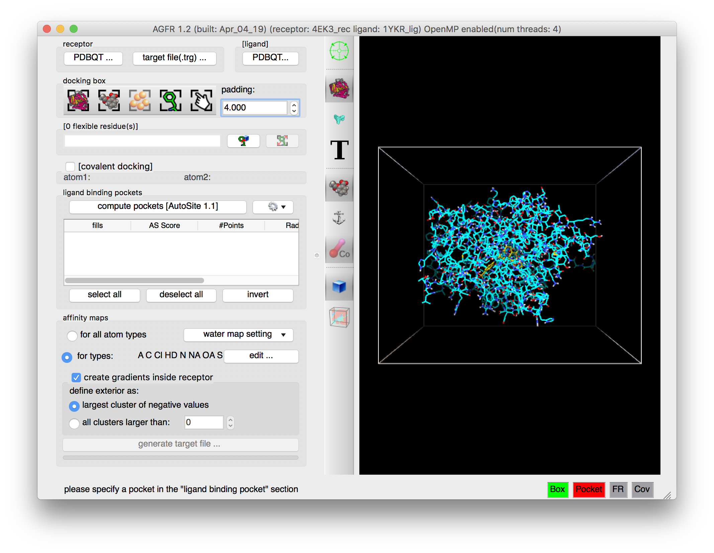

**Notes:**

- More buttons are enabled by this operation both in the control panel and in the tool-bar. In particular the button allowing to position and size the box using the ligand {.icon}.

## 3. Define box

**Click {.icon} to make the docking box cover the ligand, click on {.icon} to focus the 3D scene on the box, and click {.icon} to label residues in the box.**

The docking box is now centered on the ligand and scaled to have a 4.0 angstroms padding from the ligand atoms.

The padding can be adjusted using the spin box in the “docking box” section.

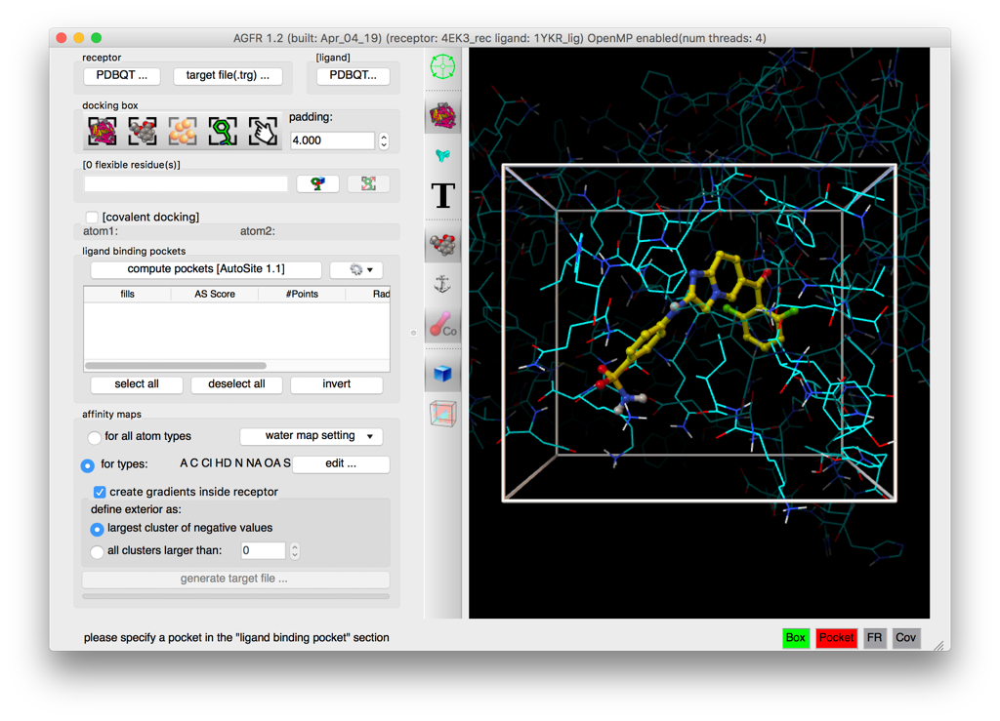

This particular ligand overlaps with side chains of the receptor’s apo conformation. Label the receptor residues in the docking box by clicking in the {.icon} button in the tool bar, and zoom in and rotate to observe the overlap of lysine 33 and lysine 89 with the ligand.

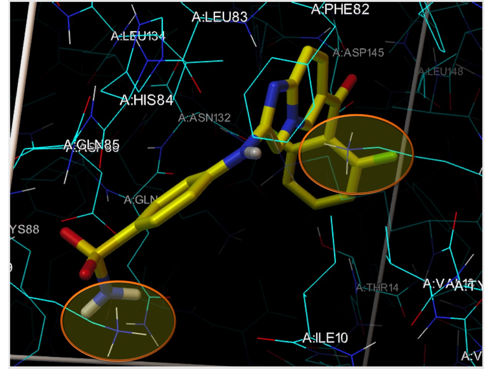

**Notes:**

- It is recommended to keep the number of flexible receptor side chains below 15.

## 4. Make side chains flexible

**Click on 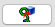{.icon} and select LYS33 and LYS89**

A residue selection widget displays all receptor amino acids currently in the docking box and having a side chain that can adopt multiple conformations (*i.e.* not alanine, glycine or proline). Check the box for a residue to select it for having its side chain made flexible during the docking. Side chains selected as flexible for docking are displayed in the 3D view as orange Sticks & Balls and listed in the type in widget.

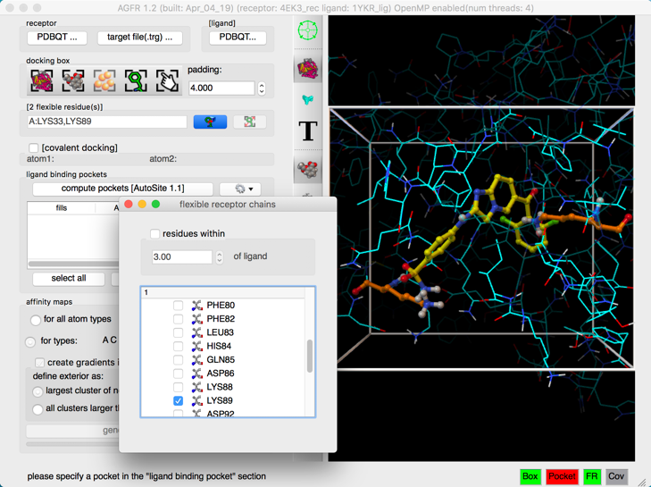

**Notes:**

- If a ligand has been loaded, receptor side chains to be made flexible can also be selected based on their distance from the ligand by checking the “residue within” button. Checking this button will override the current selection with the set of receptor side chains having at least one moving side chain atom within the current distance cutoff (i.e. 3.0 Angstroms in this case) of the ligand. Keep in mind that the more side chains are made flexible the harder the docking problem. While *ADFR* has no hard limit on how many side-chains can be made flexible we recommend keeping the number below 10 to 15.
- The receptor amino acids selected to have flexible side-chains during the docking calculation are now listed in the type-in widget. 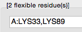{.icon} along with the number such residues. Flexible residues can be specified manually by typing directly in this widget. A residue can be specified by its residue number (*e.g.* “89”), or by its residue type and number (*e.g.*“LYS89”). Multiple residues must be separated by a comma ‘,’ or space characters, optionally preceded by a chain id (i.e. “A:120,LYS89”). If the chain id is omitted matching residues from all chains are selected. Residues from different chains can be specified by separating the selection string for each chain by a semi colon ‘;’ *e.g.* “A:10,24,35;B:12,34”
- Close the interface by destroying the window, using the button in the corner of the window.

## 5. More flexible residues

**Type “,88” in the type-in widget for flexible residues and press the Enter key**

- one more residue (lysine 88) is selected to have a flexible side chain during docking.
- The flexible residues and the selection string are expanded.
- the ‘FR’ status light (bottom right of the GUI) turned red (i.e. invalid box)

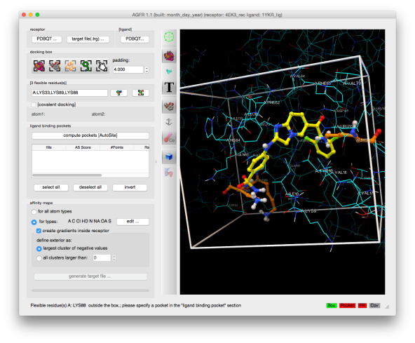

## 6. Adjust the box

**Click on 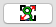{.icon} to adjust the docking box to cover all flexible receptor atoms**

- the docking box has been extended to fully cover all flexible residues (33, 88 and 89)
- the status light for flexible receptor side chains validity ‘FR’ is now green in the status bar

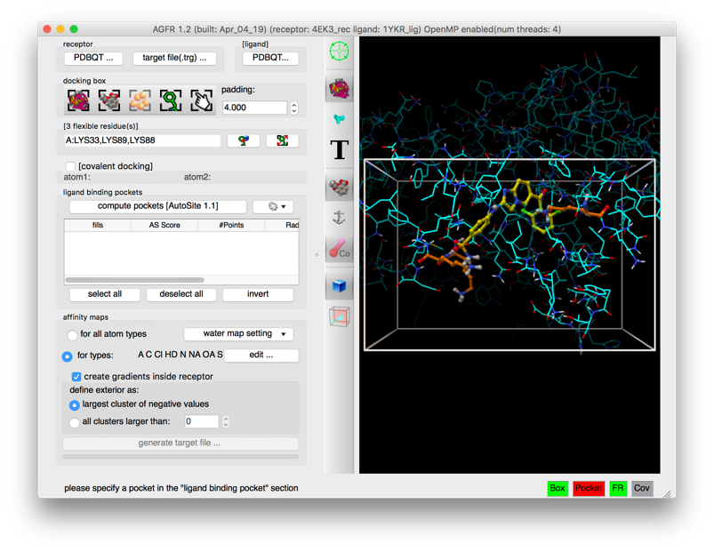

## 7. Binding pockets

**Click on {.icon}**

Ligand binding pockets are computed using [*AutoSite*](/software/autosite/index.qmd) by identifying and clustering high-affinity points. Each cluster of points is called a “fill” and listed in the table widget. The pocket with the largest *AutoSite* score is selected by default and displayed as a set of green dots. The fill points of all selected fills are displayed in the 3D viewer and will be written into the target files.

**Notes:**

- the “Pocket” status light is now green
- the “generate target file …” is enabled.

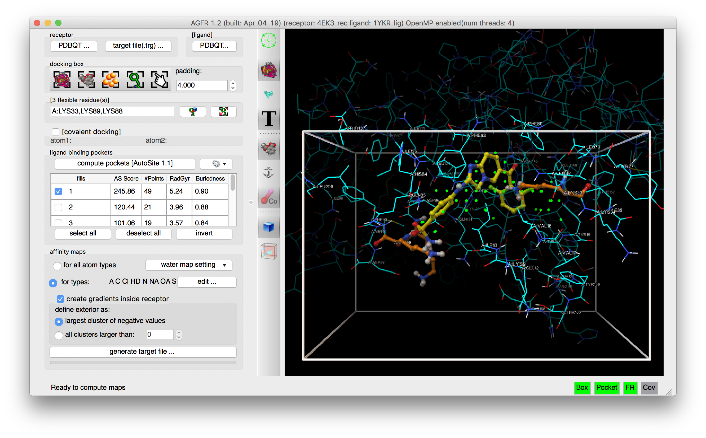

## 8. Maps parameters

**Check the {.icon} button**

 loading the ligand initialized the list of maps to be computed to the list of *AutoDock* atom types found in the ligand, in this case: “A C Cl HD N NA OA”. Computing maps for all atoms types will use a little more disk space but the resulting target file can be used for any ligand and is recommended.

The “edit …” button will display an interface for manually specifying the list of atoms types for which affinity maps are requested.

**Water maps**: water maps are calculated automatically and stored in the target file. These maps are used for [hydrated docking](https://doi.org/10.1021/jm2005145). Their parameters can be set in the “water map setting” pull-down.

**Gradients**: By default, an affinity gradient will be created for the region of the grid covered by the receptor (except for the electrostatic and desolvation maps). If your CPU has multiple cores and OpenMP is detected, the calculation will execute in parallel and the number of available threads appears in the GUI title bar. Gradients are not required, however, they are recommended as they have been shown to help docking find solutions more efficiently. The addition of gradients requires the definition of the *interior* and *exterior* of the receptor. By default, the largest cluster of negative values (favorable affinities) is used to define the exterior of the receptor. In this case, everything else, including receptor cavities large enough to hold solvent but not open to the solvent, will be considered the interior and will be overwritten with the gradient. To prevent the gradient generation on grid points of internal cavities, the user can specify a cluster size above which clusters of points with negative values are considered to be outside the receptor and therefore preserve their original affinity values.

## 9. Generate maps

**Click on the “generate target file…” button, name the target file as 4EK3_FR33_88_89**

The program asks for the name and location for the target file that will be generated. It will then compute the affinity maps and store them in the target file along with meta data.

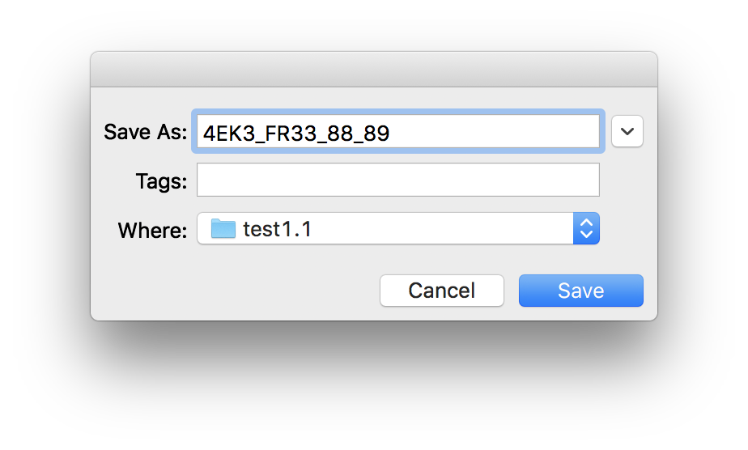

The generated target file describes the binding pocket targeted for docking on the receptor. It stores the PDBQT file of the receptor used to compute the affinity maps, the grid parameter file used to run *AutoGrid,* as well as files generated by the *AutoGrid* run (*i.e.* affinity maps, *AutoGrid* log file, etc.). In addition, it stores meta-data about the generation of the target file such as: the time and computer architecture on which the maps were computed, the docking-box parameters, the grid parameter file, the versions of *AGFR* and *AutoSite*, the water map parameters, etc.

It is recommended to use names that are descriptive. In this case we use 4EK3_FR33_88_89.

Pressing the “Save” button will start the calculation in a separate thread, leaving the graphical user interface responsive. The progress bar below the button will indicate the level of completion of the calculation.

**Note:** a target file can be inspected from the command line using the *about* command (`ADFRsuite-1.0/bin/about`)

::: {.callout-note collapse="true"}
## Review note
- The CCSB text read “type ‘,88’ … en press the key”; the key name was most likely removed by WordPress (treated as an HTML tag). Written here as the Enter key.
- The ligand step says the map list was set from the ligand to “A C Cl HD N NA OA”, the same atom types as the 4EK4 ligand in the first tutorial; check against 1YKR.
- Notes give two different limits for flexible side chains: “below 15” and “below 10 to 15”.
- `ADFRsuite-1.0/bin/about` was written `AutoDockSuite-1.0/bin/about` on the CCSB page; changed to the ADFRsuite folder name. Please confirm.
:::
