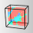
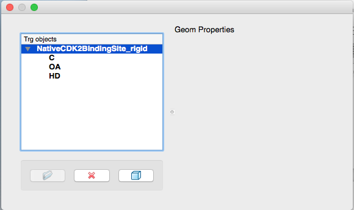
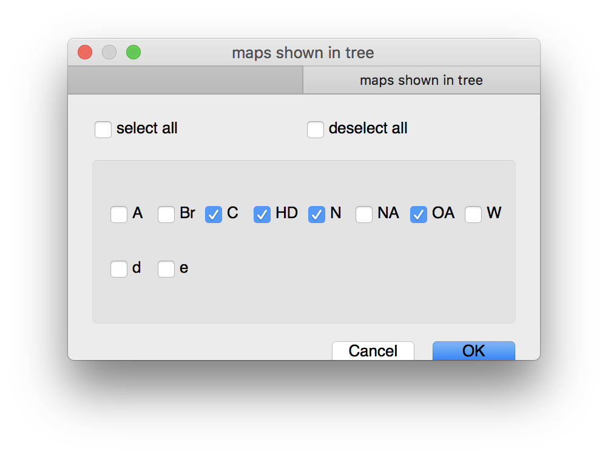
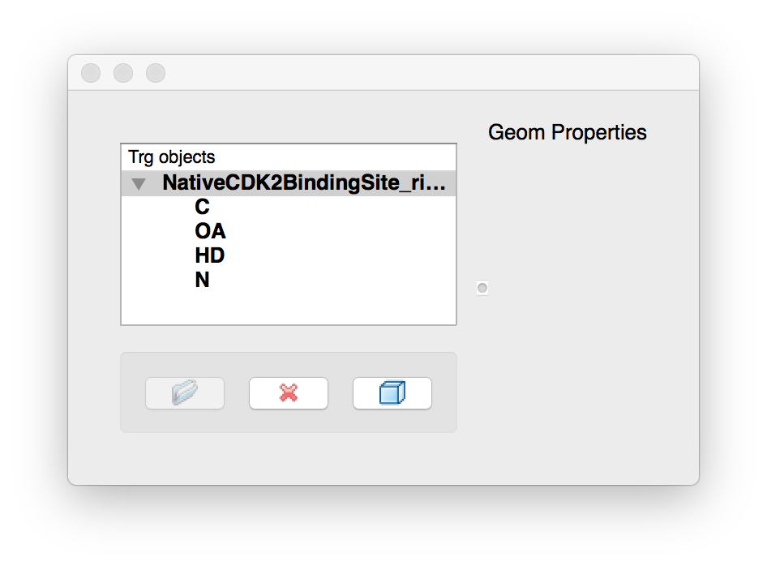
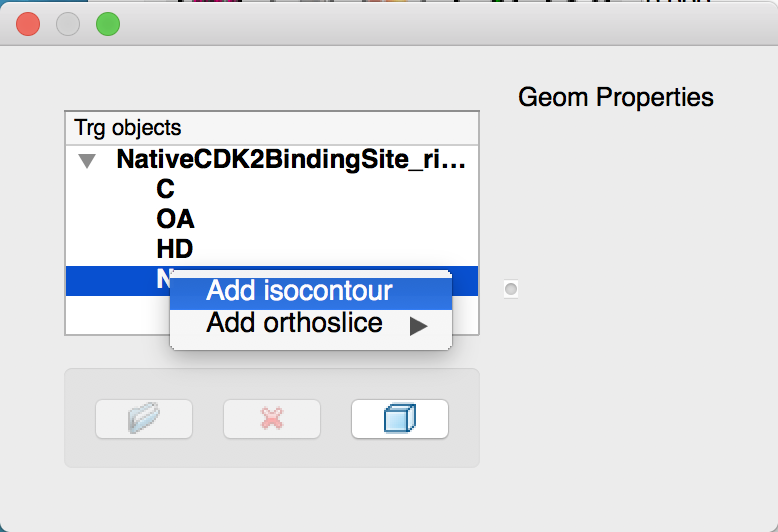
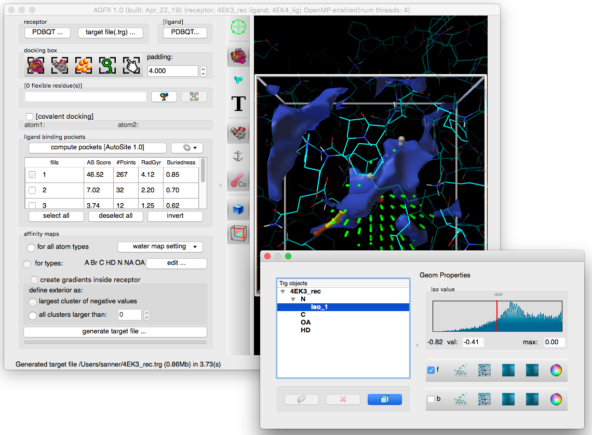

### Visual inspection of affinity maps

Here we assume that you already created or loaded a target file, else the button for inspecting/visualizing maps will be disabled.

## 1. Map viz. widget

**Click {.icon} to display the map visualization GUI**

The graphical user interface for visualizing maps presents a list of target files that can be expanded to show affinity maps. By default, only the carbon (C), Oxygen (OA), and hydrogen (HD) maps are listed.

## 2. Nitrogen map

**Right click on the target file name in the widget to add the nitrogen map**

Right-clicking on the target file name in the widget displays a menu with the “add/remove map” entry.

Selecting this entry will display a dialog allow to select the nitrogen type “N”

## 3. Isocontour

**Right-click on the nitrogen map and select “add isocontour”**

The isocontour is displayed in blue in the 3D viewer. A widget allowing to customize the isocontour is displayed in the GUI. The isocontour level can be modified by dragging the red cursor over the histogram.

**Notes:**

- The range of values for which the histogram is display can be customized using the typein widgets below the histogram.
- The 2 bars of widgets below the histogram control the rendering of the front ‘f’ and back ‘b’ facing polygons of the isocontour mesh. The options are to render the mesh as dots only, a set of lines outlining the triangles in the mesh, a shaded surface, or a shaded surface with a mesh on top. The last button in the bar opens a color picker to define the isocontour color. (you might have to resize the widget horizontally to reveal the button).
- Right clicking on some of these widgets displays an options menu.

## 4. Orthoslice

**Right-click on the nitrogen map and select “add orthoslice -\>Z”**

The orthoslice is display using the default color map. A color map editor widget is displayed in the GUI allowing to interactively modify the hue, saturation, luminosity and opacity of the transfer function. The range of values mapped to colors is displayed below the color map editor along with a slider for moving the slice through the volume.

**Notes:**

- Color maps can be saved to and loaded from files through the File menu
- The number of color entries in the color map can be set under the Edit menu
- Modifications of the color map channels support unlimited undo/redo (CtrlZ/Ctrl R)
- A set of pre-defined maps are available under the Maps menu.
- The 4 channels of the map (hue, saturation, luminosity and opacity) can be changed interactively using the mouse. Shift-Click and drag allows drawing a line to define a linear ramp.
- HSVA channels: think of Hue as the color shade, Saturation as the amount of black you mix in the color, Luminosity is how much white you mix in the color, and Opacity is how opaque the color is (1.0: completely opaque, 0.0 totally transparent).
