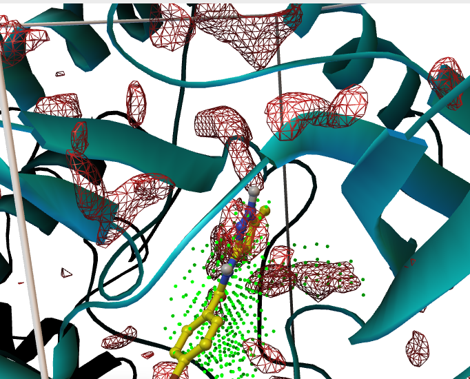
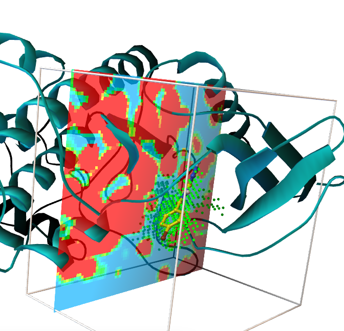

Images made with AutoSite. Click an image to enlarge it.

<!-- To add an image: put the file in software/autosite/img/ and add it inside the gallery block below,
     one image per line with a blank line between images:
     {fig-alt="Short description of what the image shows"}
     -->

::: {.gallery layout-ncol="3"}

{fig-alt="Teal protein ribbons with green pocket points around a yellow ligand and red mesh contours"}

{fig-alt="Protein ribbons in a grid box with a red and blue map slice and green pocket points"}

:::
