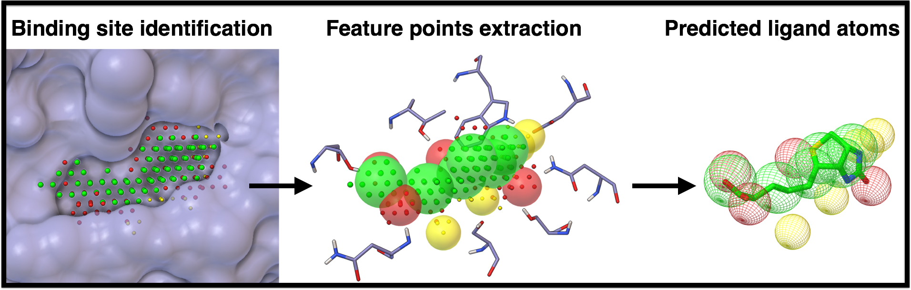

**AutoSite** identifies and characterizes binding sites in macromolecules of known
three-dimensional structure (the receptor). It finds binding sites by clustering high-affinity
points; each cluster corresponds to a potential binding pocket.

Points within a cluster are labeled by their preference for hydrophobic ligand atoms or for
hydrogen-bond donor or acceptor ligand atoms, which gives a "colored" description of the pocket.
From these colored points AutoSite derives a set of putative positions for hydrophobic and
hydrogen-bonding ligand atoms, called **feature points**.

{fig-alt="Three panels: points filling a binding pocket, feature points derived from them, and predicted ligand atom positions overlaid on a ligand"}

In the [published benchmark](https://doi.org/10.1093/bioinformatics/btw367), AutoSite
outperformed state-of-the-art energy- and geometry-based methods at identifying the binding sites
of known ligands. For the 85 ligands of the Astex Diverse Set, it placed feature points of the
right type within 2.0 Å of 79% of hydrophobic ligand atoms, of 81% of hydrogen-bond acceptor
ligand atoms bonded to the receptor, and of 63% of hydrogen atoms forming hydrogen bonds with the
receptor.

::: {.callout-note}
AutoSite is used by [AutoGridFR (AGFR)](../agfr/index.qmd) to identify binding pockets. The
AGFRgui graphical interface runs AutoSite calculations and lets you inspect the clusters of points
that fill the pockets.
:::

## Versions

AutoSite is distributed with [ADFRsuite 1.0](download.qmd), which contains AutoSite 1.0 and 1.1.
In AGFR the version is chosen with `-asv 1.0` or `-asv 1.1`. The AGFR documentation describes
version 1.0 as meant for small molecules, and version 1.1 as somewhat slower but giving better
pocket descriptions for larger ligands such as peptides.

## How to cite

If you use AutoSite in your work, please cite:

- Ravindranath, P. A.; Sanner, M. F. AutoSite: an automated approach for pseudo-ligands
  prediction, from ligand-binding sites identification to predicting key ligand atoms.
  *Bioinformatics* **2016**, 32 (20), 3142–3149.
  [doi:10.1093/bioinformatics/btw367](https://doi.org/10.1093/bioinformatics/btw367)
