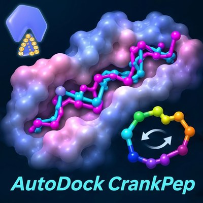
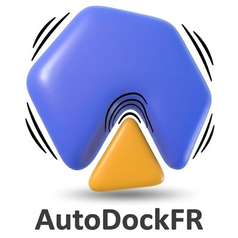
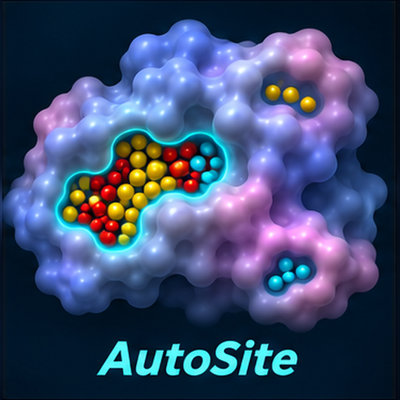
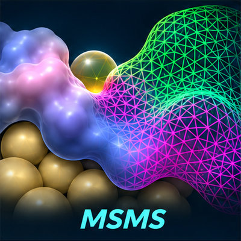
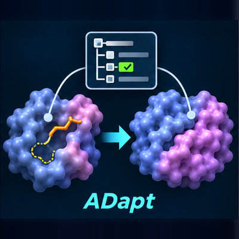
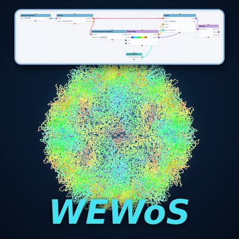
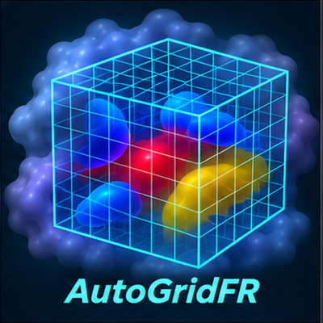
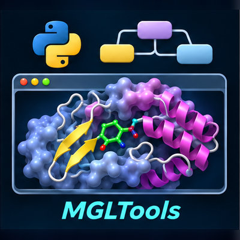

Software developed in the lab. Each tool has an overview, downloads, documentation and, where
available, tutorials. The installers and data files are on GitHub, in
[sannerlab/downloads](https://github.com/sannerlab/downloads/releases).

All the tools are distributed under the [Sannerlab MIT-like Source-Available License](/software/license.qmd); MSMS is covered by it for non-commercial use
only.

## Methods

Programs that compute: docking, pocket detection and molecular surfaces.

::: {.tool-grid}

::: {.tool-card .tc-adcp}
[{.tool-icon fig-alt=""}](adcp/index.qmd){.tool-icon-link aria-hidden="true" tabindex="-1"}

current: 1.1

### [AutoDock CrankPep (ADCP)](adcp/index.qmd)
Docking of linear and cyclic peptides by combining folding and docking.
:::

::: {.tool-card .tc-adfr}
[{.tool-icon fig-alt=""}](adfr/index.qmd){.tool-icon-link aria-hidden="true" tabindex="-1"}

in ADFRsuite 1.0

### [AutoDockFR (ADFR)](adfr/index.qmd)
Protein–ligand docking with explicitly specified receptor flexibility.
:::

::: {.tool-card .tc-autosite}
[{.tool-icon fig-alt=""}](autosite/index.qmd){.tool-icon-link aria-hidden="true" tabindex="-1"}

in ADFRsuite 1.0

### [AutoSite](autosite/index.qmd)
Identifies ligand-binding pockets from affinity maps.
:::

::: {.tool-card .tc-msms}
[{.tool-icon fig-alt=""}](msms/index.qmd){.tool-icon-link aria-hidden="true" tabindex="-1"}

current: 2.6.1

### [MSMS](msms/index.qmd)
Computes molecular surfaces. Free for non-commercial use; commercial use needs a license.
:::

:::

## User interfaces

Graphical tools for preparing, running and looking at calculations.

::: {.tool-grid}

::: {.tool-card .tc-adapt}
[{.tool-icon fig-alt=""}](adapt/index.qmd){.tool-icon-link aria-hidden="true" tabindex="-1"}

unreleased

### [ADapt](adapt/index.qmd)
Prepares receptor and ligand PDBQT files for AutoDock from a PDB entry, in a web browser.
:::

::: {.tool-card .tc-wewos}
[{.tool-icon fig-alt=""}](wewos/index.qmd){.tool-icon-link aria-hidden="true" tabindex="-1"}

in development

### [WEWoS](wewos/index.qmd)
Vision's visual programming in a web browser: connect nodes, see molecules, volumes, images and plots.
:::

::: {.tool-card .tc-agfr}
[{.tool-icon fig-alt=""}](agfr/index.qmd){.tool-icon-link aria-hidden="true" tabindex="-1"}

in ADFRsuite 1.0

### [AutoGridFR (AGFR)](agfr/index.qmd)
Prepares receptors for docking: docking box, binding pockets, affinity maps and target files.
:::

::: {.tool-card .tc-mgltools}
[{.tool-icon fig-alt=""}](mgltools/index.qmd){.tool-icon-link aria-hidden="true" tabindex="-1"}

current: 1.5.7

### [MGLTools](mgltools/index.qmd)
The lab's molecular graphics and modeling software, including PMV and AutoDockTools.
:::

:::
