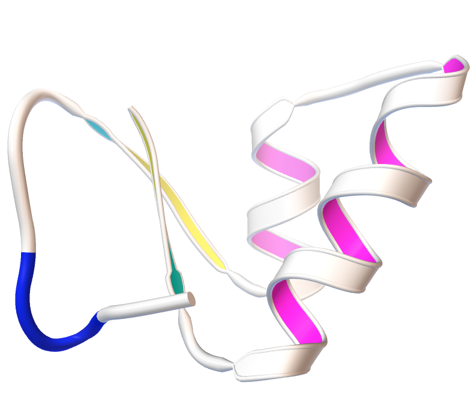
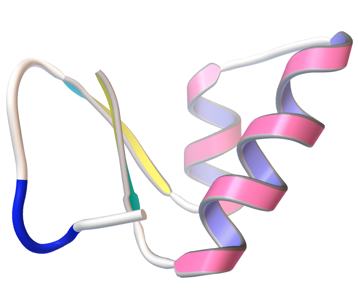
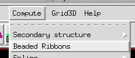
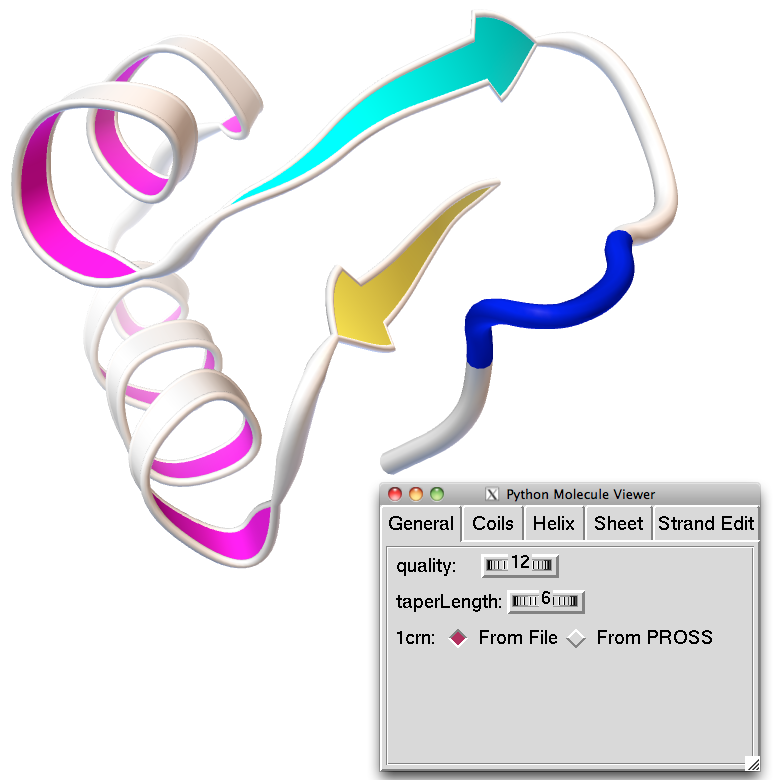
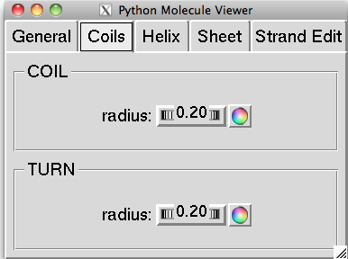
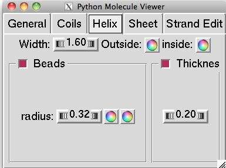
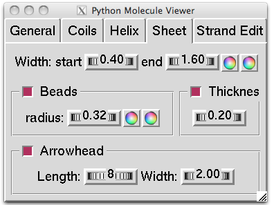
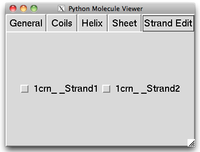

::: {layout-ncol="2"}
{fig-alt="Beaded ribbon rendering"}

{fig-alt="Beaded ribbon rendering"}
:::

With Pmv 1.5.6 we introduced a new Ribbon model called “beaded Ribbon”. This model provides a smooth transition between coils, strands and helices.

The model is made of cylinders for coils and turns that seamlessly merge into sheets for helices and strands. All aspects of this representation can be controlled by the user. The command is invoked through the Compute menu:

{fig-alt="Screenshot of PMV"}

The beaded ribbon will be computed for all molecules in the current selection (or all molecules in Pmv if nothing is selected) using the default set of parameters

{fig-alt="Screenshot of PMV"}

A Graphical User Interface (GUI) is provided allowing modifying the various parameters defining the representation.

The “general” panel of the GUI defines the overall **quality**, which specifies the number of points per residue used for representing the ribbon. The **taperLength** parameter indicates how many such points are used to morph between cylinders in coils and turns, and the start of strands and start and end of helices. Finally, for molecules providing secondary structure information in the file they were read from, this panel offers a choice of secondary structure element definition based on the information in the file or assigned programmatically using PROSS.

{fig-alt="Screenshot of PMV"}

The Coils panel provides access to coils and turns related parameters. Since coils and turns are represented using a single cylinder, the only parameters are the cylinder radius and the color.

{fig-alt="Screenshot of PMV"}

The Helix panel provides control over Helix related parameters, including the width of the 2 sheets and their colors (inside sheet and outside sheet). The beads (i.e. the 2 cylinders flanking the sheets) can be turned off by un-checking the “Beads” check button. This will hide the controls for the Beads parameters. When beads are displayed, the radius can be set using the thumbwheel and the color of each bead can be set using the color picker buttons.

Likewise, the thickness (i.e. the distance between the 2 sheets) can be controlled through a thumbwheel. When the Thickness check button is un-checked, this control is hidden and there will be a single polygonal sheet displayed.

{fig-alt="Screenshot of PMV"}

The Sheet panel provides control over parameters defining the rendering of strands in beta sheets. The body of the arrow representing a strand is located between the end of the initial taper and the base of the arrowhead. The width at the beginning and the end of the body can be set along with the colors used for either side of the sheet, using the top row of controls. The additional three groups of control allow to specify whether or not beads, arrowhead, and double faces are drawn or not. When these elements are drawn (i.e. the check button is checked) controls allow specifying bead radius and color of the bead on either side, separation between the 2 sides of the sheet (i.e. thickness), and the length of the arrowhead (in number of points) and the width at the base of the arrow head.

{fig-alt="Screenshot of PMV"}

The last panel in the GUI provides a series of check buttons, one for each sheet. Checking and un-checking these buttons allows swapping the first and second side allowing to achieve uniform coloring of outside and inside faces in a TIM barrel structure for instance.

NOTE: the current implementation does not allow this geometry to be printed as a 3D model.

NOTE: Unlike the traditional ribbon representation, which can be displayed for any subset of residues, the beaded ribbon geometry cannot be displayed for less than a molecule.
