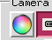
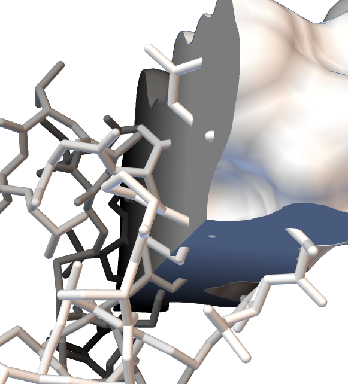
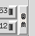

The **Camera Tools** group controls common attributes of the 3D Viewer rendering window (the
camera).

**Background and fog.** Set the background color with the color wheel button
. Depth cueing mixes the background color into
the color of displayed objects according to their distance from the viewer; this fog-like effect
enhances 3D perception. By default the fog color is the same as the background color. Clicking the
chain icon  between the two color wheel buttons
stops the fog color from following the background. Once the link is broken
, the second color wheel button becomes enabled
and sets a fog color different from the background color. The picture below shows a white
background with black fog.

{fig-alt="White background with black fog" width=420}

**Anti-aliasing.** The AA button  sets the
level of anti-aliasing. Anti-aliasing smooths the edges of lines and polygons by redrawing the
scene several times while jittering the camera and accumulating pixel values. The higher the AA
number, the smoother the edges; but since it is the number of times the scene is drawn, rendering
can slow down. Modern graphics cards usually support 4×AA in hardware with no noticeable
performance penalty.

**Clipping and fog range.** The clipZ thumbwheels
 set the near and far clipping planes, which
define the start and end of the 3D scene along the viewing axis. The fog thumbwheels
 set where the depth-cueing fog begins and
ends, unless the fog is tied to the Z clipping planes; then it follows the near and far planes
automatically. The vertical chain button  to
the right of the thumbwheels ties the fog to the Z clipping planes.
