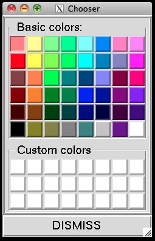
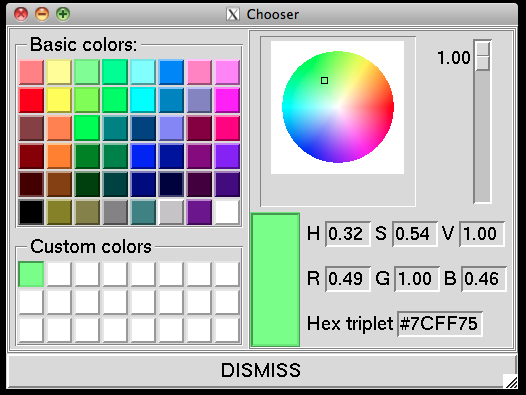

The new color chooser widget provides 48 predefined colors (Basic Colors) and 24 user-defined
colors (Custom Colors).

When a custom color chip is selected, a color editor appears to the right. Pick a hue and
saturation by moving the cursor on the color wheel, and set the value with the slider to the right
of the wheel. You can also type HSV or RGB values between 0.0 and 1.0, or a hexadecimal triplet
with each component from 00 to FF.

Custom colors persist across PMV sessions: custom colors defined in any PMV tool are saved
automatically and restored in later sessions.

::: {layout-ncol="2"}

:::
