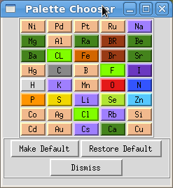

Color palette widgets set the colors used for atoms, residues, chains or molecules. Open them
through the **Edit → Color Palettes** menu; the screenshot below was made with
**Edit → Color Palettes → Edit Color by Atom Type**.

Click a colored button to open the [color chooser](color-chooser.qmd) and change the default
color. Geometries update as soon as you select a color, and the modified palette is used for the
rest of the PMV session whenever you color molecules. To keep the modified palette for future
sessions, click **Make Default**. **Restore Default** brings back the defaults shipped with PMV.

