With Pmv 1.5.6 we introduce a completely re-designed dashboard widget that facilitates carrying out Pmv commands that previously required navigating through several menus and forms with a single click. This interface presents molecules and molecular fragments in a tree structure. The matrix of buttons to the right of the tree is used to carry out the Pmv command corresponding to the column on the molecular fragment corresponding to the line. For instance, in the picture below, the crosshair is on the ‘S’ column which is the Pmv selection command and the chain ‘B’ line under protease, a protein loaded in Pmv. As the tooltip indicates, clicking a first time on this square button will select the chain B of protease. Clicking a second time on this button will deselect the entire protein.

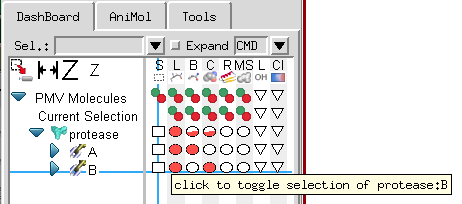{fig-alt="Screenshot of PMV"}

The Pmv commands mapped to the columns of buttons are: select 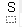 , display lines 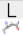 , display balls and sticks 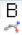 , display CPK 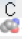 , display Ribbon  , display molecular surface 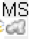 , display labels 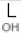 , and color 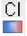 commands. Tooltips indicate the function of each button.

There are three types of buttons in the Dashboard. The first type 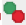 is a stateless button with 2 functions: the green circle carries out the command (i.e. select, display, label) while the red circle negates the command (i.e. deselect, undisplay, unlabel).

The second type of buttons (e.g.  ,  ,  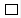 , 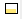 ) show the fraction of the group for which the state is on. In the picture above, all of protease is displayed as lines so there are full solid red circles in the display line column, while only chain A is displayed as balls and sticks so the circle for chain A displayed as balls and sticks is solid while the circle for balls and sticks for protease is ½ solid (i.e. 1 chain out of 2). Clicking on a button that has less than 100% of its children on forces the command on all children. Clicking on a button that is completely on (solid) negates the command. In other words, the cycle is  ⇒  ⇒ 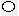 ⇒ 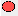 … where ⇒ represents clicking on the button.

In general, left clicking on a button carries out the command with default parameters, while right click opens an option panel specific to the command. However, there are exceptions. For instance, the menu buttons for labeling and coloring have no action associated with the right click event while the selection command has a selection menu associated with the right click.

### Molecular Fragment menu

Right clicking in a molecular fragment in the tree widget will bring up a menu that will vary based on the fragment. For instance, right clicking on “Pmv Molecules” triggers the read molecule command that displays a file browser for selecting a molecular file to read. Right clicking in “Current Selection” offers the options: to split the selection (i.e. make the current selection a different molecule) or to show the selection in the 3D Viewer by translating and scaling the scene. Right clicking on a molecule displays a longer menu with options to delete the molecule, view the text file from which the molecule was read, etc…

### Working with the ‘Current Selection’

Pmv has powerful commands for creating selections. In the dashboard, one can type [selection strings](selection-strings.qmd) 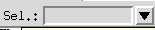 to create a selection or use the button in the left most column  . The line of buttons located to the right of ‘Current Selection in the tree 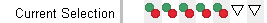 supports operations on the current selection. Note that there is no button on in the Select column of that line, since selecting the current selection does not do anything.

### Creating custom sets

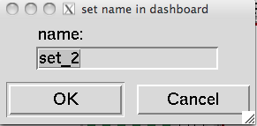{fig-alt="Screenshot of PMV"}

A Pmv selection can be saved as a new line in the Dashboard to facilitate rapid Dashboard-based operations on this specific subset. This is done using the 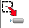 button in the upper left corner. When this button is clicked on and there is a selection, a dialog is displayed asking for a name for the set.Clicking ‘OK’ in this dialog will add a line to the dashboard tree widget 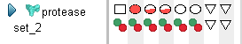 .

Sets can be renamed or removed through the menu obtained by right clicking on the set name in the tree widget.

### Configuring the Dashboard

The button located above the tree widget sets the dashboard width so that all command columns are visible ( 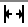 ), increases the size of the command button ( 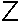 ), and decreases the size of the command buttons ( 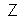 ). Note that the height of the lines in the tree is fixed, which causes the circles to become ovals for large button sizes.

### The selection command menu

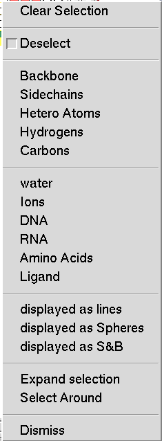{fig-alt="Screenshot of PMV"}

This menu is obtained by right clicking on the buttons in the select command column. It allows the user to tailor the selection by specifying groups of atoms to add or remove from the selection. By default, atoms are added to the selection. To remove parts of the selection, first check the ‘Deselect’ button then specify the atom set using the next five entries, which are shortcuts for selecting common subsets of atoms. Here, **Hetero Atoms** are the atoms from HETATM records in PDB files.

The following 6 sets are predefined as follows:

- **water**: residue name is WAT or HOH
- **Ions**: residue name is in the list <http://decogroup.org/ion_list.txt>
- **DNA**: residue name is one of DC, DG, DA, DT, DI, or N.
- **RNA**: residue name is one of C, G, A, U, I, N.
- **Amino** **Acids**: residue name is one of ALA, CYS, ASP, GLU, PHE, GLY, HIS, ILE, LYS, LEU, MET, ASN, PRO, GLN, ARG, SER, THR, VAL, TRP, TYR, or the residue name is declared as a modified residue in the PDB file using a MODRES record. Common example of such names are: HID, HSP, HIE, HIP, CYX, CSS, ACE, MSE, 5HP, SOC.
- **Ligand**: anything that is not water, Ions, DNA, RNA or an amino acid.

In addition this menu supports selecting atoms based on their current representation. In this particular case, the atoms are displayed as lines, spheres as well as balls and sticks. The list of options in this section will change based on the representation that are displayed.

The last section for expanding the selection and selecting around the current selection will only appear if there is a current selection. Expanding the selection will select atoms located within a user-specified distance from any currently selected atom. As the cutoff is modified, cyan colored spheres show what would be selected for the current cutoff value. The selection expands only to atoms belonging to the molecular fragment on the line on which the selection menu was activated. In the picture below, the current selection is the small molecule (indinavir). The menu was activated on protease in order to expand the selection atoms in protease. Once the “Expand selection” menu entry is activated, a counter is displayed with a cutoff value that can be modified. The selection operation is performed by clicking on the green button to the right of the cutoff value or cancelled using the red button.

Select around behaves the same as expand selection but will deselect the current selection and only keep the atoms in the vicinity of the current selection selected.

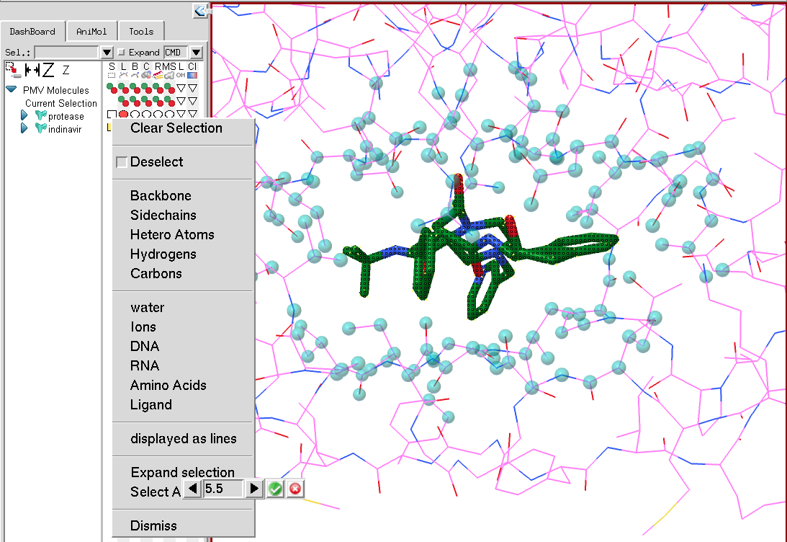{fig-alt="Screenshot of PMV"}

### Coloring Menu

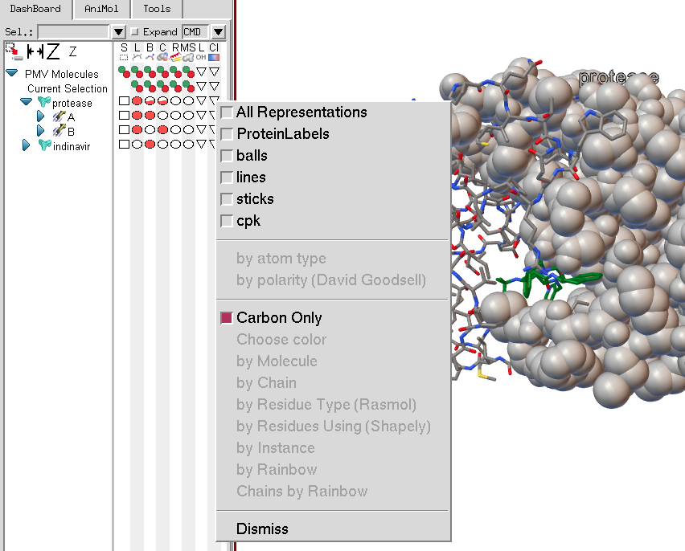{fig-alt="Screenshot of PMV"}

The coloring menu will list all current representations for the molecular fragment on which the menu is invoked. In this case, protease has cpk spheres, balls and sticks, lines and a protein label. Note that the coloring menu entries are disabled as currently no representation has been selected. If there were only one representation available, its check button would be checked by default when the menu was displayed.

Once at least one representation to be colored has been selected, the coloring commands in the menu become active.

The first two coloring commands are (1) color by atom type using a user modifiable atom type color palette, and (2) color by polarity according to a scheme developed by David Goodsell, in which carbon atoms are colored white, polar oxygens are colored pink and charged oxygens are colored red, polar nitrogen are colored light blue and charged nitrogen are colored bright blue, sulfur and phosphorus are yellow, and hydrogens are colored the same as the atoms they are bonded to.

The next set of 8 coloring commands have an additional option, which is to choose to apply the coloring scheme only to the carbon atoms in the molecular fragment on which the menu was invoked. Choose color opens a color picker widget to use to pick a color. Color by molecule and by chain will color each molecule or chain differently using a user-modifiable palette. Color by residue type uses predefined amino acid colors. Color by rainbow performs an N to C coloring along the molecule’s sequence using a rainbow colormap. Color Chains by Rainbow will only appear if the menu is invoked on a molecule. It will apply the rainbow map to each chain in the protein.

### Labeling

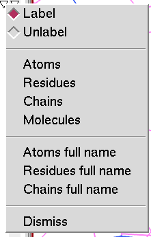{fig-alt="Screenshot of PMV"}

The Labeling menu lets the user add and remove atom, residue, chain or molecule labels. Full labels are composed of 4 strings separated by colons MolName : ChainName : ResidueName : AtomName.

::: {.callout-note collapse="true"}
## Review note
The ion list linked above (`http://decogroup.org/ion_list.txt`) no longer exists (404,
2026-10-14).
:::
