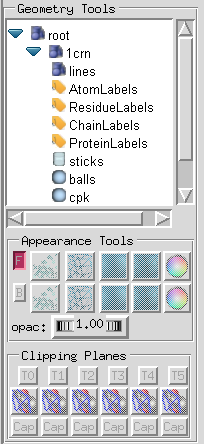
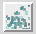
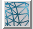
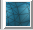
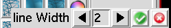
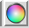
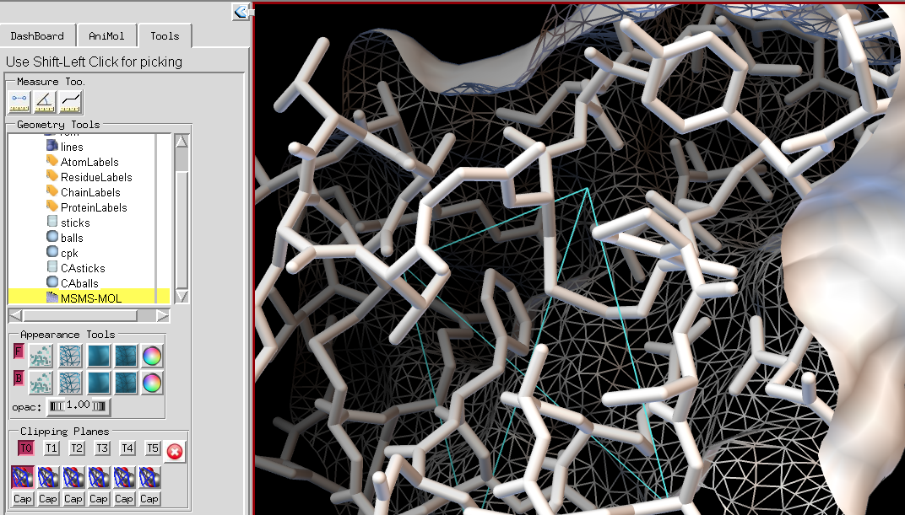
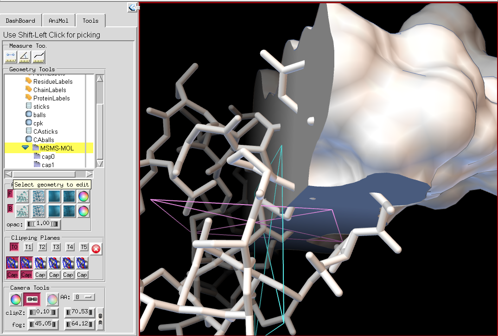

{fig-alt="Geometry Tools group"}

The **Geometry Tools** group provides a way for the user to set common rendering attributes for geometries displayed in the 3D Viewer. A tree widget reveals a “root” object, which is the parent of every geometry displayed in Pmv. This widget is used to select a geometrical object for which rendering attributes will be modified using the Appearance Tools and Clipping planes interfaces located below the tree. Note that when no geometry is selected, the appearance and clipping planes widgets are disabled.

Every molecule loaded in Pmv creates a child of the root object named after the molecule (e.g. 1crn). The children of the molecule node are the geometrical objects displayed in the 3D Viewer to represent this molecule in various ways. This list may vary based on the representations calculated and shown for a particular molecule. Nodes in this tree can be expanded and collapsed by clicking on the blue triangular shape located to the left of the node’s name.

A geometrical object is selected by clicking on its name. A yellow background identifies the current geometrical object.

Once a geometrical object is selected the **“Appearance panel”** lets the user specify whether this object should be rendered with front and/or back faces as well as which rendering mode (points, lines, Gouraud shaded, Outlines Gouraud shaded) is used for front and for back facing polygons as well as the color and opacity of the front and back polygons of this geometrical object.

The top row of buttons in the Appearance Tools group pertains to the front facing polygons (i.e. polygons with a normal vector pointing toward the camera or person viewing the scene). The first button  toggles the visibility of front facing polygons and is on by default. The next 4 buttons respectively set the rendering of front facing polygons to: points  , lines  , Gouraud shaded  and outlined Gouraud shaded  . For point and line rendering, right clicking on the button opens an interface for setting rendering parameters such as point and line width  . Numerical values can be typed in or incremented and decremented using the counter widget’s arrows. Clicking on the green check button sets the value and dismisses the interface, while clicking on the red button dismisses the interface without setting the value. The last button in the row  invokes the [color chooser](color-chooser.qmd). The opacity thumbwheel is used to set the opacity of the front facing polygons. The second row of buttons performs the same functions for the back facing polygons.

The “**Clipping Planes**” group provides an interface for enabling/disabling, transforming and capping arbitrary clipping planes. The 3D Viewer in Pmv supports up to 6 arbitrary clipping planes, each of which can be enabled or disabled for any geometrical object displayed in PMV. By default when a clipping plane is enabled it will clip all children geometries. Clipping planes 1 through 6 are enabled using the middle row button. The top row of buttons supports binding the 3D viewer’s virtual trackball used to create 3D transformations such as translations and rotations to a given clipping plane. When a clipping plane is transformed, its graphical representation is drawn in the 3D Viewer. Moreover, a red button is added at the right end of the top row, which can be used to stop transforming the clipping plane and restore transformation of the 3D scene. The left mouse button rotates the clipping plane. The right mouse button translates the clipping plane in X and Y screen coordinates. Shift right translates the plane along its normal.

{fig-alt="Screenshot of PMV"}

The last row of buttons is used to “cap” a particular clipping plane. Currently capping only works properly if the edge of the clipped geometrical object has a single connected component. It is possible to use multiple clipping planes on the same geometry with caps. The caps appear in the 3D Viewer as children of the clipped geometrical object, thus allowing control over the rendering of the caps.

{fig-alt="Screenshot of PMV"}
