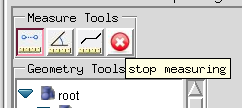
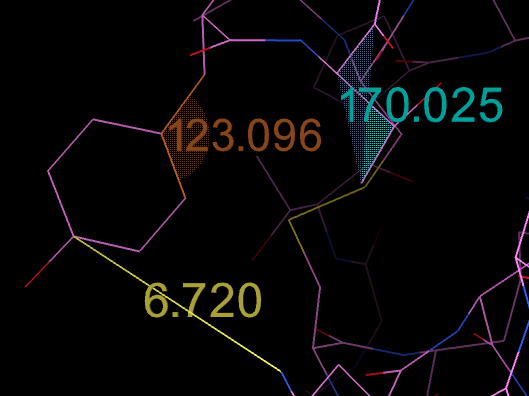

The top row of buttons under the label **Measure Tools** turns on measuring of distances, angles
or torsion angles by Shift + left-click picking. Once a measuring button is pressed, an extra
button (a white cross on a red background) appears at the right end of the row. It stops measuring
and restores the normal function of Shift + left-click.

While measuring, select atoms in the 3D Viewer by left-clicking on them with the Shift key held
down. Small spheres are drawn on the selected atoms. Each time the number of spheres the
measurement needs is reached (2 for distances, 3 for angles, 4 for torsions), a line, an angular
wedge or a bi-triangle is drawn with the measured value. Each tool uses its own color. Stopping
the measuring tools removes these visual cues.

