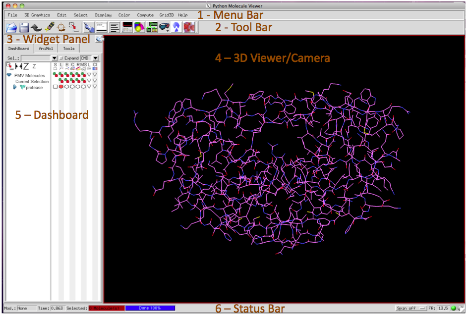
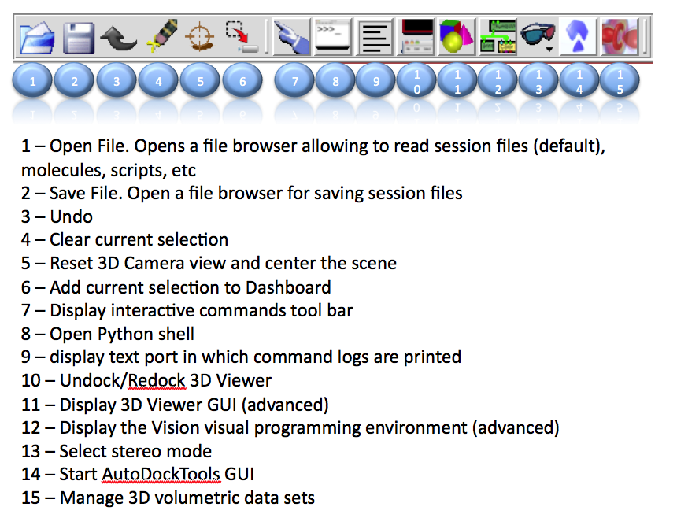
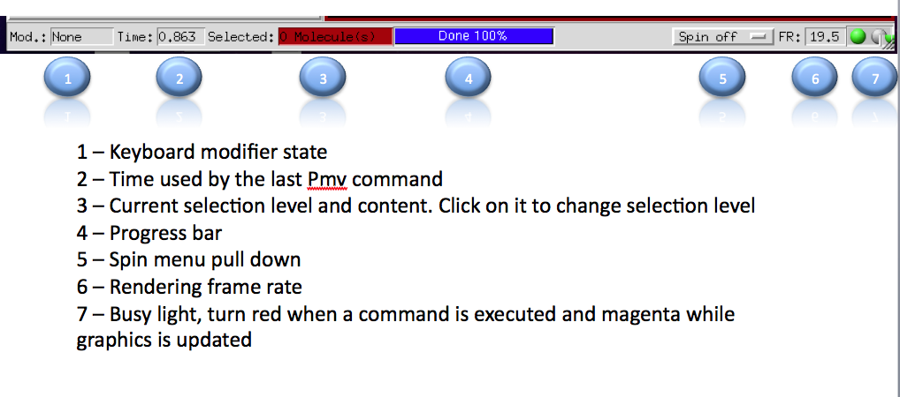

PMV's graphical user interface (GUI) is made of 1) a menu bar at the top, 2) a toolbar below the
menu bar, 3) a panel in which tools place their controls (here the [Dashboard](dashboard.qmd),
the default panel shown in this area), 4) the 3D Viewer window, in which molecules are rendered
interactively as 3D objects, and 5) a status bar.

## Menus

Before the Dashboard was added, most PMV commands were reached through menus. PMV loads commands
dynamically as they are needed, so if a command does not appear in the menus, use
**File → Browse Commands** to check whether it is available in a module that is not loaded yet.
Conversely, you can edit the `_pmvrc` file to stop PMV from loading commands you do not need.

## Toolbar

The toolbar provides buttons that are shortcuts for common actions in PMV.

## Status bar

