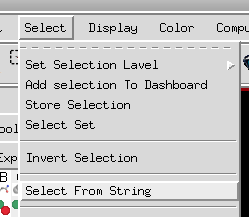
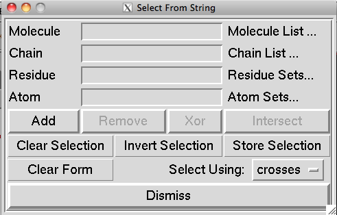
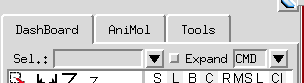

Among the various ways molecular fragments can be selected in Pmv, selection strings are one of the most powerful selection mechanisms.

Pmv stores molecules in a hierarchical data structure with 4 levels: Molecules contains Chains, made of Residues, containing Atoms. A Pmv selection string is a `:`-separated set of 1 to 4 expressions where the first expression will select one or more molecules, the second expression if present will select chains among these molecules, the 3^rd^ expression will select residues in these chains, and finally the 4^th^ expression if present will select atoms in the previously selected residues. The result of such a selection will be a set of Molecules, Chains, Residues, or Atoms depending on the number of expressions.

```
Mol selector [: [Chain selector] [: [Residue selector] [: [Atom selector]]]]
```

Multiple selection strings can be combined, separated by `;`.

### Expressions syntax

Expressions can be strings, sometimes numbers or ranges of numbers, or lambda expressions (i.e. a Python function with no name).

An **empty string selects everything**. For example:

`:::` will select all Atoms in all Residues in all Chains in all Molecules in Pmv

`Mol1::` will select all Residues in all Chains in molecule Mol1

`Mol2:B::` will select all atoms in Chain B in molecule Mol2

A **comma-separated list** of items can be used in an expression. For instance:

`Mol1, Mol2:::C,N,CA,O` selects backbone heavy atoms in molecules Mol1 and Mol2

A **Range** can be specified using the `-` character.

`::ALA35-THR45` selects a range of residues

`1CRN-2PLV` selects all molecules in the list of molecules loaded in Pmv starting at and including 1CRN and ending and including 2PLV. This will only work if 1CRN was loaded before 2PLV. Else an empty set is returned.

Expressions can contain **common regular expressions** such as `.` to match any single character, `*` to match any number of any character, and `[1235]` to match the numbers 1 through five in a single position.

`::..N*` selects all Residues with the third letter in its name being an N followed by any string

`::...[23].` selects all Residues with names made of exactly 5 characters and where the 4^th^ character is either 2 or 3

**Relative positions** in a list can be indicated by using the `#` symbol in front of a number.

`#2,#5` selects the 2^nd^ and 5^th^ molecule

`Mol1:C:#1-#5` selects the first 5 Residues in Chain C of molecule Mol1

Names of **predefined sets** can also be used in expressions. Names will be matched at the level of the elements they contain. A list of standard predefined set names is available [here](predefined-sets.qmd). Sets defined by the user will be matched as well.

### Molecule selectors

Molecular selectors match the expression against the molecule names. They support regular expressions, relative indices, lists and ranges.

### Chain selectors

Chain selectors match the expression against the chain’s id. They support regular expressions, relative indices, lists and ranges.

### Residue selectors

Residue selectors usually match the expression against the Residue name, which is a concatenation of the 3-letter Residue type (e.g. ALA, TYR, etc) and the Residue number from the PDB file (e.g. 3, 4A, etc.). One letter amino acid code can also be used (available [here](predefined-sets.qmd)). Regular expressions, relative indices, lists, and ranges are supported.

### Atom selectors

Atom selectors match the expression against the atom name. Regular expressions, relative indices, lists, and ranges are supported.

### Where to use selection strings

Selection strings can be used in the select from String command, which is accessible through the select menu.

{fig-alt="Screenshot of PMV"}

{fig-alt="Screenshot of PMV"}

or through the [dashboard](dashboard.qmd) using the Sel. Entry field:

{fig-alt="Screenshot of PMV"}

::: {.callout-note collapse="true"}
## Review note
- The text says `[1235]` matches "the numbers 1 through five"; as a regular expression it matches
  1, 2, 3 or 5. Kept as on the original page.
- WordPress turned `...` into a single ellipsis character in the example `::...[23].`; restored
  to three dots here.
:::
