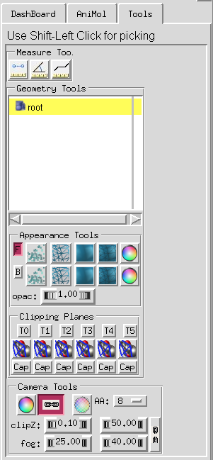

The Tools panel, located in the [widget panel](widget-panel.qmd), contains the graphical
interfaces of a variety of tools, most of them for the 3D Viewer in PMV. The tools are organized
in sections, each a group of widgets:

- [Measuring tools](measure.qmd): measure distances, angles and torsion angles
- [Geometry tools](geometry-tools.qmd): change the rendering properties of a geometrical object
  in the 3D Viewer
- [Camera tools](camera.qmd): change common parameters of the 3D rendering window

{width=320}
