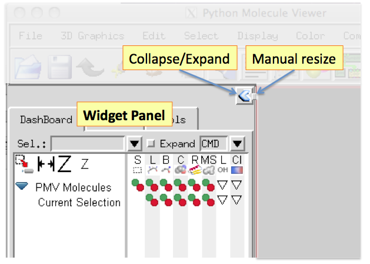

PMV 1.5.6 introduces a new panel to the left of the 3D Viewer. It holds the graphical interfaces
of various tools in a notebook widget, for example the [Dashboard](dashboard.qmd) and the
animation component Animol.

The **Collapse/Expand** button in the upper right corner of the panel shrinks the panel to a
minimal width, or expands it back to the width it had before. Set the expanded width by dragging
the **Manual resize** handle.

