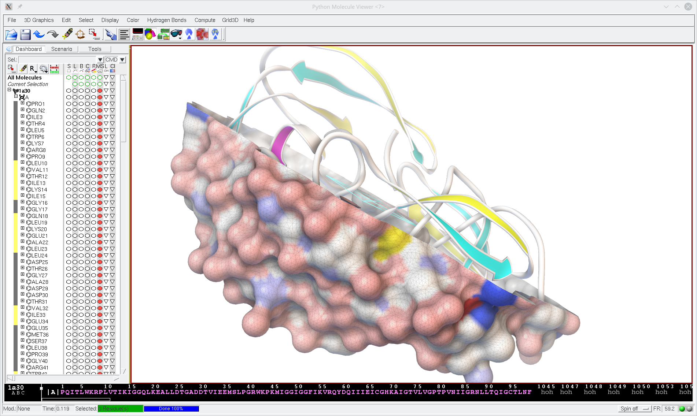

::: {.callout-warning}
**macOS users:** MGLTools does not work under macOS Catalina (10.15). The CCSB site advises not
upgrading to Catalina; if you already use it, install
[VirtualBox](https://www.virtualbox.org/wiki/Downloads) and run MGLTools inside a virtual machine.
:::

The MGLTools software suite was developed in the Sanner lab at the Center for Computational
Structural Biology (CCSB), formerly the Molecular Graphics Laboratory (MGL), at Scripps Research,
for the visualization and analysis of molecular structures. MGLTools comprises:

- the **Python Molecular Viewer (PMV)**, a general-purpose molecular viewer
- **AutoDockTools (ADT)**, a set of PMV commands developed to support AutoDock users
- **Vision**, a visual programming environment

These tools are highly integrated and built from reusable software components implemented in
Python and C++ (with Python bindings). The graphical toolkit is Tk.

MGLTools is still widely used, but the lab has shifted the development of its graphical interfaces
to Qt and will gradually replace these tools with Qt-based versions. The first such tool is
[AGFR](/software/agfr/index.qmd), a tool for specifying, computing and visualizing AutoDock
affinity maps.

{fig-alt="The PMV 1.5.7 main window"}

## Versions

| Version | Status | |
|---|---|---|
| **1.5.7** | latest | [About 1.5.7](1.5.7/index.qmd) · [Download](download.qmd#version-1.5.7) |
| 1.5.6 | previous stable | [About 1.5.6](1.5.6/index.qmd) · [Documentation](1.5.6/index.qmd#documentation) · [Download](download.qmd#version-1.5.6) |

Patched builds of both versions (October 2022) are listed first on the [Download](download.qmd)
page.

## MSMS

MSMS, the molecular surface program, can be downloaded separately from MGLTools:
[MSMS downloads](/software/msms/download.qmd).

::: {.callout-note collapse="true"}
## Review note
- The Catalina warning dates from 2019 and says an email will go to the mailing list when a fix
  exists; check whether it still reflects the current state on newer macOS versions.
- The CCSB page links AGFR to `http://agfr.scripps.edu`, which no longer responds; linked to
  the AGFR page on this site instead.
- The CCSB page names the center "CCRB"; written as CCSB here.
:::
