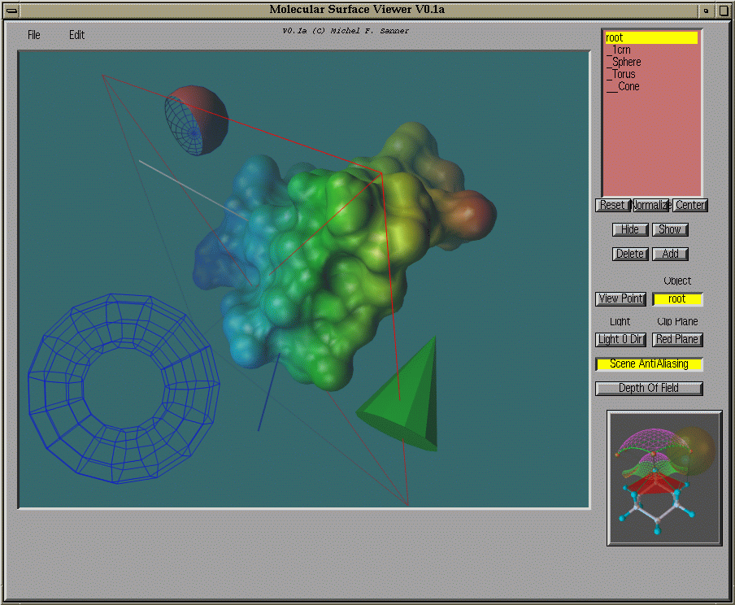
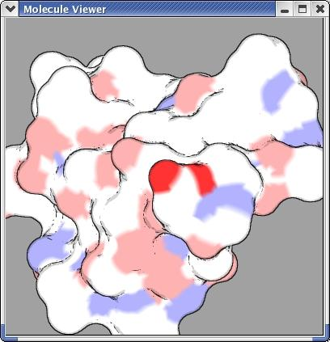

Images made with MSMS. Click an image to enlarge it.

<!-- To add an image: put the file in software/msms/img/ and add it inside the gallery block below,
     one image per line with a blank line between images:
     {fig-alt="Short description of what the image shows"}
     -->

::: {.gallery layout-ncol="3"}

{fig-alt="Screenshot of the Molecular Surface Viewer V0.1a window with a smooth green-to-blue crambin molecular surface, wireframe torus and sphere, and a cone."}

{fig-alt="Close-up of a white molecular surface with black outline edges and pink, red and blue patches, in a Molecule Viewer window."}

:::
