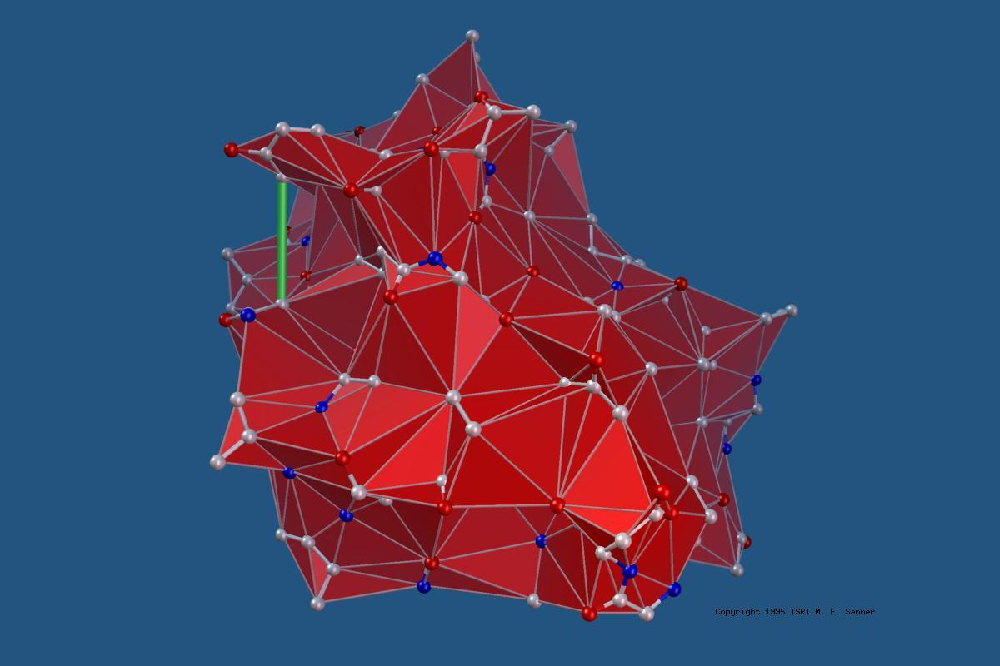
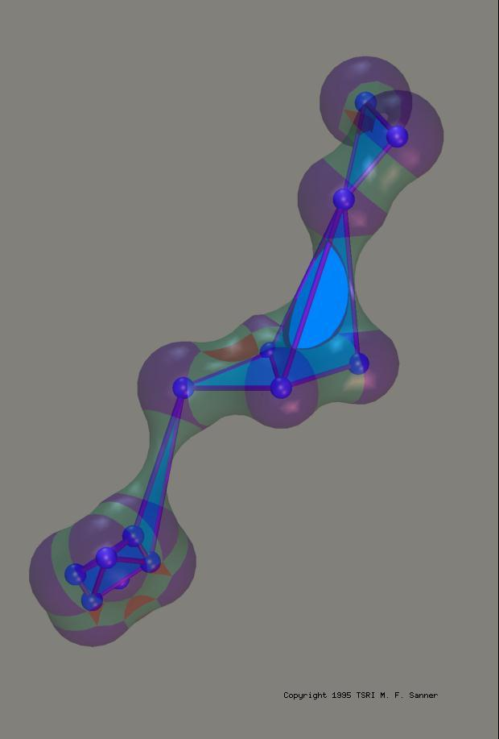
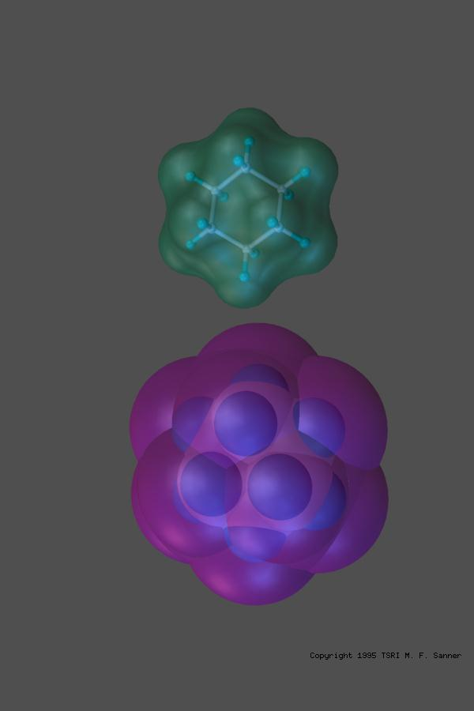
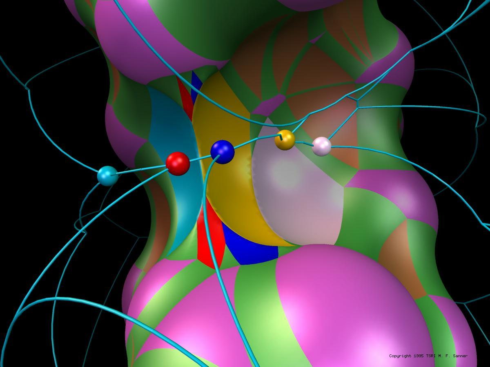
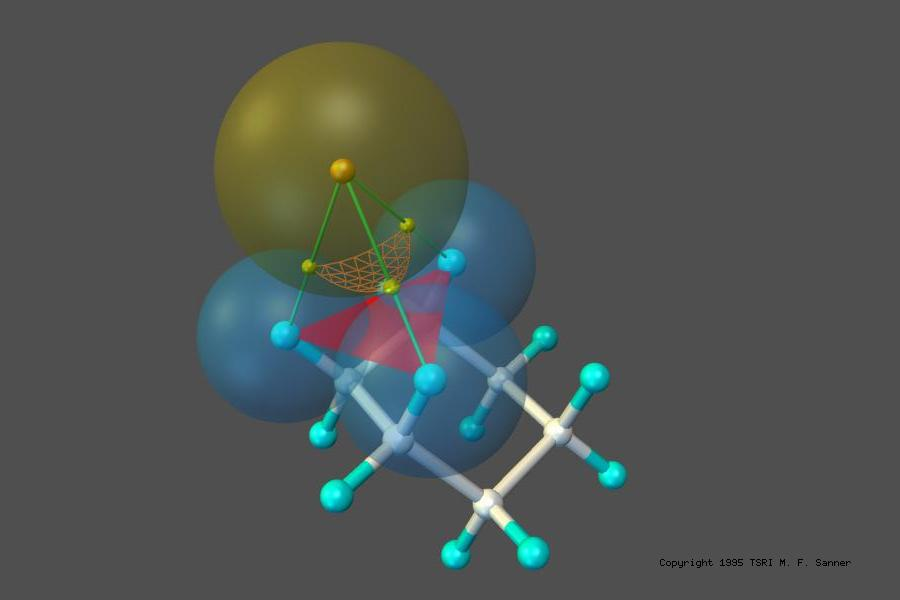
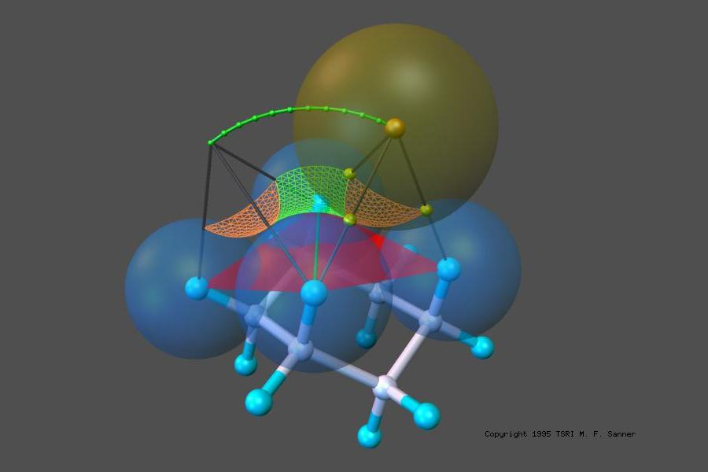
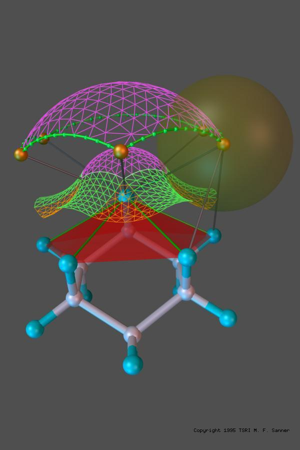

**MSMS** is a fast algorithm for computing molecular surfaces. Michel Sanner developed it as part
of his Ph.D. thesis. It has been widely used to compute and display the solvent excluded surface
(SES) of proteins. This surface is also known as the Lee and Richards surface, after the authors
who first defined it by rolling a probe sphere, representing a solvent molecule, over the spheres
representing the protein atoms. It is also called the Connolly surface, after Mike Connolly, who
wrote the first program to compute it analytically.

MSMS is used by several molecular visualization programs, including VMD, Chimera and our own PMV.
It is available as a [standalone program](download.qmd), and as a library with Python bindings in
the MGLTools and ADFRsuite distributions.

::: {.callout-note}
MSMS is free for academic research and teaching. Commercial use needs a license; see
[License](license.qmd). MSMS is not open source.
:::

::: {.gallery layout-ncol="3"}

{fig-alt="Reduced surface of a molecule: a triangulated polyhedron connecting atom centers"}

{fig-alt="MSMS illustration: reduced surface"}

{fig-alt="MSMS illustration: molecular surface construction"}

{fig-alt="MSMS illustration: a singular case"}

{fig-alt="Probe sphere and a reentrant face of the solvent excluded surface"}

{fig-alt="Probe sphere, atoms and a toric reentrant face of the solvent excluded surface"}

{fig-alt="Contact and reentrant faces of the solvent excluded surface over a ring of atoms"}

:::

## How to cite

If you use MSMS in your work, please cite:

- Sanner, M. F.; Olson, A. J.; Spehner, J.-C. Reduced surface: an efficient way to compute
  molecular surfaces. *Biopolymers* **1996**, 38, 305–320.
  [doi:10.1002/(SICI)1097-0282(199603)38:3<305::AID-BIP4>3.0.CO;2-Y](https://doi.org/c7jbnr)
