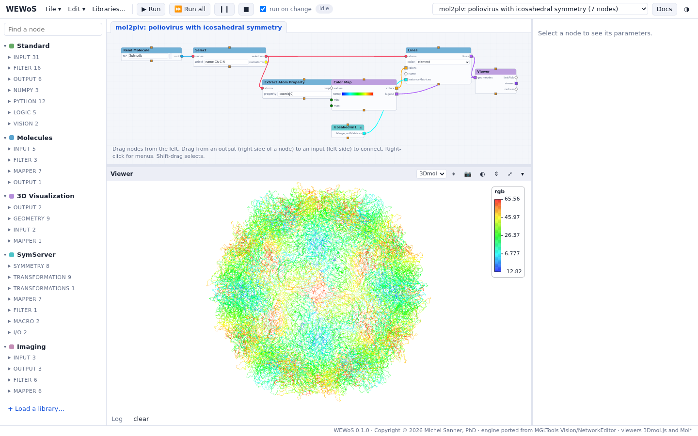
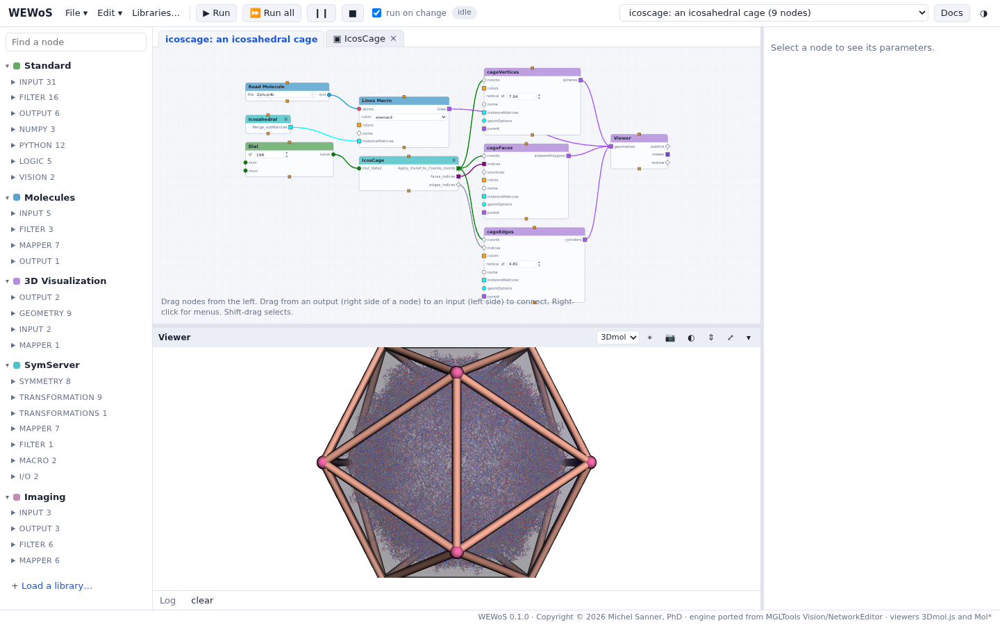
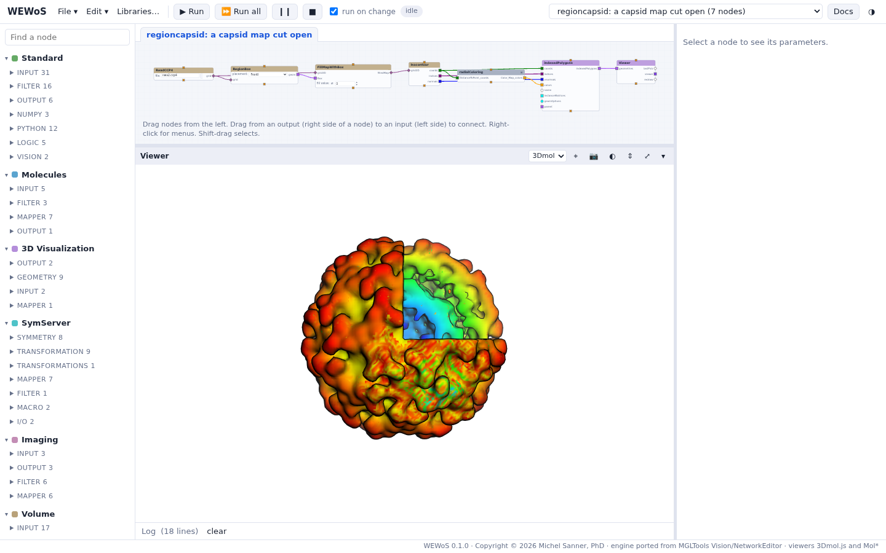
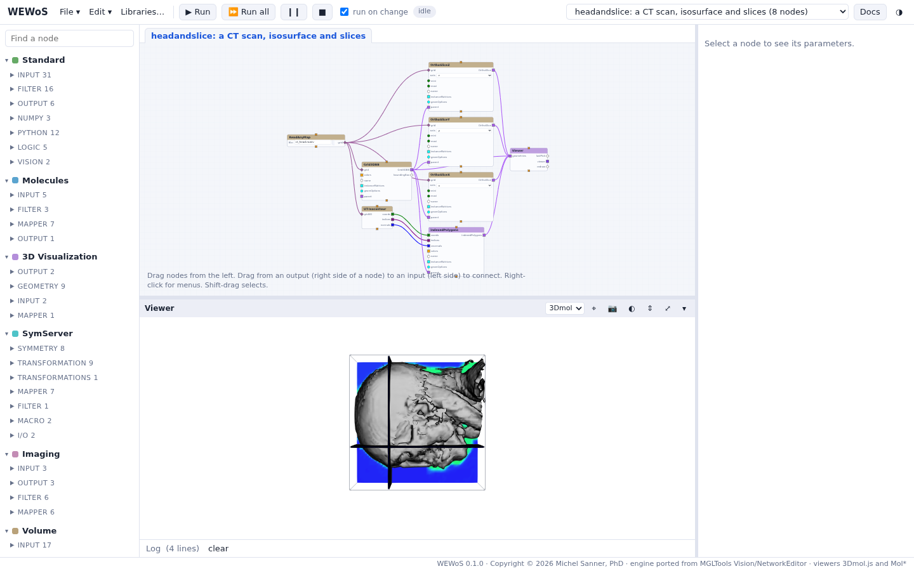
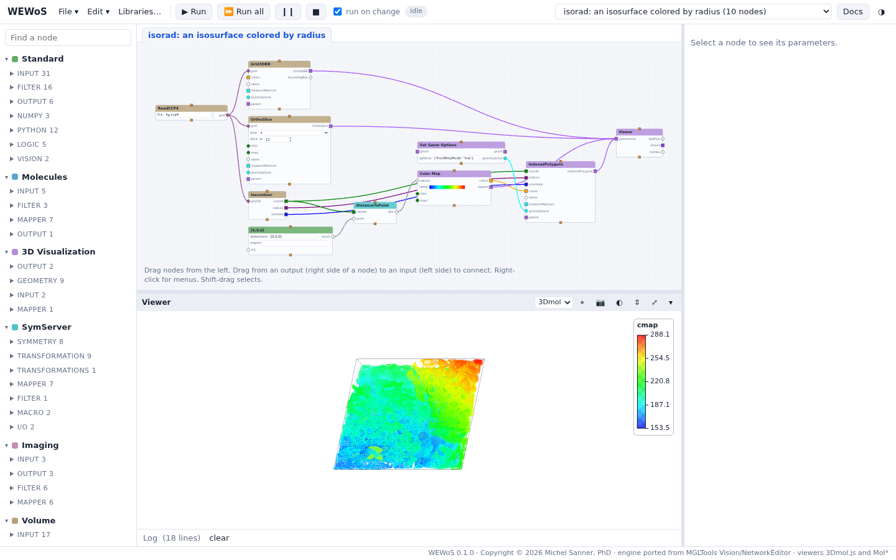
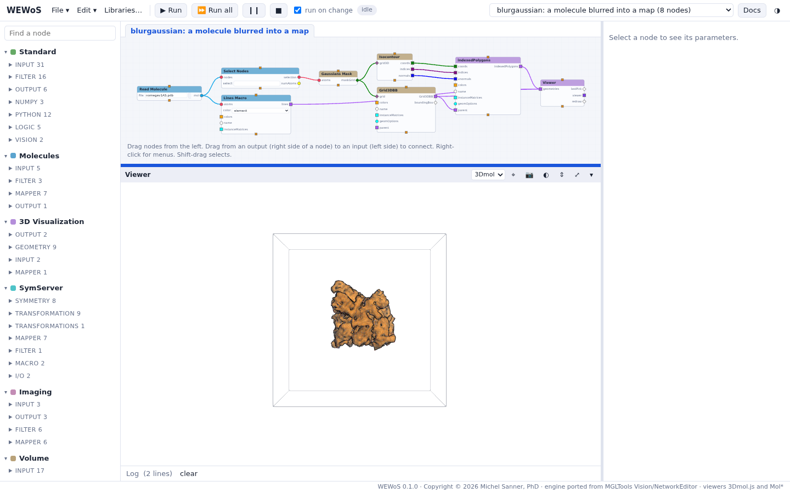
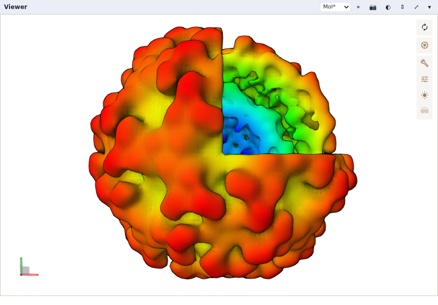
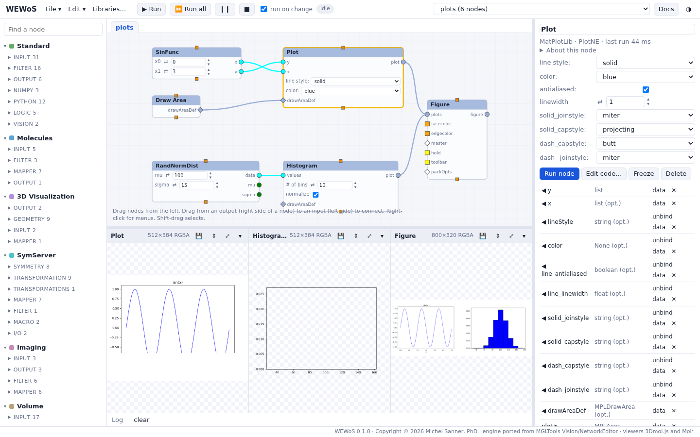

Images made with WEWoS, from its documentation. Click an image to enlarge it.

::: {.gallery layout-ncol="3"}

{fig-alt="WEWoS with the mol2plv network and a poliovirus capsid colored from blue to red"}

{fig-alt="The icoscage network and an icosahedral cage of pink cylinders and spheres around a molecule"}

{fig-alt="The regioncapsid network and a virus capsid isosurface with one octant cut away, colored by radius"}

{fig-alt="The headandslice network and a CT scan of a head: a grey isosurface of the skull and three colored slices"}

{fig-alt="The isorad network: an isosurface drawn as lines, colored from blue to red by its distance to the origin, with a legend"}

{fig-alt="The blurgaussian network: an orange translucent blob around a molecule, in the box of its grid"}

{fig-alt="A virus capsid isosurface with one octant cut away, colored from blue inside to red outside, drawn by the Mol* viewer with soft shadows"}

{fig-alt="The plots example: three MatPlotLib plots side by side under the network"}

:::
