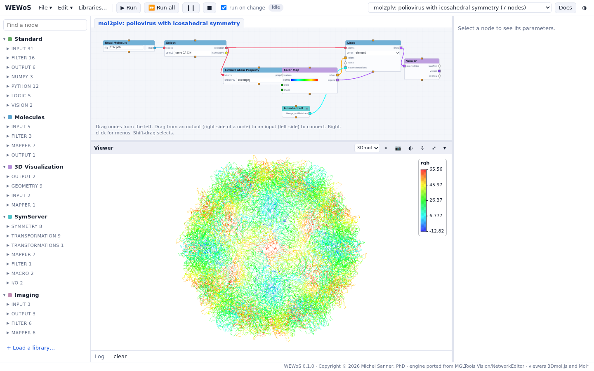

::: {.callout-warning}
WEWoS is under development (version 0.1.0). These pages describe a test version.
:::

WEWoS brings Vision, the visual programming environment of [MGLTools](../mgltools/index.qmd), to the
web browser: build programs by connecting nodes, and see molecules, surfaces, volumes, images and
plots as they run.

A program is a network of nodes. Each node runs a small Python function; connections carry data
from a node's outputs to another node's inputs, and when a node gets new data it runs and sends its
results on. Inputs can have widgets (a dial, a number, a file name, a menu), so you can explore a
computation by turning a dial and watching the result.

- **Server:** a Python 3 port of the NetworkEditor/Vision engine runs on a local server.
- **Browser:** draws the network editor and the 3D viewers, which replace DejaVu. Each viewer draws
  with [3Dmol.js](https://3dmol.csb.pitt.edu) or [Mol\*](https://molstar.org) (ambient occlusion,
  shadows, depth of field, illumination).
- **Libraries:** Standard, 3D Visualization, Molecules (MolKit2, ProDy, MSMS), Volume, Imaging,
  MatPlotLib and SymServer, loaded on demand as in Vision.
- **Vision networks:** saved Vision networks (`*_net.py`) can be imported; the file is converted, not
  executed.

{fig-alt="WEWoS in a web browser: node libraries on the left, the mol2plv network in the middle, and a 3D viewer showing a poliovirus capsid colored from blue to red"}

- [Documentation](documentation.qmd)
- [Tutorials](tutorials.qmd)
- [Download](download.qmd)

## History

Vision began as **ViPEr**, a Visual Programming Environment for Python, written by Michel Sanner,
Daniel Stoffler and Arthur Olson in the Molecular Graphics Lab of The Scripps Research Institute. It
was presented at the 10th International Python Conference in February 2002, where it received the
best paper award, and was later renamed Vision and distributed with MGLTools. WEWoS keeps the design
the paper describes; the network of the paper's figure 1 runs in WEWoS as the example *ViPEr paper
figure 1*.

- Sanner, M. F.; Stoffler, D.; Olson, A. J. ViPEr, a Visual Programming Environment for Python.
  *Proceedings of the 10th International Python Conference*, **2002**.
  [Paper](https://legacy.python.org/workshops/2002-02/papers/10/index.htm)
